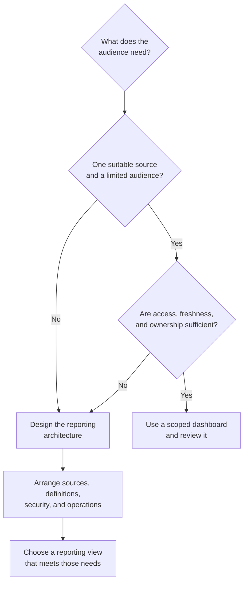

import YouTubeVideo from '@site/src/components/YouTubeVideo';

Describe a dashboard in ordinary language and Copilot can build an interactive view of your data. In [Mike Tholfsen's demonstration](https://www.youtube.com/watch?v=-XeCMdR7Zz4), that idea reaches Excel, PowerPoint, SharePoint, and OneDrive. Filters, charts, and what-if controls make the information easier to explore.

I find that exciting. A team can try an idea without first building every chart or commissioning a custom interface. But when colleagues start relying on the result, its data, access, ownership, and maintenance deserve the same attention as its appearance.

<!-- truncate -->

<YouTubeVideo
  id="-XeCMdR7Zz4"
  title="Mike Tholfsen demonstrates interactive dashboards with Copilot in Microsoft 365"
  videoLanguage="en"
/>

## From a prompt to an interactive view

In the Excel example, Mike asks Copilot to explore sales data. The resulting dashboard brings revenue, profit, margin, product performance, and filters together. What-if controls let him change assumptions such as prices and unit costs. Another example explores fictional Dunder Mifflin customer churn. He asks for territory comparisons and then adds scenarios through another prompt.

By refining an analysis through conversation, a business analyst can test a question with colleagues before investing in a larger solution. Still, a convincing chart does not verify a formula. Check source data, calculations, and assumptions. A scenario describes what follows from its assumptions; it is not automatically a reliable forecast.

Microsoft calls the Excel skill [interactive-canvas](https://support.microsoft.com/en-us/excel/copilot/copilot-in-excel-built-in-skills). Microsoft says its canvas remains connected to the workbook and updates as workbook data changes. The workbook's own sources may still need separate refresh and validation. Sharing also requires appropriate access to the workbook. Availability depends on the account, settings, and rollout; check the current documentation and your tenant before planning around it.

In PowerPoint, Mike shows interactive slides with filters, comparisons, timelines, and visual styles. This can make a management review or survey discussion more responsive: the presenter can explore a follow-up question during the meeting instead of returning to a static chart. The presentation is still a communication artifact, so agree where the authoritative figures live.

Microsoft says eligible users with access to Copilot in PowerPoint can create or update [interactive slides](https://support.microsoft.com/en-us/powerpoint/copilot/create-interactive-slides-with-copilot-in-powerpoint). People who receive the presentation can explore them without a Copilot license. Viewing depends on the client: Microsoft lists interactive support on Windows, Mac, web, iPad, and PowerPoint Live, with differences between presentation modes. On iPhone and Android, and in PDF exports, the slide appears as a non-interactive image. Check the current rollout and client requirements before a meeting.

The SharePoint and OneDrive examples turn existing files and a SharePoint issue list into dashboards. Mike shares and downloads a dashboard, then uses another prompt to add filters. A team can explore issue counts and assignments without building a custom web part first. These experiences are related, but Excel, PowerPoint, and SharePoint do not all use the same execution environment. The SharePoint HTML page deserves a closer look.

## The boundary around a SharePoint HTML page

[Microsoft's HTML page guidance](https://support.microsoft.com/en-us/sharepoint/create-edit-publish-html-pages) describes creating, uploading, editing, publishing, and sharing HTML pages in a site's Site Pages library. On November 4, 2026, Microsoft notes that some functionality is introduced gradually through Frontier. Verify availability and settings in your own tenant.

The steps have different requirements. Microsoft lists a Microsoft 365 Copilot license and page editing permission for Copilot-assisted creation or editing. Uploading existing HTML, editing page content directly, publishing, sharing, and viewing do not require that Copilot license, but each still needs the appropriate SharePoint permission. Site owners can control whether the Site Pages library accepts HTML files. Do not assume the same licensing rules apply to Excel, PowerPoint, or OneDrive.

In his [technical investigation](https://n8d.at/anatomy-of-sharepoint-html-pages-explained/), Stefan Bauer describes an HTML page displayed inside a sandboxed iframe. An iframe is a browser frame that displays a separate document. The sandbox limits what that document can do and separates it from the surrounding SharePoint page. This helps protect the host from arbitrary generated or uploaded code. A Content Security Policy also tells the browser which resources and connections are allowed.

That isolation has consequences. The dashboard is not a standard SharePoint web part with the same integration and reuse model. Microsoft documents that arbitrary fetch requests and outbound API calls are unsupported, even though supported live data is available. Plan for those boundaries before promising integrations. Bauer tested his own tenant in October 2026 and updated his article on October 27. His observations describe that test, not a guarantee for every future version.

His test also found that page colors were captured when the HTML was created. A later site theme change did not update the existing page automatically. Microsoft documents branding for pages created or updated through Copilot, but a matching initial appearance should not be assumed to be a live theme connection. After a rebrand, review existing dashboards and adjust or regenerate them where needed.

Start with the reporting need. This flow helps identify when a dashboard needs a broader data and operating design.

## Interactive does not always mean live

A filter can work perfectly on yesterday's data. Before sharing a dashboard, establish which of these patterns it uses:

- **Static snapshot:** data is captured in the artifact. Filters can still explore that copy, but changes at the source do not necessarily appear.
- **Supported live connection:** the hosting experience supplies updated data from a supported source. Check when it refreshes and what each viewer is authorized to see.
- **Enterprise integration:** a designed process combines data from systems, applies rules, controls access, and monitors updates. Its requirements go beyond a single visual.

Microsoft lists [live data sharing for lists and Excel](https://support.microsoft.com/en-us/sharepoint/create-edit-publish-html-pages) in SharePoint HTML pages, while excluding arbitrary outbound API calls and third-party live sources in that feature table. Do not infer that every generated page uses a live connection. Test the particular page and source.

Bauer examined a list-backed mechanism involving a `LiveData` manifest. In his test, SharePoint retrieved the list data on the server using the viewer's credentials and supplied it to the page before rendering. The dashboard's own script displayed the supplied data; it did not gain unrestricted network or Microsoft Graph access. Bauer reports that reloading, or using the host's refresh control, obtained the data again in his example. These are observations of the implementation, not a public contract for a refresh interval or every permission scenario.

There is also a difference between access to a source and access to a copy. A SharePoint file can have restricted permissions, while data embedded in its HTML may travel with a downloaded or copied file. Source-system permissions do not automatically follow that copy. Conversely, a supported live connection does not remove the need to review its authorization and protection. Inspect what the artifact contains, test with representative viewer accounts, and choose a location and sharing policy that fit the data.

## From a dashboard to enterprise reporting

Imagine an organization wants one management view of budget and actual spending, project progress, staffing capacity, and departmental trends. Its data comes from an ERP system, an HR system, and a SharePoint project list. This is a hypothetical example, but the design questions are familiar.

First, the organization needs reliable access to each source. Depending on the systems, that can mean APIs, database connections, or an integration service. The design must handle authentication, source permissions, failed requests, monitoring, and recovery. A small team with one well-maintained list may need none of that additional infrastructure. Multiple systems and sensitive decisions can justify it.

Then the data needs to agree. One system may identify a department differently from another. Dates may use different time zones, employees may be duplicated, and records may be incomplete. **ETL** means extract, transform, and load: collect data, correct or align it, then place it where it can be used. In **ELT**, loading comes before transformation. Either way, someone must define the rules and check their results.

The business meaning matters as much as the connection. Does an active employee include someone on leave? Is revenue based on invoices, orders, or payments? How should a reorganization affect last year's departmental figures? A reusable semantic model can hold shared relationships and measures, but a model needs an accountable owner and agreed definitions. A generated chart cannot settle those decisions by itself.

Access also has layers. A manager may need their department's detail, finance may need organization-wide figures, and employees may need aggregates. Row-level security (RLS) restricts which records a user can see. [Power BI RLS](https://learn.microsoft.com/en-us/power-bi/enterprise/service-admin-rls) is one example; Microsoft notes that its rules apply to workspace viewers, not Admin, Member, or Contributor roles. Test the actual access path and roles. SharePoint page access alone should not be assumed to filter rows already copied into an HTML file.

Agree how fresh each number must be. Monitor refresh failures, show the data's age where that affects decisions, notify an owner, and document recovery. A monthly review and a live operational decision need different arrangements. [Power BI refresh documentation](https://learn.microsoft.com/en-us/power-bi/connect-data/refresh-data) illustrates the dependencies and monitoring that a managed reporting approach can introduce.

For consequential reporting, ask where a number came from, which records and transformations contributed, which calculation version applied, and who owns its definition. **Data lineage** describes the path from sources through processing to outputs. Microsoft provides a [Power BI lineage view](https://learn.microsoft.com/en-us/power-bi/collaborate-share/service-data-lineage), although a view alone does not answer every audit question. Power BI, Microsoft Fabric, managed models, pipelines, and dedicated integrations are options when the requirements justify them. None is mandatory for every small dashboard.

## Ownership continues after publication

Suppose an employee creates an HTML dashboard for a quarterly project review. Colleagues share it and continue to use it. Months later the creator leaves. The file does not necessarily disappear, but someone must know whether its figures are current, who can correct it, and whether to retain, archive, or remove it.

The creator, business owner, data owner, site owner, and technical support team may be different people. Agree who owns the definitions, who maintains the page and source, who approves access, and when to review it. Store team information where the team can maintain it. The [ownership guide](../docs/admin-and-governance/permissions-and-ownership) and [file location decision](../docs/decisions/where-should-this-file-live) help make those choices.

Easy creation can also produce several versions of the same KPI. Copies, inconsistent definitions, unclear owners, and stale pages make it harder to identify the authoritative report. This is a risk to manage, not an inevitable result. Reuse a trusted source where possible, name the owner, and identify the report's purpose and review date.

Bauer found that SharePoint Search indexed text in his HTML page test. He also found that a page-content property used by some structured surfaces was empty. Search discovery therefore does not guarantee that individual dashboard elements can be reused in standard pages or web parts. Test the intended publishing and discovery pattern. For native page composition, see [how a SharePoint page is built](../docs/services/sharepoint/sharepoint-pages-and-web-parts).

Accessibility needs testing too. In his separate [accessibility investigation](https://n8d.at/accessibility-of-sharepoint-html-pages-explained/), Bauer reported issues in the surrounding page experience, including a focus indicator and skip link in his test. He also found useful accessible markup in the generated content. Before broad publication, test keyboard navigation, visible focus, screen-reader behavior, and the generated controls with the people and technologies the audience uses. Recheck as the feature changes.

## Choose for the work and its consequences

| Approach | Best suited for | Main strength | Main consideration |
| --- | --- | --- | --- |
| Excel Interactive Canvas | Workbook exploration and scenarios | Connected workbook analysis | Validate formulas, assumptions, access, and availability |
| PowerPoint interactive slides | Meetings and storytelling | Explore information during a presentation | Client support and authoritative source |
| SharePoint HTML page | Prototype or scoped team dashboard | Fast creation and supported live data | Isolation, accessibility, ownership, and maintenance |
| Modern SharePoint page and web parts | Intranet publishing and structured content | Native page composition and publishing | Choose suitable sources and web parts |
| [SharePoint Framework](https://learn.microsoft.com/en-us/sharepoint/dev/spfx/sharepoint-framework-overview) (SPFx) | Reusable custom SharePoint functionality | Extensibility and supported integration | Build, secure, deploy, and maintain code |
| Power BI | Managed analysis and reporting across sources | Models, access controls, and refresh options | Design and operate the model and its dependencies |

These approaches can work together. A modern SharePoint page can link to or embed a Power BI report when its integration, permissions, and licensing requirements are met. An HTML page can be a sensible production choice too, if its owner can meet the audience's needs over its intended life.

Start with the decision the audience needs to make. Then agree the source, acceptable data age, access, owner, and review date. If a small, well-controlled dashboard meets those needs, use it. If the result will drive decisions across departments, design the data and operating arrangements before treating a generated view as the organization's answer.
