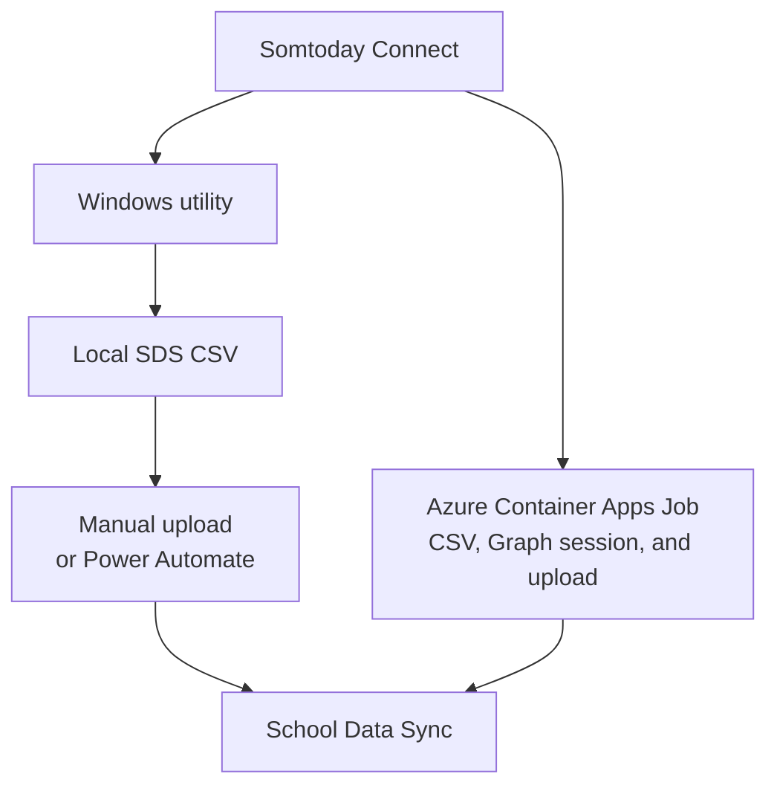

On November 5, 2026, [Microsoft announced changes to Microsoft 365 Education](https://www.microsoft.com/en-us/licensing/news/m365education-update). According to [SLBdiensten](https://www.slbdiensten.nl/nieuws-overzicht/nieuw-microsoft-365-education-programma-voor-het-nederlandse-onderwijs-blijft-alles-tot-en-met-2031-hetzelfde/), the new global program does not apply to the Dutch collective 2027-2031 agreement.

I review existing choices too. Use what your licenses already include. Remove forgotten test accounts and temporary exceptions. For new automation, choose its owner and the software identity it needs. My Somtoday connection to School Data Sync shows this approach.

<!-- truncate -->

## Microsoft changes the Education licensing model

[SLBdiensten confirms on November 12](https://www.slbdiensten.nl/nieuws-overzicht/nieuw-microsoft-365-education-programma-voor-het-nederlandse-onderwijs-blijft-alles-tot-en-met-2031-hetzelfde/) that the new global program does not apply to the Dutch collective 2027-2031 agreement. Its agreed conditions, pricing arrangements, and student rights remain in place. Schools covered by that agreement therefore do not need to switch because of this announcement. What happens after 2031 is still unknown.

[APS IT-diensten describes the arrangements for primary and special education](https://www.apsitdiensten.nl/kunnen-wij-je-helpen/microsoft-overeenkomst). The faculty base package is A3 with Defender for Office 365 Plan 1. Students can use Student Use Benefits if all faculty have licenses. Licensing fewer faculty in 2030-2031 removes that right. These specific APS conditions do not automatically apply to secondary education or SLBdiensten.

Microsoft is changing its global lineup. Student Use Benefits are being removed from that new program. The [new global lineup](https://learn.microsoft.com/en-us/training/educator-center/instructor-materials/microsoft-365-education-portfolio) has five levels:

- **MA0:** no-cost Office apps for eligible students. Exchange Online, SharePoint Online, and Teams are excluded. Collaboration through those services needs at least MA2.
- **MA2:** apps, email, and collaboration through SharePoint and optional Teams. Copilot Chat and basic mobile device management are included too.
- **MA3:** MA2 with Windows 11 Education and Intune for Education for broader device management.
- **MA5:** more extensive security, identity management, and compliance.
- **MA7:** MA5 with Microsoft 365 Copilot and extra management for AI and access.

Arrange Copilot Credits for extra paid usage separately. See Microsoft's guidance for [Copilot in SharePoint](https://learn.microsoft.com/en-us/sharepoint/copilot-in-sharepoint-get-started), for example.

The global A0 offer has its own [conditions](https://learn.microsoft.com/en-us/training/educator-center/instructor-materials/microsoft-365-education-frequently-asked-questions#how-do-institutions-qualify-for-the-microsoft-365-education-a0-offering). Microsoft lists MA2 or higher for all faculty and educational Windows use by students. This faculty requirement belongs to that offer. It is not a new requirement for schools covered by the Dutch agreement.

Storage changes under the global program too. The [existing model](https://www.microsoft.com/en-us/education/products/microsoft-365-storage-options) gives your tenant 100 TB of base storage, plus storage from paid licenses. OneDrive, SharePoint, and Exchange share that space. The new global model removes the 100 TB base. Each paid student license adds 4 GB for MA2, 8 GB for MA3, or 12 GB for MA5 or MA7. Each faculty license adds 50, 75, or 150 GB. MA0 adds no storage. This global change also does not apply to the Dutch collective 2027-2031 agreement.

## Power Apps and Power Automate

From February 2027, [Power Apps checks more strictly whether users have the right license](https://learn.microsoft.com/en-us/power-platform/admin/powerapps-licensing-faq). The requirements themselves are not new. They cover model-driven apps and apps in Managed Environments, among others. Custom apps outside the use covered by your Dynamics 365 license are also in scope. Without suitable Premium rights, users can no longer open their app. In [Managed Environments](https://learn.microsoft.com/en-us/power-platform/admin/managed-environment-licensing), environments with extra management features, this includes standard apps. Check the license reports before February.

Power Automate remains available and is included in MA2-MA7. The [included rights](https://learn.microsoft.com/en-us/power-platform/admin/powerapps-flow-licensing-faq) generally cover standard connectors. Connectors link a flow to other services. Premium connectors, custom connectors, and HTTP actions need extra rights. Managed Environment licensing requirements apply to flows too. Check what each flow does and where it runs.

A service principal is an identity for software. [It can own a flow](https://learn.microsoft.com/en-us/power-automate/service-principal-support). This reduces dependence on an employee who might leave. A Premium flow still needs a license. That can be a Process license. Where allowed, you can [designate a co-owner with a suitable license](https://learn.microsoft.com/en-us/power-automate/assign-user-license-service-principal-flow). Exceptions apply to standard flows and certain Dynamics 365 uses. Agree who will manage connections and resolve failures too.

I would keep an approval flow that works well and is well managed. Review its setup when licenses, connections, or responsible people change.

## Use what you already have

Education licenses were relatively inexpensive for years and included many features. I find that schools sometimes do not know exactly what their package offers. This does not describe every school.

Before buying or renewing, check what your [existing Microsoft licenses](https://learn.microsoft.com/en-us/microsoft-365/education/guide/0-start/all-license) already offer. Include account management, device management, security, data protection, and monitoring. Microsoft 365 A3 includes Entra ID P1 and Intune for Education. Microsoft 365 A5 adds Entra ID P2 and more extensive Purview audit and investigation features, among others. Check faculty/student differences and extra license requirements.

Microsoft [adds faculty features in the new global lineup](https://learn.microsoft.com/en-us/training/educator-center/instructor-materials/microsoft-365-education-frequently-asked-questions) too. MA3 gets Defender for Office 365 Plan 1. MA5 gets Intune Suite. Your current subscription does not receive these features automatically.

Compare setup, integration with other systems, support, and administration too. An external product may fit better. This comparison can avoid duplicate licenses and extra administration. The [Purview decision guide](../docs/decisions/which-purview-solution-should-you-use) helps identify the data protection you need.

## Free accounts still need an owner

I see test accounts created for temporary technical research. Sometimes an available student license is assigned. After the test, the account remains because it has no visible cost. An owner and end date can be missing. Normal account management can miss the account. Access rights and tokens can then keep working unnoticed.

Check whether you may use this student license for a test account. Student Use Benefits have usage conditions too. MA0 also remains free under certain conditions. Not every account will therefore start costing money.

For a service account, check whether the account and license fit its task. Review app registrations and service principals left behind after a test too. Remove temporary security exceptions when they are no longer needed.

According to [Kennisnet's identity and access management domain](https://normenkaderibp.kennisnet.nl/informatiebeveiliging/domein-10-identity-en-accessmanagement/), system owners decide who gets access and review those rights regularly. I give every temporary exception a reason, a responsible person, and an end date. Record who creates, checks, and removes accounts in the [access and ownership process](../docs/admin-and-governance/permissions-and-ownership). Free accounts deserve attention too.

## School Data Sync and Microsoft Classroom

On November 11, Microsoft [announced Microsoft Classroom](https://techcommunity.microsoft.com/blog/educationblog/introducing-microsoft-classroom-a-new-experience-built-for-teaching-and-learning/4571185). The new learning environment brings assignments, classwork, grades, and Class Notebook together. The idea of one familiar place for schoolwork appeals to me. Teams for Education remains available alongside it.

<video
  controls
  playsInline
  preload="none"
  poster="/videos/microsoft-classroom-demo-poster.png"
  width="1656"
  height="1092"
  style={{width: '100%', height: 'auto'}}
  aria-label="Microsoft Classroom demonstration without sound"
>
  <source src="/videos/microsoft-classroom-demo.mp4" type="video/mp4" />
  Your browser cannot play this video. <a href="/videos/microsoft-classroom-demo.mp4">Download the Microsoft Classroom demonstration</a>.
</video>

Classroom uses School Data Sync (SDS) to set up classes and their members. That gives a good connection to your student information system extra value. You use the school data you already maintain, without entering classes and members again by hand.

For schools using Somtoday, I have already built that connection. My [Windows utility for School Data Sync](../docs/tools/apps/somtoday-to-school-data-sync) reads Somtoday Connect and creates SDS V1 or V2.1 CSV files. Schools already using this connection also have a data foundation to build on for Classroom.

The tool runs on a secured Windows computer or server. Upload the files manually or use Microsoft's [Power Automate upload solution](https://learn.microsoft.com/en-us/schooldatasync/automate-csv-upload). It reads files through a gateway and file-system connection. The tool creates the files; a separate flow delivers them to SDS.

## Synchronize Somtoday without Power Automate

My new [Somtoday2MicrosoftSDS](https://github.com/Essella/Somtoday2MicrosoftSDS) lets this connection run entirely in Azure. A scheduled Container Apps Job reads Somtoday, creates the CSV files, and sends them directly to SDS. The Graph session, upload, and SDS result check are all part of that same Job. No Power Automate flow is needed between them.

The Job uses a managed identity for Graph: Azure manages its credentials. No ordinary Microsoft 365 user is needed for that task. CSV files are created in memory and sent to temporary SDS storage. There is no permanent application Blob storage. The [logging policy](https://github.com/Essella/Somtoday2MicrosoftSDS/blob/main/SECURITY.md) excludes personal data and SAS tokens.

See the [setup guide](https://github.com/Essella/Somtoday2MicrosoftSDS/blob/main/docs/operations/DEPLOYMENT.md) for more information.

Azure costs, updates, access management, and the school-year transition remain operational tasks. Choose the route your team can support.

Both solutions supply SDS without a Classroom-specific change. New education features can build on that data. Classroom itself still needs separate setup and testing.

See the [GitHub README](https://github.com/Essella/Somtoday2MicrosoftSDS) and [Releases with empty CSV sets](https://github.com/Essella/Somtoday2MicrosoftSDS/releases) to get started.
