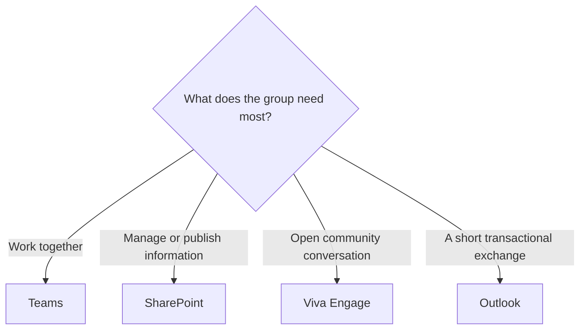

# Which Collaboration Tool Should I Use?

Microsoft 365 collaboration tools overlap on purpose. The right choice depends on the relationship between the people involved.

## Quick Answer

Use Teams when people need to work together, whether briefly in chat or over time in a Team. Use SharePoint to organize, manage, or publish information for its intended audience. Use Viva Engage for open community conversation. Use Outlook for a short transactional exchange.

## Decision Flow

## Choose Teams For Active Work

Teams centers on people working together. Start in chat or a meeting for an ad hoc need. Create a Team when people need recurring collaboration, shared topics, tools, and ownership.

Use a Team for projects, departments, working groups, and other durable collaborations. See [Ad Hoc And Structured Collaboration In Teams](../services/teams/ad-hoc-and-structured-collaboration.md).

## Choose SharePoint For Content

SharePoint centers on information that needs structure, ownership, access, publishing, metadata, or a longer lifecycle. Its audience may be a working Team, a department, or the whole organization.

Use it for intranet pages, knowledge bases, document libraries, policies, templates, and published resources.

## Choose Viva Engage For Community

Viva Engage is strongest when conversation should be visible beyond one team. It works well for leadership updates, communities of practice, employee engagement, and questions that benefit from a broad audience.

Use it when discovery and participation matter more than task execution.

## Choose Outlook For Short Transactions

Email still has a place. Use Outlook when the message is short-lived, directed to specific people, and does not need a shared workspace or long-term collaboration pattern.

If the exchange becomes ongoing work together, continue in Teams. Give information that needs a managed or published home a suitable SharePoint site.

## Related Guides

- [Teams](../services/teams/index.mdx)
- [SharePoint](../services/sharepoint/index.mdx)
- [Viva Engage](../services/viva-engage.md)
- [Teams Or Viva Engage?](./teams-or-viva-engage.md)
