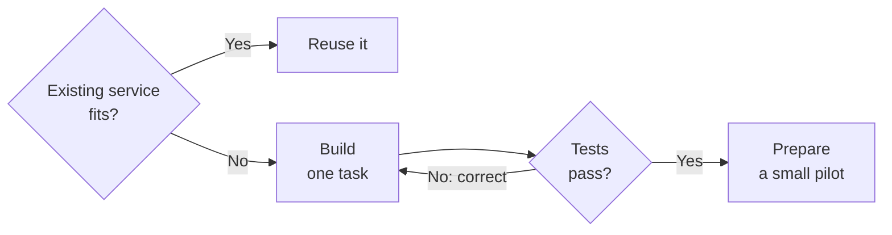

# Build Solutions With Copilot Code

Use Copilot Code when you need custom software and can describe its expected behavior. Start with a small task and test the result. Reuse an existing service when it already meets the need.

[Microsoft's Code guidance](https://learn.microsoft.com/en-us/copilot/code/use-code) covers apps, dashboards, static websites, data transforms, and scripts. You describe the outcome in ordinary language. Code builds a first version that you can test and change. You can start without programming experience, but someone must still check the result.

Use this guide to choose an approach, describe requirements, and validate a solution. Continue with [Publish And Govern Copilot Apps](./managed-apps.mdx) when you want colleagues to use a shared app.

## Choose The Work Before Building {#choose-the-work-before-building}

Use [Chat](./assist.md) to draft or analyze with a person. Use [Cowork](./delegate.md) to carry out work across files and services. Choose Code when you need software you can use again. For a fixed transfer with clear rules, also assess Power Automate. Use Cowork when interpreting the material adds value.

A character counter can be a useful first experiment. A shared content board needs more: records must remain available after people close the app. Before building, check whether [Microsoft Lists](../lists.md) and its existing views already solve the problem.

I would compare these starting points. Their capabilities overlap:

| Need | Starting point I would assess | Main maintenance question |
| --- | --- | --- |
| A small custom tool, script, or dashboard | Copilot Code | Can someone check its output and maintain it? |
| A custom interface for shared team records | Copilot Code with Managed Runtime | Can the team support the code, data rules, and releases? |
| Forms and task screens maintained by Power Platform makers | Power Apps canvas apps | Does the team already support the controls, formulas, and connections? |
| A process centered on related business records | Power Apps model-driven apps with Dataverse | Are the data model and security roles properly designed? |
| An agent that answers questions or takes actions | [Agent Builder or Copilot Studio](./build.md) | Who maintains its knowledge, actions, and tests? |
| Software with a development team and its own AI services | [GitHub Copilot and Microsoft Foundry](./develop.md) | Who owns the architecture, deployment, and support? |

Microsoft's [Power Apps overview](https://learn.microsoft.com/en-us/power-apps/maker/) covers canvas apps and AI-assisted creation. Its [model-driven app guidance](https://learn.microsoft.com/en-us/power-apps/maker/model-driven-apps/model-driven-app-overview) explains Dataverse relationships and releases through solutions. The use of prompts alone does not establish which product fits.

[Copilot Studio also has an app creation preview](https://learn.microsoft.com/en-us/microsoft-copilot-studio/apps-experience/create-app). Those apps run on Managed Runtime. Studio supports several kinds of solutions, so check which experience you are comparing. Do not assume that every Studio agent uses the app runtime.

If Code fits the task, I would follow this route. Reuse comes first. Test the custom solution before preparing a pilot.

## Define The Need Before Building {#define-the-need-before-building}

Write down who will use the solution and what they need to achieve. Name the source of the information and who may change it. Describe how you will check the result.

For a content board, I would agree the following first:

- The team uses one existing SharePoint list for its records.
- Each record has a title, owner, status, and publication date.
- Editors may change records. Readers may only view them.
- A saved status change remains visible after the app reopens.
- A failed save produces a clear message.

Start with one complete task. For example, let an editor change an item's status. Leave automatic imports, reminders, and manual card ordering for later.

This is an example of a first request to Code:

> Build a content board for our communications team. Start with sample records. Show each item's title, owner, status, and publication date. Let an editor move an item from Draft to Review. Readers may only view items. Show whether the save succeeds. We plan to use an existing SharePoint list later. Explain where this first version stores its records.

These are requirements to test. A prompt does not enforce permissions or prove that records are stored correctly. Check both before connecting the real list.

## Choose Where To Build

Code supports local and cloud projects. Microsoft's [local and cloud comparison](https://learn.microsoft.com/en-us/copilot/code/overview#build-locally-or-in-the-cloud) describes the options:

| Build location | When I would assess it | What to check |
| --- | --- | --- |
| Local project folder | A tool that works with files on your device | Which files Code can change, what it installs, and how you keep a recoverable copy |
| Cloud project | A project you need across devices or want to share | Where the project and its data are stored, and how the intended audience will use it |

Review where you build and where users run the result. A cloud project does not by itself establish shared data storage or a supported team service. For interactive team apps, review [publishing to Managed Runtime](./managed-apps.mdx#publish-to-a-shared-runtime).

Use a dedicated local folder with copies of test files. [Code can read and write within project folders already in use](https://learn.microsoft.com/en-us/copilot/code/use-code#stay-in-control). By default, it asks permission for network calls, terminal commands, and access beyond those folders. Review each request against the task. The *Always allow* setting remains active until you disable it, including for new sessions.

## Define Data Rules {#define-data-rules}

A request for a Kanban board describes an interface. You must also define what happens to the records. For the content board, move a card to change its status. To preserve a manual order within a column, add a position field and rules for updating it.

Use stable item identifiers so a changed title still refers to the same record. Define allowed statuses, an owner, and publication dates. Decide what happens when two colleagues change the same item. Show failed saves clearly so users do not mistake a moved card for a saved change.

Keep one authoritative source, the place where the team maintains the records. Reuse the existing list instead of creating another copy for the new interface. Choose its site and access model using [SharePoint content structure and permissions](../sharepoint/sharepoint-content-structure.md).

I would choose SharePoint for a small team tracker with clear ownership. Reassess the data platform when related records, complex access rules, or several dependent updates become central. A custom interface can make a weak data design harder to notice.

If Cowork supplies records, agree which material belongs on the board. Keep personal notes separate from approved team information. Copy only what the team needs, with its source and selection date. Test duplicate records and missed runs. Use the [operational checks for connected apps](./managed-apps.mdx#check-data-connections-and-permissions) before enabling this transfer.

## Build And Test In Small Steps {#build-and-test-in-small-steps}

Microsoft recommends [starting simply and making focused changes](https://learn.microsoft.com/en-us/copilot/code/use-code#iterate-and-revert). Ask Code to explain where it stores data and what each connection does. Test the result yourself; Code's explanation is another claim to check.

1. Build the first task with sample data.
2. Perform it as the intended user. Inspect the output or saved record.
3. Describe one change, then repeat the first task.
4. Test exceptions before adding more features.
5. Keep a short record of requirements, changes, and results.

For the content board, I would include these checks:

| Test | Result to confirm |
| --- | --- |
| Move a card, close the app, and reopen it | The stored status matches the board. |
| Leave required information empty | The app explains what needs correction. |
| Try a save that fails | The app reports failure and preserves the user's work where possible. |
| Edit the same item with two users | The app handles the conflict according to the agreed rule. |
| Use a reader account | The user can view permitted records and cannot change them. |
| Use an account without source access | The user cannot read or change the source records. |
| Change one feature | Existing tasks still work. |

For a script or data transform, compare known inputs and expected outputs. Include empty files, invalid values, and a failed run. Check whether a retry creates duplicates or overwrites useful information. Use copies until you understand the effects.

:::warning[Review Before Sharing]

A working prototype still needs review. Have the responsible people check data access, business rules, and support before others depend on it. A preview URL does not establish separate test data.

:::

## Prepare Shared Use {#prepare-shared-use}

Before a team pilot, assign a process owner and an app maintainer. The process owner decides whether the behavior is correct. The maintainer needs access and skills to repair it. Agree who supports users, approves changes, and retires the solution.

Record the requirements, data rules, connections, test results, and source location. Keep a known working version and agree a fallback. For the board, that might mean temporarily returning to the existing list view. Test whether another maintainer can continue the work.

[Code saves projects automatically, while publishing is a separate action](https://learn.microsoft.com/en-us/copilot/code/use-code#publish-your-app). Before making an app live, follow [Publish And Govern Copilot Apps](./managed-apps.mdx). That guide covers runtime access, source permissions, release checks, developer handoff, and recovery. Sharing an app does not grant access to its connected data.

## Check Preview Access And Cost

Code requires Frontier access. For organizational use, check the supported account, license, platform, and enabled Code tab in [Microsoft's Code requirements](https://learn.microsoft.com/en-us/copilot/code/code-requirements). GitHub connectivity is optional; you can build without a GitHub account.

Code also uses [usage-based billing with Copilot Credits](https://learn.microsoft.com/en-us/microsoft-365/copilot/user-subscription-license-usage-based-billing). A user subscription license and an administrator-configured spending policy are required. Budget for testing, unsuccessful attempts, and later changes as well as the first build.

Running a published app needs separate coverage. Check [app funding and runtime costs](./managed-apps.mdx#budget-for-building-and-running) with the budget owner. Use [Licensing And Costs](./licensing-and-costs.md) for the broader licensing choice.

:::warning[Check Each Preview's Terms]

Code and Managed Runtime have preview terms. Microsoft's [Copilot Studio app preview is not meant for production use](https://learn.microsoft.com/en-us/microsoft-copilot-studio/apps-experience/create-app). Check each experience separately. I would keep a pilot outside critical processes and agree a fallback before testing with a team.

:::

## Official Microsoft Documentation

- [Check Code access, accounts, and supported platforms](https://learn.microsoft.com/en-us/copilot/code/code-requirements).
- [Describe, build, test, publish, and share a solution](https://learn.microsoft.com/en-us/copilot/code/use-code).
- [Compare local and cloud projects](https://learn.microsoft.com/en-us/copilot/code/overview#build-locally-or-in-the-cloud).
- [Understand Copilot licenses and usage-based billing](https://learn.microsoft.com/en-us/microsoft-365/copilot/user-subscription-license-usage-based-billing).

## Related Guides

- [Publish And Govern Copilot Apps](./managed-apps.mdx)
- [Copilot Overview](./index.mdx)
- [Build An Agent](./build.md)
- [Develop With AI](./develop.md)
- [Permissions And Ownership](../../admin-and-governance/permissions-and-ownership.md)
- [Microsoft Lists](../lists.md)
