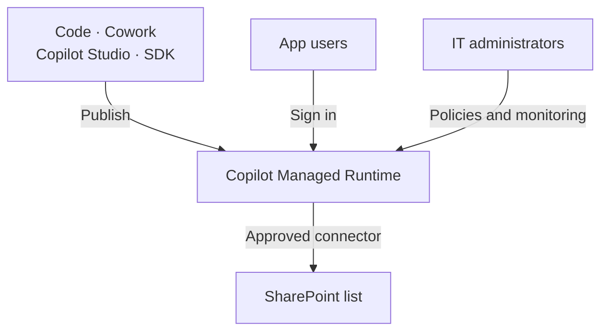
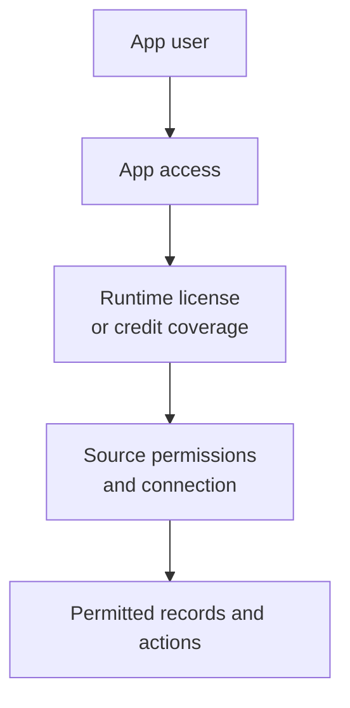

# Publish And Govern Copilot Apps

Treat a shared Copilot app as a maintained team service. Agree access, ownership, support, and budget before colleagues depend on it. Check that the tested app still works after publication.

Use this guide for publishing, data connections, permissions, monitoring, costs, and support. Start with [Copilot Code](./code.md) to compare approaches, define data rules, and test a first version. The content board from that guide is the example here.

:::info[Check Preview Access]

[Copilot Code requires Frontier access](https://learn.microsoft.com/en-us/copilot/code/use-code). [Copilot Managed Runtime is in public preview](https://learn.microsoft.com/en-us/microsoft-365/managed-apps/). Check the terms and availability for your tenant before planning deployment.

:::

## Prepare The App For Shared Use {#choose-the-work-before-building}

Confirm the audience, allowed actions, data source, and test results. Reuse the existing list or application if it already meets the need. The [Code guide's platform comparison](./code.md#choose-the-work-before-building) helps with that choice. Keep shared records in the agreed team location and assign an owner.

Bring the [requirements and test results](./code.md#prepare-shared-use) into the release review. Agree who accepts the app and who repairs it. A developer may need to maintain what a business user started. Test that handoff before the creator leaves.

## Publish To A Shared Runtime {#publish-to-a-shared-runtime}

For the content board, confirm that records survive closing and reopening the app. Check the actual SharePoint list, not only the cards on screen. The [Code guide explains the data rules and first tests](./code.md#define-data-rules).

[Microsoft's Code guidance](https://learn.microsoft.com/en-us/copilot/code/use-code#publish-your-app) separates building from publishing. Code saves the project as you work. Ask Code to publish when the version is ready. Once you publish, that version is live for the people you share it with. I would test the change and record the version first.

The runtime is the environment that hosts and runs the app. [Copilot Managed Runtime](https://learn.microsoft.com/en-us/microsoft-365/managed-apps/) hosts apps from Code, Cowork, Copilot Studio, and its software development kit (SDK). Microsoft operates the hosting. Apps use Microsoft Entra authentication and follow tenant policies. Users find available apps at `managedapps.cloud.microsoft`.

The creation tool and the operating platform are separate choices. Teams can use different tools while IT governs their hosted apps together. Review the [source-control and deployment options](https://learn.microsoft.com/en-us/microsoft-365/managed-apps/developer/dev-inner-loop) for the chosen app. Do not assume that every app has the same source setup.

Record the source location, live version, data connections, and support contact. Use the [developer handoff checks](#support-changes-and-incidents) before the team relies on the app.

## Check Data Connections And Permissions {#check-data-connections-and-permissions}

Confirm which list the published board reads and changes. Keep the [agreed data rules](./code.md#define-data-rules) with its support record. Review the site's access model using [SharePoint content structure and permissions](../sharepoint/sharepoint-content-structure.md).

Sharing introduces separate access decisions. [Microsoft's runtime FAQ](https://learn.microsoft.com/en-us/microsoft-365/admin/manage/apps/faq-about-apps) distinguishes app access from access to connected data. Giving a colleague the app does not grant SharePoint permissions. Users also need the appropriate data connections.

[App sharing](https://learn.microsoft.com/en-us/microsoft-365/managed-apps/developer/share-app) supports access for users or groups and organization links. Choose access to run the app for ordinary users. Grant edit access only to people who maintain it. A recipient also needs the required runtime license or credit coverage.

Test with an ordinary colleague's account. Include someone who may read records but cannot edit them. Also test someone who cannot access the list. Check the actual result in SharePoint after each action.

:::warning[A Hidden Control Does Not Remove Access]

Do not treat a hidden button or filtered screen as a security rule. Enforce access at the data source. Review [permissions and ownership](../../admin-and-governance/permissions-and-ownership.md) before connecting sensitive records.

:::

If [Cowork](./delegate.md) supplies records, review that transfer as a separate dependency. Confirm the selection rules, source, and selection date. Keep personal notes out of the shared list unless approved for team use. Assign someone to handle duplicates, missed runs, and incorrect selections. If the transfer stops, decide whether people can continue using the board.

## Review Governance And Visibility {#review-governance-and-visibility}

IT can find the apps centrally and intervene when needed. The inventory does not show every action an app can take. Review its data connections and permissions alongside the inventory.

Microsoft documents [default governance rules](https://learn.microsoft.com/en-us/microsoft-365/admin/manage/apps/governance) for routing, connectors, sharing, and browser content security. Routing determines the maker's environment. Connector actions can be restricted individually. For example, the SharePoint connector can remain available while its open-ended HTTP request action is blocked. Review the allowed actions when approving a connector.

There are limits to the current administrative view:

| What an administrator can review | What still needs checking |
| --- | --- |
| App inventory and Data & tools | Exact destinations, dynamic endpoints, executed actions, and each user's effective data permissions are not fully visible there. |
| Connector policy display | Existing classic data policies may change effective access. Check the Power Platform admin center too. |
| Operational health and usage | A technically successful update may still apply the wrong business rule. |
| App access and blocking | Removing app access does not remove all underlying data permissions. |

Microsoft's [runtime FAQ](https://learn.microsoft.com/en-us/microsoft-365/admin/manage/apps/faq-about-apps) documents the access and visibility limits. The process owner must still check whether the app applies the right rules.

:::warning[The Policy Display Can Mislead]

Microsoft documents a [known limitation for existing environment groups](https://learn.microsoft.com/en-us/microsoft-365/admin/manage/apps/governance#known-limitations). A display showing no allowed connectors may reflect a missing advanced connector policy. It does not necessarily mean connectors are blocked. Review that policy, the *Advanced connector policies only* setting, and applicable classic data policies in the Power Platform admin center.

:::

[Runtime monitoring](https://learn.microsoft.com/en-us/microsoft-365/managed-apps/developer/monitor-apps) includes central health monitoring and alerts. Apps can also send runtime metrics to a chosen monitoring service. Configure the app and permitted monitoring destinations for that route. Agree which failures need an alert and who responds. Avoid putting personal notes or other sensitive content into logs.

For the content board, I would check failed writes, stale records, and repeated automation failures. I would separately sample whether the selected ideas meet the team's rules. Health metrics cannot judge that editorial decision.

Assign a process owner, a data owner, and an app maintainer. One person can hold several roles. Write down who approves changes, reviews access, and stops the app. Retirement must also address scheduled tasks, source permissions, and records that need keeping.

## Support Changes And Incidents {#support-changes-and-incidents}

A published update can break behavior that previously worked. This is called a regression. For example, a board may still open while status changes stop saving correctly. A successful build does not prove that the team's workflow still works.

Agree support before the team relies on the app. I recommend the following division. People may hold several roles. Developer support can come from IT or an agreed supplier.

| Role | Responsibility |
| --- | --- |
| Process owner or KeyUser | Defines correct behavior, checks important workflows, and accepts a repaired version. |
| App maintainer or developer | Maintains source code, tests changes, publishes releases, and prepares code recovery. |
| IT platform or service team | Manages tenant controls, access, connectors, and platform health; coordinates escalation for service faults. |

Record the app ID, live URL, owners, support route, source location, and deployed version. Agree which repairs IT supports and who handles the rest. A tenant administrator is not automatically the app's developer.

If IT accepts code maintenance, reserve developer time for it. Agree who funds that work and how urgent fixes are handled. Use [Permissions And Ownership](../../admin-and-governance/permissions-and-ownership.md) to agree responsibilities and continuity.

### Check Existing Behavior Before Publishing

Keep a short list of tasks that must work. Use it for every release. Start with the [Code guide's first-version tests](./code.md#build-and-test-in-small-steps). Include reading, adding, and changing records, read-only access, failed saves, and concurrent edits. Check the existing workflow as well as the requested change. Use a test list with sample records. A preview URL alone does not establish separate test data.

Microsoft documents [separate preview and live versions](https://learn.microsoft.com/en-us/microsoft-365/managed-apps/developer/dev-inner-loop). The command-line tool (CLI) provides a developer preview for apps with Git source control. That preview requires write access to the repository, which stores code and version history. Agree a test route for business reviewers who should not have those rights.

For these apps, `ms app deploy --commit <sha>` can deploy an earlier code build. Record and test a working recovery version before publishing a change.

### Arrange A Developer Handoff

Microsoft documents [how to continue an existing app in a code editor](https://learn.microsoft.com/en-us/microsoft-365/managed-apps/developer/collaborate-on-app). The app owner must grant edit access. A developer can then copy (clone) a platform-managed repository with `ms app clone --app <app-id>`.

External GitHub repositories require repository access and `git clone`. Apps without a source-control binding cannot use this cloning path.

Test the handoff for the chosen app before an incident. Give the maintainer access to the requirements, data model, connections, and release history. Source code alone does not explain why a business rule exists.

### Handle A Fault After An Update

1. Record the app, current and last working versions, time, and affected users. Add steps to reproduce the fault. Describe expected and actual behavior.
2. Pause further releases and assess whether incorrect writes require stopping affected work. Agree a temporary working method with the process owner.
3. Compare code, list columns, permissions, connections, and spending limits. Use the [monitoring guidance](#review-governance-and-visibility) to separate platform faults from app or data problems. Health metrics alone cannot confirm correct business results.
4. Restore a compatible code version or publish a tested repair. Have the process owner check the full workflow before resuming work. Escalate platform faults with the collected evidence through the organization's support route.

:::warning[Code Recovery Does Not Restore Data]

If you deploy older code, changed records and list columns remain. Check compatibility with the current data before reverting. Plan data recovery separately with the data owner. SharePoint can [restore earlier item versions when versioning is enabled](https://support.microsoft.com/en-us/sharepoint/documents-and-library/restore-a-previous-version-of-an-item-or-file-in-sharepoint). Confirm what can be recovered before changing data or its structure.

:::

## Budget For Building And Running {#budget-for-building-and-running}

Copilot Credits measure eligible usage. A capacity pack supplies prepaid credits. With pay-as-you-go, you pay for credit consumption through an Azure subscription. Use Microsoft's term *Copilot Credit capacity pack* when requesting prepaid capacity.

Microsoft describes these [credit purchasing and billing options](https://learn.microsoft.com/en-us/microsoft-365/copilot/usage-based-billing-compare-dashboard-views):

| Funding route | How it pays for eligible usage |
| --- | --- |
| Prepaid capacity packs | Usage draws from a pool of credits bought in advance. |
| Copilot Credit Pre-purchase Plan (P3) | Credits are bought in advance through a linked Azure subscription. |
| Pay-as-you-go | Eligible credit consumption is charged to a linked Azure subscription. |

An administrator must [enable usage-based billing and configure a spending policy](https://learn.microsoft.com/en-us/microsoft-365/copilot/usage-based-billing-copilot-credits-setup) for the intended users and services. Confirm available capacity. Credits allocated to Power Platform environments reduce what remains available elsewhere.

P3 sits on top of pay-as-you-go. After its credits run out, billing continues by consumption. Capacity packs can also use pay-as-you-go for continuity when configured. Set limits and alerts before enabling broad use.

Estimate creation and ongoing use separately. A successful first build does not establish the monthly cost. Measure the following during a pilot:

| Cost area | What to measure during a pilot |
| --- | --- |
| Creation and revision | Initial build, unsuccessful attempts, testing, and later changes |
| Scheduled Cowork work | Runs, interpretation effort, retries, and review |
| App runtime | User activity and calls to connected services |
| Additional services | Separately billed AI services and any monitoring resources |

For organizational use, [Code and Cowork require a user subscription license and usage-based billing](https://learn.microsoft.com/en-us/microsoft-365/copilot/user-subscription-license-usage-based-billing). Credit funding does not replace that license.

To run the app, users need Power Apps Premium or Copilot Credits. Microsoft's [runtime licensing FAQ](https://learn.microsoft.com/en-us/microsoft-365/admin/manage/apps/licensing-faq) explains that requirement. Users do not need a Microsoft 365 Copilot license solely to run the app. Included Power Apps rights in Microsoft 365 do not cover this runtime.

The same FAQ lists 0.1 credits per runtime API call. These calls include opening an app, connector requests, and publication. Power Apps Premium covers runtime within its applicable request limits. Usage above those limits and specialized services can incur extra charges.

For illustration, 10,000 metered runtime calls would consume 1,000 credits. At the [$0.01 USD pay-as-you-go rate in Microsoft's Copilot Credits Guide](https://www.microsoft.com/licensing/guidance/CopilotCreditsGuide), that is $10 USD. Use this calculation to understand the meter. Measure calls during real use before estimating a monthly bill.

[Build and runtime spending are managed separately](https://learn.microsoft.com/en-us/microsoft-365/admin/manage/apps/licensing-faq#are-build-costs-and-runtime-costs-billed-together). Confirm coverage for the people using the published app. A creator's budget does not establish runtime coverage for the whole team.

Use [spending policies](https://learn.microsoft.com/en-us/microsoft-365/copilot/usage-based-billing-manage-copilot-credits) for the intended users and services. Set limits and alerts, then review consumption with the budget owner. Inspect overlapping policies and whether future services are added automatically. Keep access restrictions separate from the spending decision.

Use [Licensing And Costs](./licensing-and-costs.md) to compare subscription and credit funding with the budget owner.

## Compare Platforms And Plan A Pilot

Compare Code, Power Apps, and Copilot Studio using the [Code guide's platform comparison](./code.md#choose-the-work-before-building). Before release, check who can maintain the solution. Review how changes reach users and what it costs to run. I would keep an existing Power Apps solution when it meets the requirements and the team can support it.

:::warning[Keep Preview Apps Out Of Critical Production Work]

Microsoft states that the [Copilot Studio app preview is not meant for production use](https://learn.microsoft.com/en-us/microsoft-copilot-studio/apps-experience/create-app). Check each experience's preview terms separately. I would keep a pilot outside critical processes and agree a fallback before testing with a team.

:::

For a first pilot, choose one small process and reuse its existing data. Record the owner, audience, allowed actions, and budget. Test access, failed updates, and concurrent changes. Publish to a small group. Review errors, credits, support effort, and usefulness together before expanding access.

Before colleagues depend on the app, make sure someone can repair it, explain its data rules, and retire it safely.

## Official Microsoft Documentation

- [Use Copilot Code, including publishing and sharing](https://learn.microsoft.com/en-us/copilot/code/use-code).
- [Understand Copilot Managed Runtime and its creation paths](https://learn.microsoft.com/en-us/microsoft-365/managed-apps/).
- [Share an app with users or groups and review access levels](https://learn.microsoft.com/en-us/microsoft-365/managed-apps/developer/share-app).
- [Review governance defaults and known policy-display limitations](https://learn.microsoft.com/en-us/microsoft-365/admin/manage/apps/governance).
- [Check administrative visibility and access limitations](https://learn.microsoft.com/en-us/microsoft-365/admin/manage/apps/faq-about-apps).
- [Monitor app health and configure runtime metrics](https://learn.microsoft.com/en-us/microsoft-365/managed-apps/developer/monitor-apps).
- [Preview, deploy, and return to an earlier app build](https://learn.microsoft.com/en-us/microsoft-365/managed-apps/developer/dev-inner-loop).
- [Hand an existing app over to another developer](https://learn.microsoft.com/en-us/microsoft-365/managed-apps/developer/collaborate-on-app).
- [Restore a previous SharePoint item version](https://support.microsoft.com/en-us/sharepoint/documents-and-library/restore-a-previous-version-of-an-item-or-file-in-sharepoint).
- [Confirm runtime licensing and metering](https://learn.microsoft.com/en-us/microsoft-365/admin/manage/apps/licensing-faq).
- [Compare credit funding options and Azure billing](https://learn.microsoft.com/en-us/microsoft-365/copilot/usage-based-billing-compare-dashboard-views).
- [Enable billing and select a credit funding method](https://learn.microsoft.com/en-us/microsoft-365/copilot/usage-based-billing-copilot-credits-setup).
- [Configure spending policies and limits](https://learn.microsoft.com/en-us/microsoft-365/copilot/usage-based-billing-manage-copilot-credits).

## Related Guides

- [Build Solutions With Copilot Code](./code.md).
- [Delegate Work To AI](./delegate.md).
- [Build An Agent](./build.md).
- [Govern Copilot Studio Agents Before Enabling Makers](../../admin-and-governance/govern-copilot-studio-agents.md).
- [Copilot Licensing And Costs](./licensing-and-costs.md).
- [Govern Sharing In SharePoint](../../admin-and-governance/govern-sharing-in-sharepoint.md).
