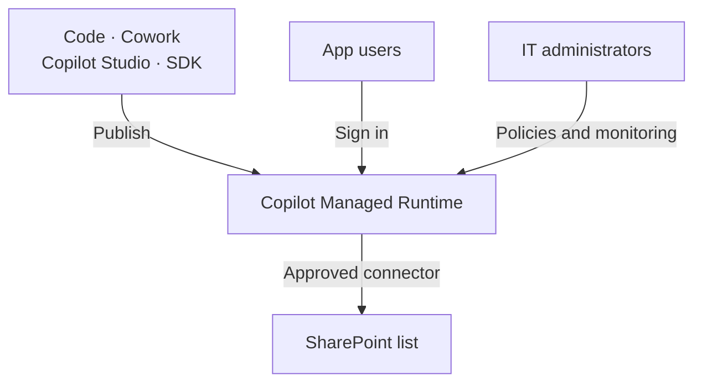
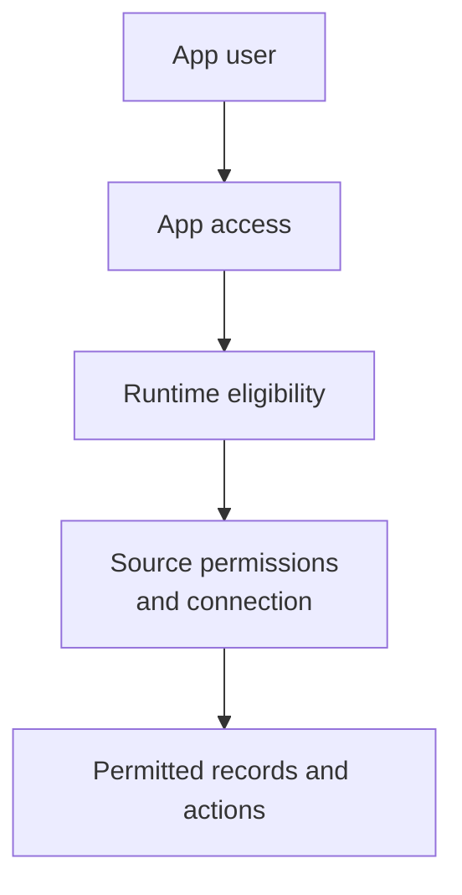

# Publish And Govern Copilot Apps

Treat a shared Copilot app as a maintained team service. Define its data rules, access, owner, support, and budget before colleagues depend on it. Reuse an existing list or application when it already meets the need.

Use this guide for publishing, SharePoint connections, permissions, monitoring, costs, and platform choices. Start with [Copilot Code](./code.md) if you first need to describe and validate a solution.

:::info[Check Preview Access]

[Copilot Code requires Frontier access](https://learn.microsoft.com/en-us/copilot/code/use-code). [Copilot Managed Runtime is in public preview](https://learn.microsoft.com/en-us/microsoft-365/managed-apps/). Check the terms and availability for your tenant before planning deployment.

:::

## Choose The Work Before Building

Use [Chat](./assist.md) to draft or analyze with a person. Use [Cowork](./delegate.md) to carry out a task across files and services. Build an app when people need a reusable interface. Store shared deliverables in the agreed team location and assign an owner.

If Cowork supplies records to the app, define selection rules. Decide how to handle duplicate records and missed runs. Keep personal notes separate from approved team information. Copy only what the team needs, with a source and selection date. For a fixed transfer with clear rules, also assess Power Automate. Use Cowork when interpreting the material adds value.

## Publish To A Shared Runtime

A character counter without a persistent backend is a useful small test. A shared content board adds another requirement: changes must survive and remain available to colleagues. An attractive preview does not establish that behavior.

[Microsoft's Code guidance](https://learn.microsoft.com/en-us/copilot/code/use-code) separates building from publishing. Saving a project does not publish it. Publishing makes the latest version live for its shared audience. I would use that boundary for a short release check: test the change, record it, then publish.

The runtime is the environment that hosts and runs the app. [Copilot Managed Runtime](https://learn.microsoft.com/en-us/microsoft-365/managed-apps/) provides a common destination for apps from Code, Cowork, Copilot Studio, and its developer toolkit (SDK). Users find available apps at `managedapps.cloud.microsoft`. The creation tool and the operating platform are separate choices.

This diagram summarizes those relationships:

Microsoft's [runtime announcement](https://www.microsoft.com/en-us/copilot/blog/copilot-studio/build-where-you-want-run-with-confidence-now-microsoft-hosts-and-manages-the-code-created-by-copilot/) describes Microsoft-operated hosting, Microsoft Entra identity, Git source control, and policy enforcement. Teams can use different creation tools while IT governs their hosted apps together.

That also creates a practical handoff. A developer may need to maintain what a business user started. Keep a record of the source, live version, data connections, and support contact. Test how another maintainer takes over before the creator leaves.

## Define Data Rules And SharePoint Permissions

Consider a content board that stores its records in SharePoint. Moving a card between columns changes its status. Keeping a manual order within a column also needs a position field and rules for updating it.

A request for a Kanban board describes an interface. It does not fully define how the information should behave.

For this board, I would define stable item identifiers, allowed statuses, an owner, and publication dates. Decide what happens when two colleagues edit the same item. Show failed saves clearly so users do not mistake a moved card for a saved change.

Start with the existing [Microsoft Lists guidance](../lists.md). A maintained list and its existing views may already meet the need. Add a custom app when it removes a specific problem. Keep the same authoritative records instead of creating another copy for the new interface. Choose the list's site and access model using [SharePoint content structure and permissions](../sharepoint/sharepoint-content-structure.md).

Sharing introduces separate access decisions. [Microsoft's app-sharing guidance](https://learn.microsoft.com/en-us/microsoft-365/managed-apps/developer/share-app) distinguishes app access from access to connected data. Giving a colleague the app does not grant SharePoint permissions. Users may also need to establish their connection.

The following flow summarizes the checks for a connected app. Runtime eligibility means the user has the required license or credit coverage.

Test with an ordinary colleague's account. Include someone who may read records but cannot edit them. Also test someone who cannot access the list. Check the actual result in SharePoint after each action.

:::warning[Hiding A Control Does Not Remove Access]

Do not treat a hidden button or filtered screen as a security rule. Enforce access at the data source. Review [permissions and ownership](../../admin-and-governance/permissions-and-ownership.md) before connecting sensitive records.

:::

I would choose SharePoint for a bounded team tracker with clear ownership. Reassess the data platform when related records, complex access rules, or several dependent updates become central. A custom interface can make a weak data design harder to notice.

## Review Governance And Visibility {#review-governance-and-visibility}

Central administration makes these apps easier to find. It also gives IT a place to intervene. However, finding an app does not explain every action it can take.

Microsoft documents [default governance rules](https://learn.microsoft.com/en-us/microsoft-365/admin/manage/apps/governance) for routing, connectors, sharing, and browser content security. Connector actions can be restricted individually. For example, the SharePoint connector can remain available while its open-ended HTTP request action is blocked. Approving a connector should therefore lead to a review of its allowed actions.

There are limits to the current administrative view:

| What an administrator can review | What still needs checking |
| --- | --- |
| App inventory and Data & tools | Exact destinations, dynamic endpoints, executed actions, and each user's effective data permissions are not fully visible there. |
| Connector policy display | Existing classic data policies may change effective access. Check the Power Platform admin center too. |
| Operational health and usage | A technically successful update may still apply the wrong business rule. |
| App access and blocking | Removing app access does not remove all underlying data permissions. |

These access and visibility limits are documented in [Microsoft's runtime FAQ](https://learn.microsoft.com/en-us/microsoft-365/admin/manage/apps/faq-about-apps). Review the actual data connections and permissions alongside the inventory.

:::warning[The Policy Display Can Mislead]

Microsoft documents a [known limitation for existing environment groups](https://learn.microsoft.com/en-us/microsoft-365/admin/manage/apps/governance#known-limitations): a display showing no allowed connectors may reflect a missing advanced connector policy. It does not necessarily mean connectors are blocked. Review the effective policies before relying on that display.

:::

[Runtime monitoring](https://learn.microsoft.com/en-us/microsoft-365/managed-apps/developer/monitor-apps) includes central health monitoring and alerts. Apps can also send runtime metrics to a chosen monitoring service. Agree which failures need an alert and who responds. Avoid putting journal text or other sensitive content into logs.

For the content board, I would check failed writes, stale records, and repeated automation failures. I would separately sample whether the selected ideas meet the team's rules. Health metrics cannot judge that editorial decision.

Assign a process owner, a data owner, and an app maintainer. One person can hold several roles. Write down who approves changes, reviews access, and stops the app. Retirement must also address scheduled tasks, source permissions, and records that need keeping.

## Support Changes And Incidents {#support-changes-and-incidents}

A published update can break behavior that previously worked. This is called a regression. For example, a board may still open while status changes stop saving correctly. A successful build does not prove that the team's workflow still works.

Agree support before the team relies on the app. I recommend the following division. People may hold several roles. Developer support can come from IT or an agreed supplier.

| Role | Responsibility |
| --- | --- |
| Process owner or KeyUser | Defines correct behavior, checks important workflows, and accepts a repaired version. |
| App maintainer or developer | Maintains source code, tests changes, publishes releases, and prepares code recovery. |
| IT platform or service team | Manages tenant controls, access, connectors, and platform health; coordinates escalation for service faults. |

Record the app ID, live URL, owners, support route, source location, and deployed version. Agree which repairs IT supports and who handles the rest. A tenant administrator is not automatically the app's developer. If IT accepts code maintenance, reserve developer time for it. Agree who funds that work and how urgent fixes are handled. Use [Permissions And Ownership](../../admin-and-governance/permissions-and-ownership.md) to agree responsibilities and continuity.

### Check Existing Behavior Before Publishing

Keep a short list of tasks that must work. Use it for every release. Test reading, adding, and changing records, read-only access, failed saves, and concurrent edits. Check the existing workflow as well as the requested change. Use a test list with sample records; a preview URL alone does not establish separate test data.

Microsoft documents [separate preview and live versions](https://learn.microsoft.com/en-us/microsoft-365/managed-apps/developer/dev-inner-loop). The command-line tool (CLI) uses a developer preview that requires repository write access. The repository stores code and its version history. Agree a test route for business reviewers who should not have those rights. For apps with Git source control, `ms app deploy --commit <sha>` can deploy an earlier code build. Record and test a working recovery version before publishing a change.

### Arrange A Developer Handoff

Microsoft documents [continuing an existing app in a code editor](https://learn.microsoft.com/en-us/microsoft-365/managed-apps/developer/collaborate-on-app). The app owner must grant edit access. A developer can then copy (clone) a platform-managed repository with `ms app clone --app <app-id>`. External GitHub repositories require repository access and `git clone`. Apps without a source-control binding cannot use this cloning path.

Test the handoff for the chosen app before an incident. Give the maintainer access to the requirements, data model, connections, and release history. Source code alone does not explain why a business rule exists.

### Handle A Fault After An Update

1. Record the app, current and last working versions, time, affected users, and steps to reproduce. Describe expected and actual behavior.
2. Pause further releases and assess whether incorrect writes require stopping affected work. Agree a temporary working method with the process owner.
3. Compare code, list columns, permissions, connections, and spending limits. Use the [monitoring guidance](#review-governance-and-visibility) to separate platform faults from app or data problems. Health metrics alone cannot confirm correct business results.
4. Restore a compatible code version or publish a tested repair. Have the process owner check the full workflow before resuming work. Escalate platform faults with the collected evidence through the organization's support route.

:::warning[Code Recovery Does Not Restore Data]

Deploying older code does not undo changed records or list columns. Check compatibility with the current data before reverting. Plan data recovery separately with the data owner. SharePoint can [restore earlier item versions when versioning is enabled](https://support.microsoft.com/en-us/sharepoint/documents-and-library/restore-a-previous-version-of-an-item-or-file-in-sharepoint). Confirm what can be recovered before changing data or its structure.

:::

## Budget For Building And Running {#budget-for-building-and-running}

Copilot Credits measure eligible usage. A capacity pack supplies prepaid credits; pay-as-you-go bills credit consumption through an Azure subscription. Use Microsoft's term *Copilot Credit capacity pack* when requesting prepaid capacity.

Microsoft describes these [credit purchasing and billing options](https://learn.microsoft.com/en-us/microsoft-365/copilot/usage-based-billing-compare-dashboard-views):

| Funding route | How it pays for eligible usage |
| --- | --- |
| Prepaid capacity packs | Usage draws from a pool of credits bought in advance. |
| Copilot Credit Pre-purchase Plan (P3) | Credits are bought in advance through a linked Azure subscription. |
| Pay-as-you-go | Eligible credit consumption is charged to a linked Azure subscription. |

An administrator must [enable usage-based billing and configure a spending policy](https://learn.microsoft.com/en-us/microsoft-365/copilot/usage-based-billing-copilot-credits-setup) for the intended users and services. Confirm available capacity: credits allocated to Power Platform environments reduce what remains available elsewhere. P3 sits on top of pay-as-you-go; after its credits run out, billing continues by consumption. Capacity packs can also use pay-as-you-go for continuity when configured. Set limits and alerts before enabling broad use.

Estimate creation and ongoing use separately. A successful first build does not establish the monthly cost. Measure the following during a pilot:

| Cost area | What to measure during a pilot |
| --- | --- |
| Creation and revision | Initial build, unsuccessful attempts, testing, and later changes |
| Scheduled Cowork work | Runs, interpretation effort, retries, and review |
| App runtime | User activity and calls to connected services |
| Additional services | Separately billed AI services and any monitoring resources |

For organizational use, [Code and Cowork require a user subscription license and usage-based billing](https://learn.microsoft.com/en-us/microsoft-365/copilot/user-subscription-license-usage-based-billing). Credit funding does not replace that license.

Running the resulting app has different rules. Microsoft's [runtime licensing FAQ](https://learn.microsoft.com/en-us/microsoft-365/admin/manage/apps/licensing-faq) specifies Power Apps Premium or Copilot Credits. Users do not need a Microsoft 365 Copilot license solely to run the app. Included Power Apps rights in Microsoft 365 do not cover this runtime.

The same FAQ lists 0.1 credits per runtime API call. Power Apps Premium covers runtime within its applicable request limits. Usage above those limits and specialized services can incur extra charges.

For illustration, 10,000 metered runtime calls would consume 1,000 credits. At the [$0.01 USD pay-as-you-go rate in Microsoft's Copilot Credits Guide](https://www.microsoft.com/licensing/guidance/CopilotCreditsGuide), that is $10 USD. Use this calculation to understand the meter. Measure calls during real use before estimating a monthly bill.

[Build and runtime spending are managed separately](https://learn.microsoft.com/en-us/microsoft-365/admin/manage/apps/). Confirm coverage for the people using the published app. A creator's budget does not establish runtime coverage for the whole team.

Use [spending policies](https://learn.microsoft.com/en-us/microsoft-365/copilot/usage-based-billing-manage-copilot-credits) for the intended users and services. Set limits and alerts, then review consumption with the budget owner. Inspect overlapping policies and whether future services are added automatically. Keep access restrictions separate from the spending decision. Use [Licensing And Costs](./licensing-and-costs.md) to compare subscription and credit funding with the budget owner.

## Compare Platforms And Plan A Pilot

I would not replace an existing Power Apps solution because a new board looks better. First compare the required data rules, support skills, release process, and running cost.

These are my starting points. Their capabilities overlap:

| Need | Starting point I would assess | Main maintenance question |
| --- | --- | --- |
| A small custom web interface around team work | Copilot Code and Managed Runtime | Can someone understand, test, and maintain the generated app? |
| Forms and task screens maintained by Power Platform makers | Power Apps canvas apps | Does the team already support the controls, formulas, and connections? |
| A process centered on related business records | Power Apps model-driven apps with Dataverse | Are the data model and security roles properly designed? |
| An agent that answers questions and takes actions across channels | [Copilot Studio](./build.md) | Who maintains its knowledge, actions, evaluations, and releases? |

Microsoft's [Power Apps overview](https://learn.microsoft.com/en-us/power-apps/maker/) covers canvas apps and AI-assisted creation. Its [model-driven app guidance](https://learn.microsoft.com/en-us/power-apps/maker/model-driven-apps/model-driven-app-overview) explains Dataverse relationships and moving components between environments through solutions. Prompting alone is therefore a poor dividing line between these products.

[Copilot Studio](https://learn.microsoft.com/en-us/microsoft-copilot-studio/fundamentals-what-is-copilot-studio) supports agents and workflows. It also has an [app creation preview](https://learn.microsoft.com/en-us/microsoft-copilot-studio/apps-experience/create-app) that publishes to Managed Runtime. Comparing "Code apps versus Studio agents" now misses part of Studio. Check what you are building and how it will run. Do not assume that every Studio agent runs on the app runtime.

:::warning[Keep Preview Apps Out Of Critical Production Work]

Microsoft states that the [Copilot Studio app preview is not meant for production use](https://learn.microsoft.com/en-us/microsoft-copilot-studio/apps-experience/create-app). Check each experience's preview terms separately. I would keep a pilot outside critical processes and agree a fallback before testing with a team.

:::

For a first pilot, choose one small process and reuse its existing data. Record the owner, audience, allowed actions, and budget. Test access, failed updates, and concurrent changes. Publish to a small group, then review errors, credits, support effort, and usefulness together.

Before colleagues depend on the app, make sure someone can repair it, explain its data rules, and retire it safely.

## Official Microsoft Documentation

- [Use Copilot Code, including publishing and sharing](https://learn.microsoft.com/en-us/copilot/code/use-code).
- [Understand Copilot Managed Runtime and its creation paths](https://learn.microsoft.com/en-us/microsoft-365/managed-apps/).
- [Review governance defaults and known policy-display limitations](https://learn.microsoft.com/en-us/microsoft-365/admin/manage/apps/governance).
- [Check administrative visibility and access limitations](https://learn.microsoft.com/en-us/microsoft-365/admin/manage/apps/faq-about-apps).
- [Preview, deploy, and return to an earlier app build](https://learn.microsoft.com/en-us/microsoft-365/managed-apps/developer/dev-inner-loop).
- [Hand an existing app over to another developer](https://learn.microsoft.com/en-us/microsoft-365/managed-apps/developer/collaborate-on-app).
- [Restore a previous SharePoint item version](https://support.microsoft.com/en-us/sharepoint/documents-and-library/restore-a-previous-version-of-an-item-or-file-in-sharepoint).
- [Confirm runtime licensing and metering](https://learn.microsoft.com/en-us/microsoft-365/admin/manage/apps/licensing-faq).
- [Compare credit funding options and Azure billing](https://learn.microsoft.com/en-us/microsoft-365/copilot/usage-based-billing-compare-dashboard-views).
- [Enable billing and select a credit funding method](https://learn.microsoft.com/en-us/microsoft-365/copilot/usage-based-billing-copilot-credits-setup).
- [Configure spending policies and limits](https://learn.microsoft.com/en-us/microsoft-365/copilot/usage-based-billing-manage-copilot-credits).

## Related Guides

- [Build Solutions With Copilot Code](./code.md).
- [Delegate Work To AI](./delegate.md).
- [Build An Agent](./build.md).
- [Govern Copilot Studio Agents Before Enabling Makers](../../admin-and-governance/govern-copilot-studio-agents.md).
- [Copilot Licensing And Costs](./licensing-and-costs.md).
- [Govern Sharing In SharePoint](../../admin-and-governance/govern-sharing-in-sharepoint.md).
