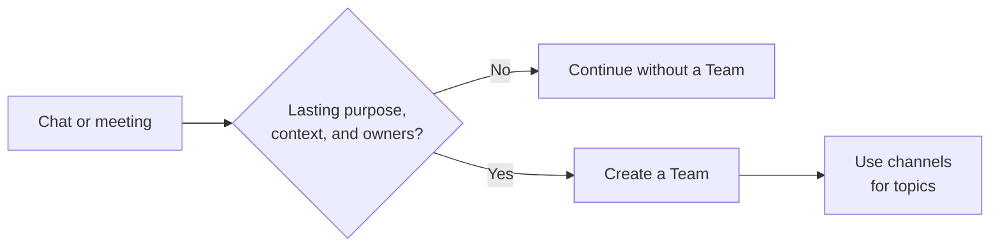

# Ad Hoc And Structured Collaboration In Teams

Start with the smallest place that lets people work together. A quick exchange can stay in chat or around a meeting. Create a Team when the work needs a recognizable purpose, recurring participation, shared context, and owners who can maintain it over time.

## Choose A Place For The Work

| Place | Use it when | Watch for |
| --- | --- | --- |
| One-to-one chat | Two people need to ask, decide, or review something together. | Decisions others must use need an owned, discoverable place. |
| Group chat | Several people need a quick discussion or short period of coordination. | A named chat can continue, but it does not give the work the topic structure and ownership of a Team. |
| Meeting chat | Participants need to share links, questions, or follow-up around a meeting. | Access before and after the meeting depends on the invitation, participant type, and meeting settings. |
| Team | People work together repeatedly around a shared purpose. | Name owners and review membership, information, and the end of the collaboration. |
| Channel | A topic within a Team needs its own conversation, shared content, and apps. | Add a channel for a meaningful topic, not every small activity. |

Microsoft documents [one-to-one and group chat](https://support.microsoft.com/en-us/teams/chat/chat-with-others-in-microsoft-teams) and [meeting chat access](https://support.microsoft.com/en-us/teams/meetings/access-meeting-chat-in-microsoft-teams). Meeting chat can continue after a meeting, but access is not identical for every attendee. Keep durable decisions in a place the intended group can find and own.

## Let The Collaboration Develop

A group chat may begin with a question, then become a recurring activity. When new participants need the history, work splits into several topics, or files and apps need a shared home, agree on the purpose and owners of a Team. Use suitable channels for continuing topics and regular meetings about them. Link or move important information to its intended managed location. Do not assume that creating a Team transfers a chat's history or files automatically.

Let the work's purpose and lifetime determine the choice. A large short-lived meeting may need no Team. A small group responsible for an ongoing process may need one. Use [Microsoft Teams Governance](../../admin-and-governance/teams-governance.md) when the collaboration needs separate owners and a lifecycle.

:::tip[Start Small]

Begin in chat when the need is still taking shape. Create a Team once people can name the shared purpose, owners, and work that must remain available to others.

:::

## Related Guides

- [Microsoft Teams](./index.mdx)
- [Channels And Lifecycle In Teams](./channels-and-lifecycle.md)
- [Which Collaboration Tool Should I Use?](../../decisions/which-collaboration-tool-should-i-use.md)
