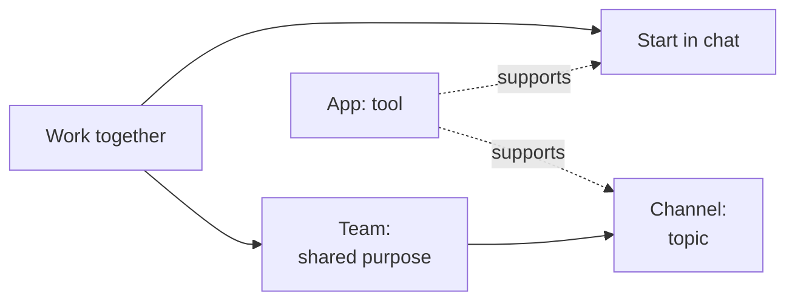

# Microsoft Teams

Microsoft Teams is a workspace for people who work together. Start with a chat or meeting for a quick exchange. Create a Team when the collaboration needs a shared purpose, context, and ownership that lasts beyond one conversation.

A **Team** brings people together for a collaboration. A **channel** gives a topic within that collaboration its own place. An **app** provides a tool to get the work done. Chat, meetings, shared content, and apps can support either informal or structured work.

## Best For

Use Teams to coordinate work with people, discuss decisions, meet, and use the tools that support the work. A department may keep a Team for years; a project may use one until its work ends. A short question or one-time meeting may need only a chat.

## Teams And SharePoint

Teams centers on the people doing the work together. SharePoint centers on the information being organized, managed, or published. A SharePoint site can serve a Team, a department, or an organization-wide audience. Teams uses SharePoint sites for channel content, while SharePoint also supports information and publishing needs beyond Teams. See [SharePoint](../sharepoint/index.mdx).

## Explore Teams

1. [Choose between chat, meetings, Teams, and channels](./ad-hoc-and-structured-collaboration.md).
2. [Give topics a place and manage their lifecycle](./channels-and-lifecycle.md).
3. [Use apps as tools for the work](./apps.md).

## Related Guides

- [Which Collaboration Tool Should I Use?](../../decisions/which-collaboration-tool-should-i-use.md)
- [Microsoft Teams Governance: Prevent Sprawl](../../admin-and-governance/teams-governance.md)
- [Teams Or Viva Engage?](../../decisions/teams-or-viva-engage.md)
