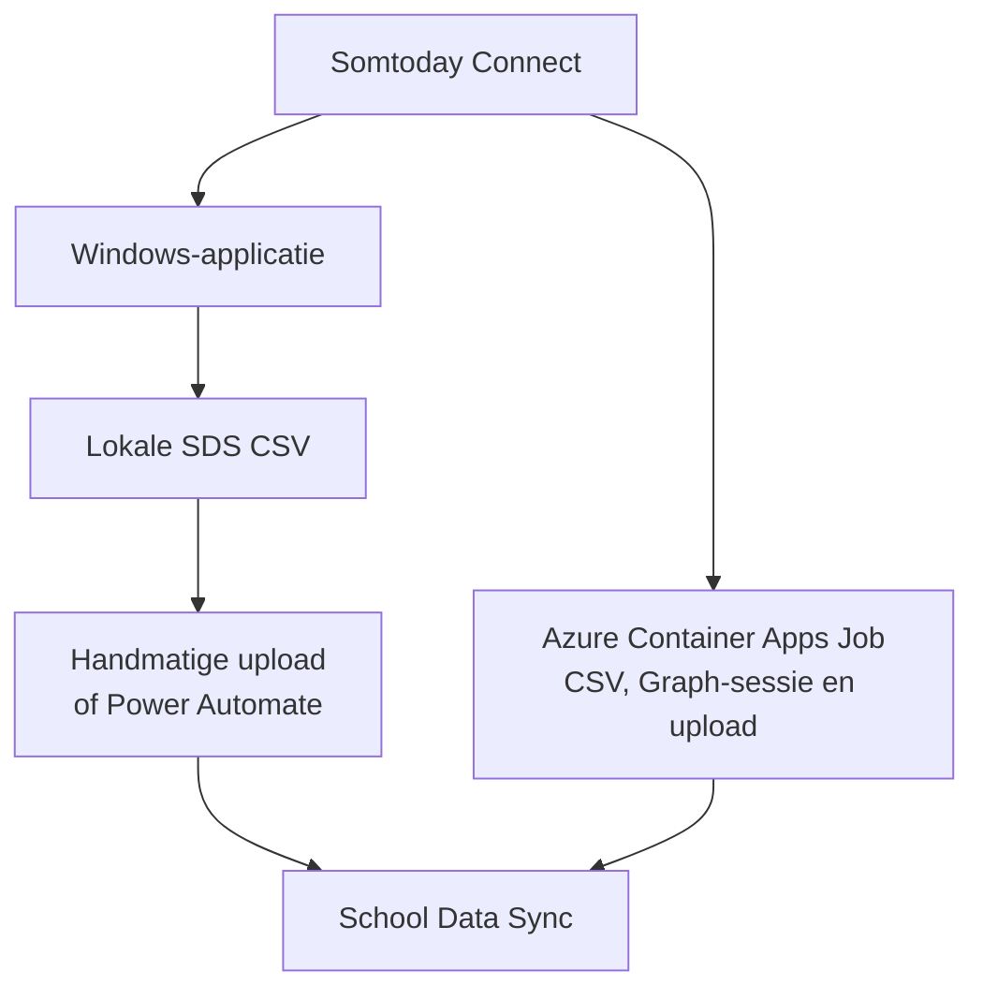

Op 5 november 2026 [kondigde Microsoft wijzigingen in Microsoft 365 Education aan](https://www.microsoft.com/nl-nl/licensing/news/m365education-update). Volgens [SLBdiensten](https://www.slbdiensten.nl/nieuws-overzicht/nieuw-microsoft-365-education-programma-voor-het-nederlandse-onderwijs-blijft-alles-tot-en-met-2031-hetzelfde/) geldt het nieuwe wereldwijde programma niet voor de Nederlandse collectieve overeenkomst van 2027-2031.

Ik loop ook bestaande keuzes na. Gebruik wat je licenties al bieden. Ruim vergeten testaccounts en tijdelijke uitzonderingen op. Bepaal bij nieuwe automatisering de beheerder en benodigde software-identiteit. Mijn Somtoday-koppeling met School Data Sync laat dat zien.

<!-- truncate -->

## Microsoft verandert het Education-licentiemodel

[SLBdiensten bevestigt op 12 november](https://www.slbdiensten.nl/nieuws-overzicht/nieuw-microsoft-365-education-programma-voor-het-nederlandse-onderwijs-blijft-alles-tot-en-met-2031-hetzelfde/) dat het nieuwe wereldwijde programma niet geldt voor de Nederlandse collectieve overeenkomst van 2027-2031. Daarbinnen blijven de afgesproken voorwaarden, prijsafspraken en leerlingrechten gelden. Scholen onder die overeenkomst hoeven vanwege deze aankondiging dus niet over te stappen. Wat na 2031 gebeurt, is nog onbekend.

[APS IT-diensten beschrijft de afspraken voor basis- en speciaal onderwijs](https://www.apsitdiensten.nl/kunnen-wij-je-helpen/microsoft-overeenkomst). Het basispakket voor medewerkers is A3 met Defender for Office 365 Plan 1. Leerlingen kunnen Student Use Benefits gebruiken als alle medewerkers een licentie hebben. Geef je in 2030-2031 minder medewerkers een licentie, dan vervalt dat recht. Deze specifieke APS-voorwaarden gelden niet automatisch voor voortgezet onderwijs of SLBdiensten.

Wereldwijd verandert Microsoft het aanbod wel. Student Use Benefits verdwijnen daar uit het nieuwe programma. Het [nieuwe wereldwijde aanbod](https://learn.microsoft.com/nl-nl/training/educator-center/instructor-materials/microsoft-365-education-portfolio) heeft vijf niveaus:

- **MA0:** kosteloze Office-apps voor leerlingen, onder voorwaarden. Exchange Online, SharePoint Online en Teams ontbreken. Voor samenwerken via die diensten is minimaal MA2 nodig.
- **MA2:** apps, e-mail en samenwerken met SharePoint en optioneel Teams. Ook Copilot Chat en basisbeheer voor mobiele apparaten zijn inbegrepen.
- **MA3:** MA2 met Windows 11 Education en Intune for Education voor uitgebreider apparaatbeheer.
- **MA5:** uitgebreidere beveiliging, identiteitsbeheer en compliance.
- **MA7:** MA5 met Microsoft 365 Copilot en extra beheer voor AI en toegang.

Copilot Credits voor betaald extra verbruik regel je apart. Zie bijvoorbeeld Microsofts uitleg over [Copilot in SharePoint](https://learn.microsoft.com/nl-nl/sharepoint/copilot-in-sharepoint-get-started).

Het wereldwijde A0-aanbod heeft eigen [voorwaarden](https://learn.microsoft.com/nl-nl/training/educator-center/instructor-materials/microsoft-365-education-frequently-asked-questions#how-do-institutions-qualify-for-the-microsoft-365-education-a0-offering). Microsoft noemt MA2 of hoger voor alle medewerkers en Windows-gebruik door leerlingen voor onderwijs. Deze medewerkerseis hoort bij dat aanbod. Het is geen nieuwe eis voor scholen onder de Nederlandse overeenkomst.

Ook de opslag verandert in het wereldwijde programma. De [bestaande regeling](https://www.microsoft.com/nl-nl/education/products/microsoft-365-storage-options) geeft je tenant 100 TB basisopslag, plus opslag uit betaalde licenties. OneDrive, SharePoint en Exchange delen die ruimte. In het nieuwe wereldwijde model vervalt de 100 TB-basis. Per betaalde leerlinglicentie komt er 4 GB bij voor MA2, 8 GB voor MA3 en 12 GB voor MA5 of MA7. Per medewerkerslicentie is dat 50, 75 of 150 GB. MA0 voegt geen opslag toe. Ook deze wereldwijde wijziging geldt niet voor de Nederlandse overeenkomst van 2027-2031.

## Power Apps en Power Automate

Vanaf februari 2027 [controleert Power Apps strenger of gebruikers de juiste licentie hebben](https://learn.microsoft.com/nl-nl/power-platform/admin/powerapps-licensing-faq). De licentie-eisen zelf zijn niet nieuw. Het gaat onder meer om model-driven apps en apps in Managed Environments. Ook maatwerkapps buiten het gebruik dat je Dynamics 365-licentie toestaat, vallen hieronder. Zonder passende Premium-rechten kunnen gebruikers hun app niet meer openen. In [Managed Environments](https://learn.microsoft.com/nl-nl/power-platform/admin/managed-environment-licensing), omgevingen met extra beheerfuncties, geldt dat ook voor standaardapps. Controleer de licentierapporten vóór februari.

Power Automate blijft beschikbaar en zit in MA2-MA7. De [inbegrepen rechten](https://learn.microsoft.com/nl-nl/power-platform/admin/powerapps-flow-licensing-faq) zijn doorgaans voldoende voor standaardconnectors. Connectors verbinden een flow met andere diensten. Voor Premium-connectors, custom connectors en HTTP-acties zijn extra rechten nodig. Ook voor flows gelden de licentie-eisen van Managed Environments. Bekijk dus welke acties de flow uitvoert en waar deze draait.

Een service principal is een identiteit voor software. [Deze kan eigenaar van een flow zijn](https://learn.microsoft.com/nl-nl/power-automate/service-principal-support). Dat verkleint de afhankelijkheid van een medewerker die kan vertrekken. Voor een Premium-flow blijft een licentie nodig. Dat kan een Process-licentie zijn. Waar toegestaan, kun je een [mede-eigenaar met de juiste licentie aanwijzen](https://learn.microsoft.com/nl-nl/power-automate/assign-user-license-service-principal-flow). Voor standaardflows en bepaald Dynamics 365-gebruik gelden uitzonderingen. Spreek ook af wie de verbindingen beheert en storingen oplost.

Een goed werkende en goed beheerde goedkeuringsflow zou ik behouden. Bekijk de inrichting opnieuw als licenties, verbindingen of verantwoordelijken veranderen.

## Gebruik wat je al hebt

Onderwijslicenties waren jarenlang relatief goedkoop en boden veel mogelijkheden. Ik merk dat scholen daardoor soms niet precies weten wat hun pakket biedt. Dat geldt niet voor iedere school.

Controleer vóór aankoop of verlenging wat je [bestaande Microsoft-licenties](https://learn.microsoft.com/nl-nl/microsoft-365/education/guide/0-start/all-license) al bieden. Bekijk ook accountbeheer, apparaatbeheer, beveiliging, gegevensbescherming en monitoring. Microsoft 365 A3 bevat Entra ID P1 en Intune for Education. Microsoft 365 A5 voegt onder meer Entra ID P2 en uitgebreidere Purview-functies voor controle en onderzoek toe. Let op verschillen tussen medewerkers en leerlingen en extra licenties.

Microsoft [voegt in het nieuwe wereldwijde aanbod ook functies toe voor medewerkers](https://learn.microsoft.com/nl-nl/training/educator-center/instructor-materials/microsoft-365-education-frequently-asked-questions). MA3 krijgt Defender for Office 365 Plan 1. MA5 krijgt Intune Suite. Je huidige abonnement krijgt die functies niet automatisch.

Vergelijk ook invoering, samenwerking met andere systemen, ondersteuning en beheer. Een extern product kan beter passen. Deze afweging kan dubbele licenties en extra beheer voorkomen. De [Purview-keuzehulp](../docs/decisions/which-purview-solution-should-you-use) helpt bepalen welke gegevensbescherming je nodig hebt.

## Gratis accounts hebben een eigenaar nodig

Ik zie testaccounts ontstaan voor tijdelijk technisch onderzoek. Soms krijgt zo'n account een beschikbare leerlinglicentie. Na de test blijft het bestaan, omdat het geen zichtbare kosten heeft. Soms ontbreken een verantwoordelijke en einddatum. Normaal accountbeheer kan het account missen. Rechten en toegangstokens kunnen dan ongemerkt blijven werken.

Controleer of je deze leerlinglicentie voor een testaccount mag gebruiken. Ook Student Use Benefits hebben gebruiksvoorwaarden. MA0 blijft bovendien kosteloos onder voorwaarden. Niet ieder account gaat dus straks geld kosten.

Bekijk bij een serviceaccount of het account en de licentie bij de taak passen. Controleer ook app registrations en service principals die na een test achterblijven. Ruim tijdelijke beveiligingsuitzonderingen op zodra ze niet meer nodig zijn.

Volgens [Kennisnets domein voor identiteits- en toegangsbeheer](https://normenkaderibp.kennisnet.nl/informatiebeveiliging/domein-10-identity-en-accessmanagement/) bepaalt de systeemeigenaar wie toegang krijgt en controleert die rechten regelmatig. Iedere tijdelijke uitzondering krijgt van mij een reden, een verantwoordelijke en een einddatum. Leg in het [proces voor toegang en eigenaarschap](../docs/admin-and-governance/permissions-and-ownership) vast wie accounts aanmaakt, controleert en verwijdert. Ook kosteloze accounts verdienen aandacht.

## School Data Sync en Microsoft Classroom

Microsoft heeft op 11 november [Microsoft Classroom aangekondigd](https://techcommunity.microsoft.com/blog/educationblog/introducing-microsoft-classroom-a-new-experience-built-for-teaching-and-learning/4571185). De nieuwe leeromgeving brengt opdrachten, leswerk, cijfers en Class Notebook samen. Het idee van één herkenbare plek voor schoolwerk spreekt mij aan. Teams for Education blijft daarnaast beschikbaar.

<video
  controls
  playsInline
  preload="none"
  poster="/videos/microsoft-classroom-demo-poster.png"
  width="1656"
  height="1092"
  style={{width: '100%', height: 'auto'}}
  aria-label="Demonstratie van Microsoft Classroom zonder geluid"
>
  <source src="/videos/microsoft-classroom-demo.mp4" type="video/mp4" />
  Je browser kan deze video niet afspelen. <a href="/videos/microsoft-classroom-demo.mp4">Download de Microsoft Classroom-demonstratie</a>.
</video>

Om klassen en deelnemers klaar te zetten, gebruikt Classroom School Data Sync (SDS). Een goede koppeling met je leerlinginformatiesysteem krijgt daarmee extra waarde. Je gebruikt de schoolgegevens die je al bijhoudt, zonder klassen en deelnemers opnieuw handmatig in te voeren.

Voor scholen met Somtoday heb ik die verbinding al gebouwd. Mijn [Windows-hulpprogramma voor School Data Sync](../docs/tools/apps/somtoday-to-school-data-sync) leest Somtoday Connect uit en maakt SDS V1- of V2.1-CSV-bestanden. Wie deze koppeling al gebruikt, heeft dus ook een gegevensbasis om op voort te bouwen bij Classroom.

De tool draait op een beveiligde Windows-computer of server. Upload de bestanden handmatig of gebruik Microsofts [Power Automate-oplossing voor uploads](https://learn.microsoft.com/nl-nl/schooldatasync/automate-csv-upload). Die leest bestanden via een gateway en bestandssysteemverbinding. De tool maakt de bestanden; een aparte flow levert ze aan SDS.

## Somtoday synchroniseren zonder Power Automate

Met mijn nieuwe [Somtoday2MicrosoftSDS](https://github.com/Essella/Somtoday2MicrosoftSDS) kan die koppeling ook volledig in Azure draaien. Een geplande Container Apps Job leest Somtoday, maakt de CSV-bestanden en levert ze rechtstreeks aan SDS. Ook de Graph-sessie, upload en controle van het SDS-resultaat horen bij diezelfde Job. Een tussenliggende Power Automate-flow is niet nodig.

De Job gebruikt een managed identity voor Graph: Azure beheert de aanmeldgegevens. Een gewone Microsoft 365-gebruiker is daarvoor niet nodig. De CSV-bestanden ontstaan in het geheugen en gaan naar tijdelijke SDS-opslag. Er is geen permanente eigen Blob-opslag. Het [logbeleid](https://github.com/Essella/Somtoday2MicrosoftSDS/blob/main/SECURITY.md) sluit persoonsgegevens en SAS-tokens uit.

Bekijk de [installatiehandleiding](https://github.com/Essella/Somtoday2MicrosoftSDS/blob/main/docs/operations/DEPLOYMENT.md) voor meer informatie.

Azure-kosten, updates, toegangsbeheer en de schooljaarovergang blijven beheertaken. Kies de route die je team kan ondersteunen.

Beide oplossingen leveren aan SDS, zonder aparte aanpassing voor Classroom. Nieuwe onderwijsfuncties kunnen op die gegevens voortbouwen. Classroom zelf vraagt nog eigen inrichting en tests.

Bekijk de [GitHub README](https://github.com/Essella/Somtoday2MicrosoftSDS) en [Releases met lege CSV-sets](https://github.com/Essella/Somtoday2MicrosoftSDS/releases) om te starten.
