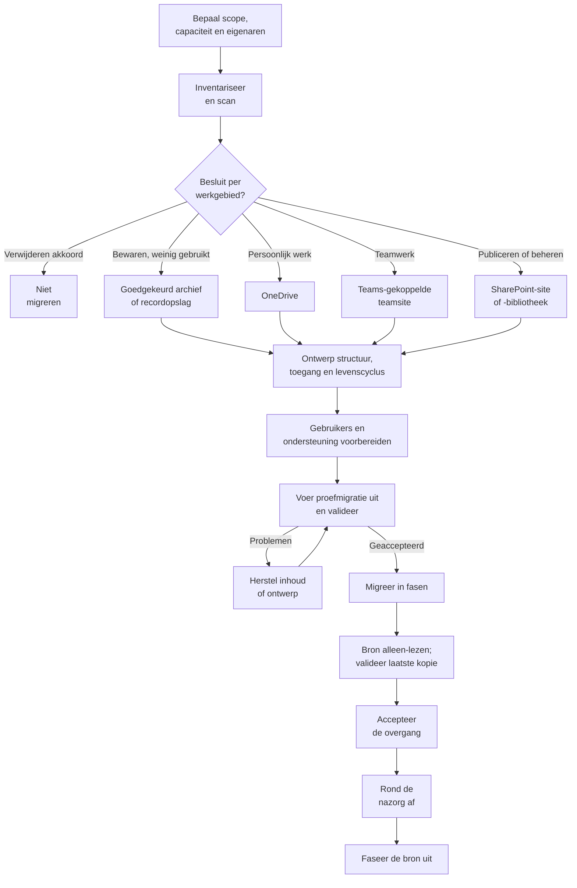
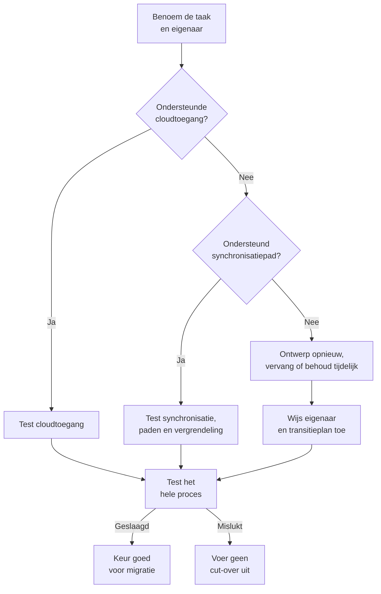

# Van fileserver naar SharePoint: kopiëren of opnieuw organiseren?

Organiseer opnieuw voordat je migreert. Een fileserver is meestal ingericht rond schijven, mappen en overgeërfde machtigingen. SharePoint werkt het beste wanneer de structuur aansluit op doel, eigenaarschap, samenwerking, toegang en de levenscyclus van informatie.

Plan de migratie als een informatie- en adoptieproject, waarbij techniek het afgesproken werkpatroon ondersteunt.

## Aanbevolen aanpak

Migreer niet eerst alles om pas daarna over de inrichting na te denken. Werk in beheersbare gebieden, zoals een afdeling, proces of project. Bepaal per gebied wat behouden moet blijven, wie eigenaar is, waar de informatie thuishoort en hoe mensen na de verhuizing gaan werken.

> Verplaats niet automatisch de bestaande chaos naar een nieuw platform.

## Migratiestroom

## Reserveer tijd en capaciteit

Een planning die alleen op het aantal bestanden en de overdrachtssnelheid is gebaseerd, is onvolledig. De technische kopie is maar één onderdeel van het werk. Reserveer mensen en werktijd voor:

- inventarisatie en workshops waarin inhoudelijke besluiten worden genomen;
- eigenaren die hun informatie beoordelen, opnieuw indelen en goedkeuren;
- het ontwerp van de doelstructuur, toegang, bewaarbeleid en beveiliging;
- herstel van bestanden, koppelingen, identiteiten en applicatieafhankelijkheden;
- de proefmigratie, feedback en aanpassingen aan het ontwerp;
- communicatie, taakgerichte training en instructies per doelgroep;
- validatie van de overgang, gebruikersondersteuning en verbeteringen na de migratie.

Dit zijn geplande projectactiviteiten, geen taken die eigenaren en Key Users naast hun gewone werk moeten zien in te passen. Spreek beslistermijnen en escalatieroutes af en geef iedere migratiefase ruimte voor bevindingen uit de vorige fase. Gebruik de proefmigratie om de benodigde tijd voor beoordeling en ondersteuning te schatten; het aantal bestanden voorspelt die inspanning niet.

Als de mensen met kennis van de inhoud geen gereserveerde capaciteit hebben, wacht de migratie op besluiten terwijl de techniek al klaarstaat.

## 1. Bepaal scope en beslissingsbevoegdheid

Begin bij de mensen die inhoudelijke besluiten kunnen nemen. Een migratieteam kan niet zelf bepalen of een oud contract mag worden verwijderd of dat een projectmap een aparte site moet worden.

Wijs per migratiegebied aan:

- een **bedrijfseigenaar** die bepaalt wat nodig is en wie toegang moet hebben;
- een **migratieleider** die scans, proefmigraties, fasen en probleemafhandeling plant;
- een **IT- of Microsoft 365-eigenaar** die bestemmingen, identiteiten, beveiliging en ondersteuning voorbereidt;
- een **contactpersoon voor recordmanagement, juridische zaken of beveiliging** wanneer bewaartermijnen, vertrouwelijkheid of regelgeving van toepassing zijn.

Leg voor verwijdering, archivering, bestemming en afwijkende toegang het besluit, de goedkeurder en de datum vast. Zo wordt het technisch team niet onbedoeld eigenaar van bedrijfsinformatie.

## 2. Inventariseer en beoordeel de bron

Gebruik twee aanvullende beoordelingen. De bedrijfsinventarisatie beschrijft wat de inhoud betekent; de technische scan laat zien wat kan mislukken of moet worden hersteld.

| Bedrijfsinventarisatie | Technische inventarisatie |
| --- | --- |
| Eigenaar en gebruikers | Aantal bestanden en mappen |
| Doel en documentsoorten | Totale omvang en grote bestanden |
| Actief, historisch of verouderd | Datum laatste wijziging |
| Vertrouwelijkheid en bewaarbehoefte | Padlengte, namen en bestandstypen |
| Benodigde toegang | Bestaande bronmachtigingen |
| Bedrijfsapplicaties en processen | Koppelingen, macro's en andere afhankelijkheden |

Behandel bestaande machtigingen als informatiebron, niet als het doelontwerp. Jaren aan uitzonderingen en individuele toegangsregels kunnen de bedoelde doelgroep verbergen. Laat de eigenaar bevestigen wie in de nieuwe locatie lees-, bewerk- of eigenaarsrechten nodig heeft.

[Microsoft Migration Manager kan fileshares scannen en beoordelen](https://learn.microsoft.com/nl-nl/sharepointmigration/mm-fileshare-scan-assess) en vóór de migratie overzichtsrapporten en gedetailleerde logboeken maken. Gebruik de resultaten om technische blokkades te vinden, maar verwacht niet dat een scan eigenaarschap, waarde of bewaarbehoefte voor je bepaalt.

### Controleer de beoogde bestemming

Toets de bronbestanden aan de eisen van de bestemming, inclusief de geplande site- en bibliotheekpaden:

- [ ] Het volledige gedecodeerde doelpad, inclusief de bestandsnaam, is niet langer dan 400 tekens.
- [ ] Ieder bestand valt binnen de uploadlimiet van 250 GB. Controleer de limieten van de gekozen migratietool afzonderlijk.
- [ ] Namen voldoen aan de actuele beperkingen voor ongeldige tekens en gereserveerde namen, zoals `CON` en `NUL`.
- [ ] Tel unieke machtigingsbereiken: inhoud met eigen toegangsregels in plaats van overgeërfde machtigingen. SharePoint ondersteunt er 50.000 per lijst of bibliotheek; Microsoft adviseert in het algemeen maximaal 5.000. Streef naar veel minder uitzonderingen.

De limieten voor paden, bestandsgrootte en ondersteunde machtigingen staan in de [servicelimieten van SharePoint](https://learn.microsoft.com/nl-nl/office365/servicedescriptions/sharepoint-online-service-description/sharepoint-online-limits). Controleer de [naambeperkingen van OneDrive en SharePoint](https://support.microsoft.com/nl-nl/onedrive/restrictions-and-limitations-in-onedrive-and-sharepoint) voordat je hernoemregels vastlegt. Gebruik een ondersteund maximum niet als ontwerpdoel.

De lijstweergavedrempel van 5.000 items is een afzonderlijke querydrempel, geen harde capaciteitslimiet voor mappen. Test geïndexeerde kolommen en gefilterde weergaven met realistische aantallen volgens [Microsofts uitleg over de lijstweergavedrempel](https://support.microsoft.com/nl-nl/sharepoint/data-and-lists/working-with-the-list-view-threshold-limit-for-all-versions-of-sharepoint). Gebruik [De SharePoint-weergavedrempel van 5.000 items uitgelegd](../../blog/sharepoint-5000-item-view-threshold-explained) voor de verschillen tussen weergaven, zoeken, synchronisatie en automatisering.

### Bepaal acceptatiecriteria voor de migratietool

Kies een tool op basis van de migratie-eisen. Vraag bewijs dat de tool:

- zonder kopiëren kan scannen en gedetailleerde bevindingen kan exporteren;
- bronnen aan bestemmingen kan koppelen en de goedgekeurde herstructurering ondersteunt;
- identiteiten en machtigingen kan koppelen, met vastgelegde verwerking van niet-ondersteunde regels;
- eerste en incrementele kopieën kan uitvoeren met voorspelbare verwerking van bestaande of gewijzigde bestanden;
- fouten rapporteert, nieuwe pogingen ondersteunt en verwachte, gemigreerde en uitgesloten inhoud verantwoordt.

Toets deze eisen in de proefmigratie. Leg handmatige stappen en niet-ondersteunde situaties vast, met een eigenaar en een afgesproken oplossing, voordat je de tool voor breder gebruik accepteert.

### Maak onderscheid tussen gebruikersdata en applicatiedata

Kijk eerst wie de informatie gebruikt: een persoon, een applicatie of beide. Kies daarna de nieuwe opslaglocatie. Alleen het bestandstype en de huidige map zeggen niet genoeg.

| Gebruikspatroon | Excelvoorbeeld | Wat moet je regelen? |
| --- | --- | --- |
| Gebruikersdata: mensen gebruiken de informatie zelf | Een team bewerkt een begroting en bespreekt de cijfers | Kies een gedeelde opslaglocatie. Wijs een eigenaar aan en leg uit hoe het team er werkt |
| Applicatiedata: software leest of schrijft gegevens in het bestand | Een applicatie importeert een Excelbestand. Een gebruiker kan de import handmatig starten | Test of de applicatie het bestand kan vinden, openen en verwerken |
| Gemengd gebruik: mensen en applicaties gebruiken hetzelfde bestand | Medewerkers vullen een werkmap in. Een andere werkmap, macro of applicatie gebruikt die gegevens | Test alle betrokken bestanden, koppelingen en verwerkingsstappen |

Gebruikersdata kan ook van een team zijn. Zet die bestanden daarom niet zomaar in de OneDrive van één medewerker. Een Excelbestand kan door mensen én applicaties worden gebruikt.

Gebruikers kun je leren waar de bestanden voortaan staan. Voor applicaties moet je vaste paden aanpassen. Soms moet je ook de applicatie aanpassen of vervangen. Test daarna of het hele proces nog werkt.

Als een applicatie alleen lokale bestandspaden accepteert, kan synchronisatie nodig zijn om de gegevens in SharePoint te houden. De applicatie heeft de lokale kopie nodig om te werken. Synchronisatie maakt die lokale paden niet voor iedere gebruiker gelijk. Controleer eerst of de applicatie cloudtoegang ondersteunt.

#### Voorbeeld: Power Query leest een lokaal bestand

Gebruiker A maakt een Power Query-import in `Summary.xlsx`. De query leest `Source.xlsx` vanuit een gesynchroniseerde projectmap. Gebruiker B opent `Summary.xlsx` en probeert de query te vernieuwen. Beide gebruikers hebben het bronbestand, maar het lokale pad verschilt:

| Gebruiker | Lokaal bronpad |
| --- | --- |
| Gebruiker A | `C:\Users\userA\OneDrive - Contoso\Project A\Source.xlsx` |
| Gebruiker B | `C:\Users\userB\OneDrive - Contoso\Project A\Source.xlsx` |

De query verwijst nog naar het lokale pad van gebruiker A. Bij gebruiker B kan die locatie ontbreken of ontoegankelijk zijn. Vernieuwen kan daardoor mislukken terwijl beide bestanden volledig gesynchroniseerd zijn. Synchronisatie van de bronmap past de bron van de query niet vanzelf aan.

Voor deze import adviseer ik de [SharePoint-mapconnector van Power Query](https://learn.microsoft.com/nl-nl/power-query/connectors/sharepoint-folder):

1. Kies in Excel **Gegevens > Gegevens ophalen > Uit bestand > Uit SharePoint-map**. Microsoft beschrijft deze optie in de [uitleg over importeren met Power Query](https://support.microsoft.com/nl-nl/excel/import-data-from-data-sources-power-query).
2. Vul de URL van de SharePoint-site in, bijvoorbeeld `https://contoso.sharepoint.com/sites/Projects`. Gebruik het siteadres, zonder bibliotheek- of bestandspad.
3. Meld je aan met een organisatieaccount dat de bron mag lezen. Filter de gevonden bestanden op de bedoelde map en `Source.xlsx` voordat je de gegevens importeert.
4. Selecteer de benodigde tabel of het werkblad. Controleer de verwerkingsstappen van de query en laad het resultaat in `Summary.xlsx`.

De query leest de bron nu via SharePoint. De bron hangt niet meer af van `C:\Users\userA\...` of een gesynchroniseerde bronmap. Iedere gebruiker heeft nog steeds een werkende verbinding en toegang tot de bron nodig. Wijzig een waarde in `Source.xlsx` op SharePoint en sla deze op. Test daarna het vernieuwen als gebruiker B. Vergelijk het resultaat met die nieuwe waarde. Vertrouw niet op gegevens die al in de werkmap waren geladen.

Pas bij een bestaande query de bron aan en controleer de volgende stappen. Een verbinding met een SharePoint-map geeft een lijst met bestanden terug. Selecteer het bedoelde bestand voordat je de inhoud verwerkt. Alleen een lokaal pad vervangen door een HTTPS-adres maakt van een lokale bestandsquery nog geen query voor een SharePoint-map.

#### Maak onderscheid tussen Power Query en werkmapkoppelingen

Power Query haalt gegevens op en verwerkt ze. Werkmapkoppelingen verwijzen naar cellen in een andere werkmap. Een aangepaste Power Query-bron herstelt niet automatisch die koppelingen, macro's of andere applicaties die lokale paden verwachten.

Excel kan [werkmapkoppelingen ook als relatieve paden opslaan](https://support.microsoft.com/nl-nl/excel/description-of-workbook-link-management-and-storage-in-excel). Die koppelingen kunnen blijven werken als de onderlinge mapstructuur gelijk blijft. Een volledig pad in de formulebalk betekent niet altijd dat Excel een absoluut pad heeft opgeslagen. Controleer hoe de koppeling is opgeslagen en hoe gebruikers de werkmappen openen.

Voor celverwijzingen tussen werkmappen ondersteunt Excel ook [werkmapkoppelingen met SharePoint- en OneDrive-adressen](https://support.microsoft.com/nl-nl/excel/create-workbook-links). Voor gedeelde werkmappen geef ik de voorkeur aan deze ondersteunde cloudkoppelingen boven koppelingen naar een Windows-profiel. Maak of herstel de koppeling via de functie voor werkmapkoppelingen in Excel. Iedere gebruiker heeft nog steeds toegang tot de bronwerkmap nodig. Controleer of de koppeling mag worden vernieuwd. Test of gewijzigde bronwaarden in het resultaat verschijnen. Andere applicaties kunnen deze vormen van cloudtoegang niet altijd gebruiken.

Neem de Excelversie van je organisatie, werkmapkoppelingen, query's, macro's en imports op in de procestests hieronder.

### Controleer hoe de applicatie zich aanmeldt

Op een Windows-fileshare kan een applicatie vaak het account van de aangemelde gebruiker gebruiken. Dat kan bijvoorbeeld via [Kerberos-authenticatie](https://learn.microsoft.com/nl-nl/windows-server/security/kerberos/kerberos-authentication-overview). Een service of geplande taak kan een ander account gebruiken. Leg vast welk account ieder bestand leest en schrijft.

Toegang in de browser zegt nog weinig over toegang vanuit een applicatie. Een applicatie kan niet automatisch de aanmeldcookies van je browser gebruiken. De applicatie moet zelf kunnen aanmelden, bijvoorbeeld via een connector. Ook zijn de juiste machtigingen nodig.

Bij [Microsoft Graph](https://learn.microsoft.com/nl-nl/graph/auth/auth-concepts) heeft de applicatie een toegangstoken nodig. Een applicatie kan namens een aangemelde gebruiker werken (gedelegeerde toegang) of een eigen identiteit gebruiken (app-only-toegang). Controleer welke methode de applicatie ondersteunt.

:::warning[Voorkom ongeplande synchronisatie als uitweg]

Als een applicatie bestanden in SharePoint niet kan openen, kunnen gebruikers die gaan synchroniseren. De applicatie gebruikt dan een lokale kopie. Het werk kan zo afhankelijk worden van één medewerker, computer en synchronisatieclient.

Laat de applicatie-eigenaar en IT deze werkwijze vóór de verhuizing goedkeuren. Controleer de beveiliging van het apparaat en de bestanden. Spreek af hoe je bestanden actueel houdt en zo nodig herstelt. Controleer ook of het werk doorgaat als die medewerker of computer niet beschikbaar is. Volg de [maatregelen voor synchronisatie en lokale gegevens](#5-beheers-risicos-van-synchronisatie-en-lokale-gegevens).

:::

Bij goedgekeurde synchronisatie meldt de synchronisatieclient zich aan bij SharePoint. De applicatie gebruikt de lokale kopie en krijgt daarmee geen rechtstreekse toegang tot SharePoint. Neem de tijd die wijzigingen nodig hebben om de volgende verwerkingsstap te bereiken op in de procestest.

### Breng afhankelijkheden van werkprocessen in kaart

Controleer zowel Office- als niet-Office-applicaties. Sommige hebben een lokaal of gekoppeld pad, een vaste mapnaam of een serviceaccount nodig. Een applicatie moet een bestand soms ook blokkeren voor anderen tijdens het bewerken. Een synchronisatieclient kan soms een lokaal pad leveren.

Volg ieder kritisch proces van taak naar applicatie, bestand, identiteit en pad. Test de volledige taak met de echte Office- of niet-Office-applicatie. Alleen het gemigreerde bestand openen bewijst niet dat gekoppelde bestanden, imports of achtergrondverwerking werken.

Beoordeel services, integraties, databases en gedeelde applicatiegegevens op dezelfde manier. Controleer hoe ze zich aanmelden, welke toegang ze nodig hebben en hoe gelijktijdig gebruik werkt. Kies daarna cloudtoegang, goedgekeurde synchronisatie of een ander opslagontwerp.

Rond deze checklist af voordat je de betreffende migratiefase plant:

- [ ] Benoem de proceseigenaar, gebruikers, kriticiteit en aanvaardbare uitvalduur.
- [ ] Leg iedere applicatie, automatisering, macro, integratie, serviceaccount en geplande taak vast die de bestanden leest of schrijft.
- [ ] Leg per bestand vast wie het gebruikt: mensen, applicaties of beide. Noteer welke andere bestanden ervan afhangen.
- [ ] Leg gekoppelde stations, vaste paden, snelkoppelingen, invoermappen, uitvoermappen en ingesloten koppelingen vast.
- [ ] Noteer welk account of welke applicatie-identiteit iedere applicatie of taak gebruikt. Controleer hoe deze zich aanmeldt en welke machtigingen nodig zijn.
- [ ] Test gelijktijdig gebruik, bestandsvergrendeling, offlinegebruik, Files On-Demand en het doelpad met de echte applicatie.
- [ ] Kies en keur één uitkomst goed: gebruik de browser, gebruik een ondersteund synchronisatiepad, pas de applicatie aan, vervang het proces of behoud de afhankelijkheid tijdelijk op beheerde opslag.
- [ ] Laat de applicatie-eigenaar en IT het gebruik van synchronisatie goedkeuren. Controleer apparaatbeveiliging, actuele bestanden en hoe het werk doorgaat zonder de gebruikelijke gebruiker of het apparaat.
- [ ] Bepaal monitoring, ondersteuning, terugval en een datum waarop iedere tijdelijke uitzondering wordt beëindigd.

## 3. Bepaal de bestemming

Kies een bestemming per samenhangend werkgebied, niet in één keer voor de hele schijf.

| Informatiepatroon | Aanbevolen bestemming |
| --- | --- |
| Werkbestanden van één persoon die nog geen onderdeel van een teamproces zijn | OneDrive |
| Documenten die een afgebakende groep actief maakt en onderhoudt | Een aan Teams gekoppelde SharePoint-teamsite |
| Gepubliceerde naslaginformatie voor een brede doelgroep | Een SharePoint-communicatiesite |
| Formele documenten met een vastgelegd proces, eigenaar en toegangsmodel | Een beheerste SharePoint-site of documentbibliotheek |
| Applicatiedata of bestanden die mensen én applicaties gebruiken | Test eerst het hele proces. Gebruik SharePoint als de applicatie dat ondersteunt, of opslag die voor de applicatie is bedoeld. Houd je bestanden tijdelijk ergens anders, wijs dan een eigenaar en einddatum aan |
| Informatie die bewaard moet blijven maar weinig wordt gebruikt | Een goedgekeurde record- of archiefoplossing op basis van bewaar- en toegangseisen |
| Verouderde, dubbele of eigenaarloze inhoud waarvan verwijdering is goedgekeurd | Niet migreren |

OneDrive, Teams en SharePoint zijn geen onderling verwisselbare mappen. De bestemming bepaalt eigenaarschap, levenscyclus, toegang en hoe mensen de informatie vinden en gebruiken. Bekijk [Waar moet dit bestand staan?](../decisions/where-should-this-file-live.md) voor de onderliggende keuze.

Gebruik een beheerde communicatiesite of niet-groepsgekoppelde SharePoint-site wanneer de organisatie publicatie, lidmaatschap of toegang centraal moet beheren. Gebruik een groepsgekoppelde teamsite wanneer een afgebakende groep moet samenwerken en de eigenaren verantwoordelijk kunnen zijn voor het lidmaatschap. SharePoint houdt eigenaarschap niet vanzelf centraal; het sitetype, de groepen, eigenaren en deelinstellingen vormen samen dat werkmodel. Volg [Delen in SharePoint beheren](./govern-sharing-in-sharepoint.md) voordat je de definitieve bestemming kiest.

:::warning[Archiveren is een levenscyclusbesluit]

Noem inhoud niet automatisch een archief omdat niemand haar gebruikt. Bevestig de eigenaar, vereiste bewaartermijn, toegangsbehoefte, juridische bewaarplichten en het goedgekeurde verwijderproces. Configureer [Microsoft Purview-bewaarbeleid voor SharePoint en OneDrive](https://learn.microsoft.com/nl-nl/purview/retention-policies-sharepoint) waar beleid of regelgeving dit vereist.

Gebruik [Welke Microsoft Purview-oplossing moet je gebruiken?](../decisions/which-purview-solution-should-you-use.md) wanneer migratiebesluiten ook gevoeligheidslabels, DLP, records, bewijs of onderzoeksmaatregelen vereisen.

:::

## 4. Ontwerp de nieuwe structuur en toegang

Maak niet automatisch van iedere bovenliggende map een site. Maak een site wanneer inhoud een duidelijk doel, een eigenaar, een doelgroep en een gezamenlijke levenscyclus heeft. Gebruik een aparte site wanneer de beveiligingsgrens of het eigenaarschap wezenlijk anders is.

Gebruik [Site, bibliotheek of map: waar organiseer je documenten?](../decisions/site-library-or-folder.md) om dit ontwerp te doorlopen voordat je migratiebestemmingen maakt.

Binnen een site:

- gebruik je documentbibliotheken voor verschillende inhoudsverzamelingen of beheerregels;
- houd je mappen begrijpelijk en redelijk ondiep;
- voeg je metadata toe wanneer mensen documenten over mappen heen moeten filteren, groeperen, zoeken of beheren;
- geef je de voorkeur aan groepen en overgeërfde machtigingen boven individuele toegang en veel uitzonderingen;
- wijs je voor belangrijke werkomgevingen ten minste twee geschikte eigenaren aan;
- spreek je vóór de migratie naamgeving, navigatie, versiebeheer, delen, bewaarbeleid en evaluatie af.

Maak de structuur uitlegbaar aan een nieuwe medewerker zonder kennis van de oude schijf.

### Beheer lidmaatschap en toegang

:::warning[Controleer toegang die Deny eerder blokkeerde]

De [machtigingsrichtlijnen voor de SharePoint Migration Tool](https://learn.microsoft.com/nl-nl/sharepointmigration/understanding-permissions-when-migrating) vermelden dat bijzondere machtigingen zoals NTFS Deny niet behouden blijven. Een gebruiker die op de bron was uitgesloten, kan via een andere machtiging toegang krijgen op de bestemming. Controleer het gedrag van andere tools afzonderlijk.

Leg deze uitsluitingen vast en laat de bedrijfseigenaar het vervangende toegangsontwerp goedkeuren. Test in de proefmigratie dat uitgesloten gebruikers de betreffende inhoud niet kunnen openen.

:::

:::warning[Houd lidmaatschap correct bij personeelswijzigingen]

Toegang tot fileservers is vaak gebaseerd op groepen die IT of identitymanagement onderhoudt. Een groepsgekoppelde SharePoint-teamsite of een Team kan werkruimte-eigenaren het lidmaatschap laten beheren. Als dat lidmaatschap niet aansluit op het vastgestelde proces voor instroom, functiewijziging en uitstroom, kan iemand na een functiewijziging noodzakelijke toegang missen of toegang behouden die had moeten eindigen.

Leg per gebeurtenis vast wie het lidmaatschap bijwerkt, welke identiteitsbron die persoon gebruikt en wie controleert of de wijziging is afgerond.

:::

Leg voor iedere bestemming vast of lidmaatschap centraal, door eigenaren of hybride wordt beheerd. Benoem de bedrijfseigenaar, minimaal twee werkruimte-eigenaren, de identiteitsbron, de goedkeurder, de uitzonderingsroute en de beoordelingsdatum. Gebruik [Machtigingen en eigenaarschap](./permissions-and-ownership.md) voor het verantwoordelijkheidsmodel. Bekijk Microsofts [richtlijnen voor delen en machtigingen](https://learn.microsoft.com/nl-nl/sharepoint/modern-experience-sharing-permissions) voor lidmaatschapsbeheer in groepsgekoppelde sites en Teams.

Beoordeel alle toegangsroutes. Rechtstreeks delen van bestanden of mappen kan unieke SharePoint-machtigingen maken en privé- of gedeelde Teams-kanalen gebruiken aparte SharePoint-sites. Controleer leden, gasten, deelkoppelingen, rechtstreekse toegang en kanaalsites afzonderlijk. Volg [Delen in SharePoint beheren](./govern-sharing-in-sharepoint.md) en Microsofts [uitleg over de integratie tussen Teams en SharePoint](https://learn.microsoft.com/nl-nl/sharepoint/teams-connected-sites).

### Beoordeel brede toegang vóór Copilot

Microsoft 365 Copilot respecteert bestaande machtigingen, maar kan toegankelijke informatie gemakkelijker vindbaar en herbruikbaar maken. Herstel vóór een brede uitrol te ruime toegang, eigenaarloze inhoud en verouderde toegang. Microsofts [veilige en beheerste databasis voor Copilot](https://learn.microsoft.com/nl-nl/microsoft-365/copilot/secure-govern-copilot-foundational-deployment-guidance) beschrijft de voorbereiding.

Gebruik Purview om gevoelige informatie te vinden, classificeren en beschermen. Labels vervangen toegangsherstel niet en een site- of groepslabel labelt niet automatisch de bestanden erin. Controleer het [toepassingsgebied van gevoeligheidslabels voor groepen en sites](https://learn.microsoft.com/nl-nl/purview/sensitivity-labels-teams-groups-sites).

Controleer toegang via `Everyone except external users` op site-, bibliotheek-, map- en bestandsniveau. Laat eigenaren bevestigen waar organisatiebrede toegang bedoeld is en verwijder die elders. Microsofts [rapporten voor datatoegangsgovernance](https://learn.microsoft.com/nl-nl/sharepoint/data-access-governance-reports) kunnen helpen om breed delen te vinden; controleer de rapportagevoorwaarden voordat je ze gebruikt.

Overweeg tijdens een machtigingsbeoordeling [Restricted Content Discovery](https://learn.microsoft.com/nl-nl/sharepoint/restricted-content-discovery) voor geselecteerde gevoelige sites. Dit beperkt tijdelijk de vindbaarheid in organisatiebrede zoekresultaten en Copilot. Het verandert geen machtigingen en blokkeert geen rechtstreekse toegang voor een bevoegde gebruiker. Controleer de actuele licentie- en beheervoorwaarden, wijs een beoordelaar aan en verwijder de beperking nadat het toegangsherstel is geaccepteerd.

## 5. Beheers risico's van synchronisatie en lokale gegevens

Ik adviseer deze toegangsvolgorde voor gedeelde documenten:

1. Begin vanuit SharePoint of Teams.
2. Gebruik een OneDrive-snelkoppeling voor taken die Verkenner vereisen. Selecteer alleen de benodigde mappen.
3. Gebruik **Synchroniseren** voor een volledige bibliotheek alleen als vastgelegde, goedgekeurde uitzondering.

Vanuit SharePoint of Teams kun je bestanden in de browser bewerken of [in een ondersteunde desktopapp openen](https://support.microsoft.com/nl-nl/sharepoint/sync/open-a-onedrive-or-sharepoint-file-in-the-desktop-app-instead-of-the-browser). Controleer de eisen van de app. De functie **Openen in app** die Microsoft beschrijft, vereist de OneDrive-client en Files On-Demand.

Microsoft [adviseert OneDrive-snelkoppelingen boven de knop Synchroniseren](https://learn.microsoft.com/nl-nl/sharepoint/sharepoint-sync). Snelkoppelingen zijn op meerdere apparaten beschikbaar. **Synchroniseren** koppelt een bibliotheek aan één apparaat. Microsoft noemt ook betere prestaties voor snelkoppelingen.

Voor toegang via Verkenner gebruiken beide methoden de OneDrive-synchronisatieclient. Een snelkoppeling kan [een specifieke map of een volledige bibliotheek](https://support.microsoft.com/nl-nl/onedrive/add-shortcuts-to-shared-folders-in-onedrive) omvatten. Selecteer alleen de inhoud die de taak vereist. Een snelkoppeling op zichzelf vermindert de gesynchroniseerde hoeveelheid niet.

Een team heeft bijvoorbeeld alleen de map `Project A` nodig. Voeg een snelkoppeling naar die map toe. Kies niet de bibliotheek met alle projecten. Wijzigingen in `Project A` worden nog steeds via OneDrive gesynchroniseerd. De snelkoppeling beperkt de betrokken inhoud, maar neemt de synchronisatie niet weg.

:::warning[Kies één methode per bibliotheek]

Je kunt **Synchroniseren** en **Snelkoppeling toevoegen aan Mijn bestanden** niet combineren voor dezelfde SharePoint-bibliotheek. Dit geldt ook als de snelkoppeling naar een map binnen die bibliotheek verwijst. Volg [Microsofts uitleg over deze beperking](https://learn.microsoft.com/nl-nl/troubleshoot/sharepoint/sync/cannot-sync-shortcut-folder).

:::

### Begrijp conflicten bij gedeelde bibliotheken

Elk apparaat houdt lokale bestanden en wijzigingen bij. Een opgeslagen wijziging op één laptop kan SharePoint nog niet hebben bereikt. Een collega kan verder werken met de versie die daar al staat. Microsoft beschrijft [synchronisatieconflicten bij offline of gelijktijdig bewerken](https://support.microsoft.com/nl-nl/onedrive/restrictions-and-limitations-in-onedrive-and-sharepoint).

Dit kan ook gebeuren met persoonlijke bestanden op meerdere apparaten. Bij gedeelde bibliotheken komen daar wijzigingen en mapverplaatsingen van collega's bij. OneDrive moet die wijzigingen op alle apparaten op elkaar afstemmen.

#### Voorbeeld: de verbinding valt weg tijdens het bewerken

Gebruiker A opent `Budget.xlsx` vanuit een gesynchroniseerde projectmap. De wifi- of VPN-verbinding valt weg. Gebruiker A werkt lokaal verder. De wijzigingen bereiken SharePoint niet meer.

Gebruiker B opent dezelfde werkmap vanuit SharePoint. Deze gebruiker past de bedragen aan en slaat op. De wijzigingen bereiken SharePoint terwijl gebruiker A nog offline werkt.

Als gebruiker A weer verbinding maakt, moet OneDrive twee reeksen wijzigingen verwerken. Ondersteunde apps en bestandsindelingen kunnen [wijzigingen samenvoegen via cocreatie](https://support.microsoft.com/nl-nl/sharepoint/get-started-with-sharepoint/document-collaboration-and-co-authoring). Sommige wijzigingen vragen handmatige controle of een afzonderlijk opgeslagen kopie. De uitkomst hangt af van de applicatie, het bestandstype en wanneer wijzigingen binnenkomen. Een geslaagde upload bewijst nog niet dat de bedoelde wijzigingen van beiden behouden zijn. Controleer de bedragen tijdens de proefmigratie.

#### Voorbeeld: een map verhuist terwijl een bestand openstaat

Gebruiker A verplaatst `Projects/Project A` naar `Completed/Project A`. Gebruiker B heeft `Budget.xlsx` nog open vanuit de oorspronkelijke map op de laptop. De verplaatsing bereikt SharePoint voordat het apparaat van gebruiker B deze ontvangt.

Gebruiker B slaat het werk op. De applicatie kan nog het oude pad gebruiken. OneDrive moet nu de mapverplaatsing en de opgeslagen wijzigingen van gebruiker B verwerken. Als de applicatie op het oude pad een bestand aanmaakt, kunnen op beide locaties bestanden staan. Zo kan een dubbele kopie of een deel van de oude mapstructuur verschijnen. Sommige applicaties verwerken de verplaatsing zonder dit probleem. Test de echte applicatie voordat je de werkwijze goedkeurt.

Een applicatie kan ook [synchronisatie blokkeren terwijl een bestand in gebruik is](https://support.microsoft.com/nl-nl/onedrive/troubleshoot-onedrive-error-this-file-can-t-be-synced). Plan grote verplaatsingen wanneer collega's de betrokken bestanden kunnen sluiten. Laat openstaande wijzigingen eerst synchroniseren voordat je gedeelde mappen opnieuw indeelt.

#### Meer situaties voor de proefmigratie

Gebruik de voorbeelden die bij het werk van het team passen:

| Situatie | Wat controleer je? |
| --- | --- |
| Iemand gebruikt een desktop en een laptop die dagen offline was | Sla op beide apparaten verschillende wijzigingen op. Verbind de laptop opnieuw en controleer welke wijzigingen SharePoint bereiken |
| Een laptop gaat in slaapstand voordat een upload klaar is | Haal de laptop uit slaapstand. Controleer of de openstaande wijzigingen aankomen voordat een collega verdergaat |
| Iemand verplaatst of hernoemt duizenden bestanden tijdens het dagelijkse werk | Controleer open bestanden, openstaande wijzigingen en de uiteindelijke maplocaties |
| Een applicatie, antivirusprogramma, DLP-tool of back-uptool houdt een bestand open | Controleer of het bestand vergrendeld is en of de synchronisatie doorgaat nadat het is vrijgegeven |
| Collega's bewerken hetzelfde niet-Office-bestand | Controleer of de applicatie cocreatie ondersteunt en hoe deze conflicterende opslagacties afhandelt |
| Een grote bibliotheek heeft veel openstaande wijzigingen, of de client is verouderd of meldt fouten | Controleer de werking van de client. Kijk of wijzigingen binnen de voor het team vereiste tijd zijn gesynchroniseerd |
| Iemand kopieert een gesynchroniseerde map naar een andere gesynchroniseerde locatie | Controleer welke kopie collega's bewerken en of zij het afgesproken werkbestand herkennen |
| Iemand koppelt OneDrive opnieuw, of verliest toegang tot een bibliotheek en krijgt die later terug | Controleer wat er met openstaande lokale wijzigingen gebeurt als de synchronisatie wordt hervat |

Beoordeel het proces en de opslagkeuze voordat je een andere synchronisatieclient kiest. Een andere client moet nog steeds de offlinewijzigingen van gebruiker A en de wijzigingen van gebruiker B verwerken. Deze moet ook omgaan met mapverplaatsingen en applicaties die oude paden gebruiken. Toets ondersteuning, beveiliging, beheer en kosten aan de eisen. Gebruik vóór goedkeuring de [beoordeling van applicaties en processen](#breng-afhankelijkheden-van-werkprocessen-in-kaart).

### Bescherm lokale gegevens en regel herstel

Te ruim delen kan informatie blootstellen aan mensen voor wie die niet bedoeld is. Synchronisatie kan ook de bestanden zelf raken: [OneDrive synchroniseert toevoegingen, wijzigingen en verwijderingen](https://support.microsoft.com/nl-nl/onedrive/sync-your-computer-s-files-and-folders-with-onedrive) tussen het apparaat en de cloud. Een onbedoelde verwijdering, schadelijke applicatie of gecompromitteerd apparaat kan daardoor de gedeelde cloudkopie en andere gesynchroniseerde apparaten raken. Behandel synchronisatie als toegangsmethode en niet als back-up.

| Risico | Wat kan gebeuren | Vereiste ontwerpmaatregel |
| --- | --- | --- |
| Te ruim delen | Breed lidmaatschap, rechtstreekse machtigingen of koppelingen maken informatie zichtbaar voor onbedoelde personen | Herstel toegang en volg [Delen in SharePoint beheren](./govern-sharing-in-sharepoint.md) |
| Lokale blootstelling | Lokaal beschikbare of altijd beschikbare bestanden zijn mogelijk leesbaar via een ontgrendelde of gecompromitteerde gebruikerssessie | Vereis beheer van apparaten, schijfversleuteling, schermvergrendeling, incidentafhandeling en passende downloadbeperkingen |
| Doorgegeven verwijdering of beschadiging | Een gesynchroniseerde verwijdering of wijziging kan SharePoint en andere apparaten bereiken | Configureer versiebeheer en [herstelopties](https://learn.microsoft.com/nl-nl/sharepoint/safeguarding-your-data) en test de herstelprocedure |
| Overmatige synchronisatie | Grote bibliotheken, te veel gesynchroniseerde items of veel offlinekopieën kunnen opslag, netwerkgebruik en betrouwbaarheid beïnvloeden | Synchroniseer alleen wat het werkpatroon vereist, gebruik Files On-Demand en test tegen de [actuele OneDrive- en SharePoint-limieten](https://support.microsoft.com/nl-nl/onedrive/restrictions-and-limitations-in-onedrive-and-sharepoint) |
| Incompatibel proces | Een applicatie verwacht een gekoppeld station, vast pad, specifiek vergrendelgedrag of lokaal gegevensbestand | Los de afhankelijkheid vóór de cut-over op of behoud een expliciet beheerde tijdelijke uitzondering |

[Files On-Demand](https://support.microsoft.com/nl-nl/onedrive/save-disk-space-with-onedrive-files-on-demand-for-windows) kan bestandsinhoud online houden totdat deze nodig is. Gebruikers kunnen bestanden altijd beschikbaar maken en applicaties kunnen bestanden die alleen online staan downloaden wanneer ze die benaderen. Behandel dit als een opslag- en synchronisatiemaatregel, niet als beveiligingsgrens.

SharePoint-machtigingen beschermen niet vanzelf iedere gedownloade kopie. Vereis beheerde en conforme apparaten, apparaatversleuteling, sterke aanmelding en vergrendeling en passende [maatregelen voor onbeheerde apparaten](https://learn.microsoft.com/nl-nl/sharepoint/control-access-from-unmanaged-devices).

Voeg waar het informatierisico en de licenties dit rechtvaardigen Purview-gevoeligheidslabels met versleuteling, [bescherming die SharePoint-machtigingen uitbreidt naar gedownloade bestanden](https://learn.microsoft.com/nl-nl/purview/sensitivity-labels-sharepoint-extend-permissions) of [Endpoint DLP](https://learn.microsoft.com/nl-nl/purview/endpoint-dlp-learn-about) toe. Een label dat alleen classificeert, voorkomt niet dat iemand met een bevoegde, ontgrendelde sessie het bestand leest.

Voordat je synchronisatie voor een site of bibliotheek inschakelt:

- [ ] Keur goed welke rollen synchronisatie nodig hebben en welke bibliotheken zij nodig hebben.
- [ ] Gebruik Files On-Demand als normaal patroon en leg gerechtvaardigde offline-uitzonderingen vast.
- [ ] Controleer aantallen items, padlengten, beschikbare opslag, bandbreedte en de actuele synchronisatielimieten.
- [ ] Bevestig de eisen voor apparaatbeheer, versleuteling, vergrendeling, acties op afstand en onbeheerde apparaten.
- [ ] Bepaal of gevoelige bestanden versleuteling, uitgebreide bescherming na downloaden, Endpoint DLP of een patroon zonder download nodig hebben.
- [ ] Test verwijdering, versieherstel, herstel vanuit de prullenbak en de escalatieroute voor incidenten.
- [ ] Neem het verwijderen van gesynchroniseerde gegevens en toegang op in processen voor uitdiensttreding, verloren apparaten en apparaatvervanging.

## 6. Ruim op en herstel problemen

Laat de bedrijfseigenaar goedkeuren of inhoud moet worden gemigreerd, gearchiveerd of verwijderd. Onderzoek inhoud die:

- dubbel, verouderd of eigenaarloos is;
- binnen de afgesproken beoordelingsperiode niet is gebruikt;
- niet kan worden geopend of met een wachtwoord is beveiligd;
- afhankelijk is van gekoppelde stations, vaste paden, snelkoppelingen, macro's of applicaties;
- namen, typen, formaten of paden heeft die als migratieprobleem zijn gemeld;
- machtigingen heeft die niet aan actieve Microsoft 365-identiteiten kunnen worden gekoppeld.

Gebruik de laatste wijzigingsdatum niet als enige verwijderregel. Sommige records worden zelden geopend, maar moeten wel worden bewaard. Andersom is een recent gewijzigd duplicaat niet automatisch waardevol.

Scan na herstel opnieuw tegen de goedgekeurde bestemming. Een map hernoemen of verplaatsen verandert de doelpaden van de inhoud en kan afhankelijkheden raken. Bewaar de bijgewerkte bevindingen bij de besluiten voor de migratiefase. Los blokkades op of keur een andere bestemming goed voordat je de kopie plant.

## 7. Bereid gebruikers voor en oefen het nieuwe werkpatroon

Bereid mensen vóór iedere migratiefase voor. Leg uit waarom het werk verandert, waar documenten thuishoren, welke oude gewoonten moeten veranderen en wat gebruikers tijdens de overgang kunnen verwachten. Gebruik de afgesproken structuur en toegangsregels in de training. Laat zien waar de bestaande teamdocumenten in de nieuwe structuur thuishoren.

Wijs een adoptieverantwoordelijke aan die training, instructies en feedback afstemt met de migratieleider. Reserveer voorbereidings-, oefen- en ondersteuningstijd voor lokale Key Users of champions. Vraag leidinggevenden die tijd beschikbaar te maken en het afgesproken werkpatroon aan hun teams uit te leggen. Microsofts [hulpmiddelen voor champions](https://learn.microsoft.com/nl-nl/office365/customlearning/champ_getstarted) helpen bij het organiseren van deze lokale ondersteuning.

Bepaal leerdoelen per doelgroep:

| Doelgroep | Wat moet worden geoefend? |
| --- | --- |
| Eindgebruikers | Documenten op de juiste plek vinden en opslaan, samen bewerken, een koppeling delen, toegang controleren en een eerdere versie herstellen. Herkennen wanneer synchronisatie is goedgekeurd en weten hoe ze hulp vragen |
| Key Users en werkruimte-eigenaren | Collega's begeleiden, bruikbare metadata en weergaven onderhouden, lidmaatschap binnen hun bevoegdheid beheren en toegangs- of inhoudsbesluiten escaleren |
| IT en servicedesk | Ontbrekende toegang en synchronisatieproblemen onderzoeken, herstelprocedures gebruiken en applicatie- of beveiligingsincidenten naar de juiste eigenaar doorzetten |

Laat representatieve gebruikers vóór de overgang hun echte taken oefenen in de ingerichte bestemming met hun normale machtigingen. Gebruik representatieve inhoud met goedgekeurde toegang. Laat de oefeningen aansluiten op het [werkpatroon voor samenwerken aan documenten](../scenarios/collaborate-on-documents.md). Leg vast waar gebruikers vastlopen en pas instructies of ontwerp aan voordat je opnieuw test.

Geef bij de overgang korte taakinstructies, de nieuwe locaties en een duidelijke ondersteuningsroute. Bied tijdens de nazorg inloopmomenten aan, herhaal oefeningen waar nodig en verzamel vragen via één afgesproken kanaal. Laat de adoptieverantwoordelijke deze met Key Users en IT beoordelen, zodat terugkerende problemen leiden tot aanpassingen in training, inrichting of werkpatroon.

Controleer gereedheid met taken die gebruikers zelfstandig kunnen uitvoeren. Alleen aanwezigheid bij training laat niet zien dat een team op de nieuwe locatie kan werken. Los leer- of gebruiksproblemen die essentieel werk verhinderen vóór de overgang op. Geef andere problemen een eigenaar, een afgesproken oplossing en een opvolgdatum.

## 8. Voer een proefmigratie uit met een representatieve groep

Kies een proefmigratie met realistische complexiteit: mappen, Office-bestanden, bijzondere machtigingen, koppelingen, grotere bestanden en gebruikers met verschillende werkpatronen. Een technisch eenvoudige map bewijst weinig.

Valideer deze vier gebieden:

**Inhoud en migratieresultaten**

- [ ] Vergelijk de inventarisatie, goedgekeurde uitsluitingen, verwachte inhoud, gemigreerde inhoud en fouten. Leg de redenen voor verschillen vast en vraag goedkeuring aan de bedrijfseigenaar.
- [ ] Bevestig dat de tool voldoet aan de afgesproken eisen voor scans, mapping, herstructurering, incrementele kopieën, nieuwe pogingen en rapportage.
- [ ] Test namen, paden en representatieve documenten bij de beoogde werkwijze via de browser, Teams of synchronisatie.

**Toegang en bescherming**

- [ ] Controleer de verwachte toegang voor eigenaren, leden, bezoekers en goedgekeurde uitzonderingen.
- [ ] Voer de vereiste negatieve toegangstests uit voor voormalige leden, functiewijzigers, verlopen gasten, verouderde rechtstreekse machtigingen en oude deelkoppelingen.
- [ ] Test Deny-uitsluitingen op de bron en onbedoelde toegang via `Everyone except external users` met de betreffende accounts.
- [ ] Test het gedrag op beheerde en onbeheerde apparaten en toepasselijke Purview-bescherming met representatieve gevoelige bestanden.

**Applicaties en processen**

- [ ] Test Word, PowerPoint en Excel, inclusief externe koppelingen en macro's.
- [ ] Voer met kritieke niet-Office-applicaties de volledige bedrijfstaken uit.
- [ ] Test handmatige verwerking, bestandsimports, gekoppelde Excelwerkmappen en achtergrondtaken waar deze worden gebruikt. Gebruik het account of de applicatie-identiteit die na de verhuizing het werk uitvoert.
- [ ] Wijzig een waarde in een bronbestand en controleer het resultaat na import, verversen en verdere verwerking. Vertrouw niet op oude opgeslagen waarden.
- [ ] Herhaal tests met gekoppelde werkmappen, query's, macro's en imports als gebruiker B, met een ander Windows-profiel en de bedoelde machtigingen. Controleer op paden naar het profiel van gebruiker A. Bevestig dat nieuwe bronwaarden het resultaat bereiken.
- [ ] Vernieuw de Power Query-import via de SharePoint-connector als beide gebruikers, zonder de bronmap te synchroniseren. Controleer de aanmelding, toegang tot de bron en het resultaat nadat een bronwaarde verandert.
- [ ] Schakel OneDrive-synchronisatie alleen voor het goedgekeurde werkpatroon in. Test Files On-Demand, offlinegebruik, aantallen items, verwijdering en herstel.
- [ ] Bevestig de toegangsmethode per taak: SharePoint of Teams, een gerichte OneDrive-snelkoppeling of goedgekeurde synchronisatie van een volledige bibliotheek. Leg de benodigde inhoud en de reden voor offlinegebruik vast.
- [ ] Gebruik testbestanden voor offline bewerken terwijl een andere gebruiker hetzelfde bestand online bewerkt. Maak opnieuw verbinding en sla de wijzigingen op.
- [ ] Verplaats een gedeelde testmap terwijl een andere gebruiker daaruit nog een bestand open heeft. Sla vanuit die applicatie op.
- [ ] Neem andere relevante situaties uit de [voorbeelden voor gedeelde bibliotheken](#meer-situaties-voor-de-proefmigratie) mee. Denk aan een tweede apparaat dat weer online komt, een laptop in slaapstand of een applicatie die bestanden openhoudt.
- [ ] Controleer bij beide situaties de wijzigingen van beide gebruikers, de bestandslocatie, synchronisatiestatus en eventuele dubbele kopieën. Toets de ondersteuningsroute voor onopgeloste problemen. De tests kunnen slagen zonder dat een conflict ontstaat.
- [ ] Vraag goedkeuring van de applicatie-eigenaar en IT voor synchronisatiegebruik door applicaties. Toon aan dat het werk doorgaat zonder de gebruikelijke gebruiker of het apparaat.

**Gebruikers en ondersteuning**

- [ ] Test zoeken, metadata, weergaven, navigatie, delen en goedkeuringsprocessen.
- [ ] Laat representatieve gebruikers hun belangrijkste taken zelfstandig uitvoeren. Wijs eigenaren en oplossingen toe aan resterende leer- of gebruiksproblemen die de overgang niet blokkeren.
- [ ] Maak taakinstructies beschikbaar en bevestig dat gebruikers weten waar ze hulp vragen.
- [ ] Bevestig wie bij de overgang ondersteuning biedt en hoe toegangsvragen, synchronisatieproblemen en applicatieproblemen worden afgehandeld.
- [ ] Spreek terugvalcriteria, de beslisser en de herstelprocedure af.
- [ ] Leg de acceptatie van de proefmigratie door de bedrijfseigenaar en IT-eigenaar vast.

Ga niet over bij onbedoelde toegang, falende kritieke processen, gebruikers die essentiële taken niet kunnen uitvoeren of ontbrekende ondersteunings- en terugvalafspraken. Los deze blokkades eerst op. Accepteer andere problemen alleen met benoemde eigenaren en afgesproken einddatums.

[Microsofts migratierichtlijnen voor fileshares](https://learn.microsoft.com/nl-nl/sharepointmigration/fileshare-to-odsp-migration-guide) adviseren een incrementele proefmigratie gevolgd door een cut-over. Gebruik de bevindingen om het doelontwerp, de herstelregels, communicatie en faseplanning bij te werken voordat je opschaalt.

## 9. Migreer in fasen en rond de overgang af

Migreer per werkgebied, zodat iedere fase een verantwoordelijke eigenaar en bekende doelgroep heeft. Plan per fase drie besluiten: de overgang accepteren, de nazorg afronden en de bron uitfaseren.

1. De eigenaar keurt de inhoudslijst, bestemming en het toegangsmodel goed.
2. IT lost scanbevindingen op, scant opnieuw en bereidt de bestemming voor.
3. Het migratieteam voert een eerste of incrementele kopie uit.
4. Gebruikers oefenen en valideren de bestemming vóór de afgesproken deadline.
5. De bron wordt alleen-lezen en het team migreert de laatste wijzigingen.
6. Het team vergelijkt de inventarisatie met de resultaten en valideert machtigingen, kritieke bestanden en bedrijfsprocessen. De eigenaar keurt vastgelegde verschillen goed.
7. De bedrijfseigenaar en IT accepteren de overgang op basis van de onderstaande criteria. Gebruikers stappen over op Microsoft 365 en de nazorg begint.

Communiceer vooraf het overgangsmoment, de regels voor de schrijfstop, de nieuwe locaties, de ondersteuningsroute en de terugvalcriteria. Los blokkades op voordat gebruikers overstappen. Laat beide locaties niet beschrijfbaar; dubbele werkkopieën maken onduidelijk welke versie leidend is.

Benoem vóór de overgang de nazorgverantwoordelijke, het servicedeskcontact, lokale Key Users en eigenaren voor escalaties. Bereid korte ondersteuningsinstructies voor ontbrekende toegang en synchronisatieproblemen voor, inclusief controles vóór een nieuwe poging en wanneer escalatie nodig is. Plan een evaluatie van terugkerende vragen, openstaande fouten en trainingsbehoeften.

Spreek voor de oude share een alleen-lezenperiode, toegangsregels en een beslisdatum voor uitfasering af. Baseer die periode op validatie-, bedrijfsvoerings- en bewaarbehoeften. Houd de bron tijdens de nazorg en tot goedkeuring van de uitfasering alleen-lezen. Een alleen-lezenbron vervangt geen back-up of herstelplan.

## Wanneer is de migratie klaar?

Leg elk van de volgende besluiten afzonderlijk vast. Onbedoelde toegang of een falend kritisch proces blokkeert acceptatie. Andere problemen hebben een eigenaar, een afgesproken oplossing en een einddatum nodig.

### Accepteer de overgang

- [ ] De bedrijfseigenaar heeft inhoud, structuur en bestemming goedgekeurd. De migratieresultaten sluiten aan op de inventarisatie en goedgekeurde uitsluitingen, of de eigenaar heeft vastgelegde verschillen goedgekeurd.
- [ ] De toegangstests slagen. De bron voor lidmaatschap, het deelmodel, de werkruimte-eigenaren, de eigenaar van toegangsbeoordelingen, de uitzonderingsroute en de beoordelingsdatums zijn vastgelegd.
- [ ] Kritieke koppelingen, applicaties en volledige bedrijfstaken slagen voor hun tests of zijn vervangen door geteste alternatieven.
- [ ] Representatieve gebruikers voeren essentiële taken zelfstandig uit. Training en taakinstructies zijn beschikbaar voor de betrokken gebruikers.
- [ ] IT heeft afspraken over bewaring, herstel, apparaatbescherming en terugval bevestigd.
- [ ] De servicedesk en het nazorgteam zijn beschikbaar met ondersteuningsinstructies, eigenaren voor escalaties en een geplande evaluatie.
- [ ] De bron is alleen-lezen en Microsoft 365 is de afgesproken werklocatie.

### Rond de nazorg af

- [ ] De geplande evaluatie heeft plaatsgevonden. Het team heeft terugkerende ondersteuningsproblemen aangepakt en waar nodig aanvullende training gegeven.
- [ ] Beheereigenaren hebben de resterende problemen die het werk niet blokkeren geaccepteerd, met benoemde eigenaren, oplossingen en einddatums.
- [ ] De nazorgverantwoordelijke en service-eigenaar hebben de overdracht naar reguliere ondersteuning goedgekeurd, inclusief instructies, herstelprocedures, verantwoordelijkheden en beoordelingsdatums.

### Faseer de bron uit

- [ ] De nazorg is afgerond. De bedrijfseigenaar en IT hebben bevestigd dat vereiste records, juridische bewaarplichten en herstelbehoeften zijn geregeld voordat de bron wordt uitgefaseerd.
- [ ] Het besluit tot uitfasering, de uitvoerder en de datum zijn vastgelegd. Kritieke koppelingen en processen zijn niet meer afhankelijk van de oude share.
- [ ] De oude locatie is volgens het goedgekeurde plan uitgefaseerd.

Meet succes aan vindbaarheid, juiste toegang, acceptatie door de eigenaar, continuïteit van processen en afgenomen gebruik van de fileserver. Aantallen gekopieerde items vormen slechts een deel van het bewijs.

:::warning[Veelgemaakte migratiefouten]

- Alles één op één kopiëren.
- Van iedere bovenliggende map een site maken.
- Machtigingen pas na de migratie beoordelen.
- Aannemen dat SharePoint toegang centraal beheerd houdt zonder eigenaarschap, lidmaatschap en delen in te richten.
- Oude en nieuwe opslag te lang beide beschrijfbaar laten.
- Excel-koppelingen, macro's, snelkoppelingen en applicatieafhankelijkheden missen.
- Adoptie pas na de technische migratie oppakken, waardoor gebruikers geen duidelijk nieuw werkpatroon hebben en terugvallen op de fileserver of lokale kopieën.
- Alleen de technische migratiepartner verantwoordelijk maken.
- Het aantal gekopieerde items als definitie van succes gebruiken.

:::

## Officiële Microsoft-documentatie

- [Overzicht van Migration Manager voor fileshares](https://learn.microsoft.com/nl-nl/sharepointmigration/mm-get-started)
- [Fileshares scannen en beoordelen met Migration Manager](https://learn.microsoft.com/nl-nl/sharepointmigration/mm-fileshare-scan-assess)
- [Bestands- en mapmachtigingen bij gebruik van de SharePoint Migration Tool](https://learn.microsoft.com/nl-nl/sharepointmigration/understanding-permissions-when-migrating)
- [Microsofts planningsgids voor de migratie van fileshares](https://learn.microsoft.com/nl-nl/sharepointmigration/fileshare-to-odsp-migration-guide)
- [Informatiearchitectuur in modern SharePoint](https://learn.microsoft.com/nl-nl/sharepoint/information-architecture-modern-experience)
- [Bewaarbeleid voor SharePoint en OneDrive](https://learn.microsoft.com/nl-nl/purview/retention-policies-sharepoint)
- [Servicelimieten van SharePoint](https://learn.microsoft.com/nl-nl/office365/servicedescriptions/sharepoint-online-service-description/sharepoint-online-limits)
- [Werken met de lijstweergavedrempel](https://support.microsoft.com/nl-nl/sharepoint/data-and-lists/working-with-the-list-view-threshold-limit-for-all-versions-of-sharepoint)
- [Rapporten voor datatoegangsgovernance](https://learn.microsoft.com/nl-nl/sharepoint/data-access-governance-reports)
- [Voorwaarden en werking van Restricted Content Discovery](https://learn.microsoft.com/nl-nl/sharepoint/restricted-content-discovery)
- [Hulpmiddelen voor Microsoft 365-champions](https://learn.microsoft.com/nl-nl/office365/customlearning/champ_getstarted)
- [Werkmapkoppelingen maken in Excel](https://support.microsoft.com/nl-nl/excel/create-workbook-links)
- [Hoe Excel relatieve en absolute werkmapkoppelingen opslaat](https://support.microsoft.com/nl-nl/excel/description-of-workbook-link-management-and-storage-in-excel)
- [SharePoint-mapconnector van Power Query](https://learn.microsoft.com/nl-nl/power-query/connectors/sharepoint-folder)
- [Gegevens in Excel importeren met Power Query](https://support.microsoft.com/nl-nl/excel/import-data-from-data-sources-power-query)
- [Kerberos-authenticatie in Windows Server](https://learn.microsoft.com/nl-nl/windows-server/security/kerberos/kerberos-authentication-overview)
- [Authenticatie en autorisatie voor Microsoft Graph](https://learn.microsoft.com/nl-nl/graph/auth/auth-concepts)
- [Integratie tussen Teams en SharePoint](https://learn.microsoft.com/nl-nl/sharepoint/teams-connected-sites)
- [Microsoft 365 Copilot veilig beheren](https://learn.microsoft.com/nl-nl/microsoft-365/copilot/secure-govern-copilot-foundational-deployment-guidance)
- [Gevoeligheidslabels voor groepen en sites gebruiken](https://learn.microsoft.com/nl-nl/purview/sensitivity-labels-teams-groups-sites)
- [Bestanden tussen een computer en OneDrive synchroniseren](https://support.microsoft.com/nl-nl/onedrive/sync-your-computer-s-files-and-folders-with-onedrive)
- [SharePoint-synchronisatie en OneDrive-snelkoppelingen vergelijken](https://learn.microsoft.com/nl-nl/sharepoint/sharepoint-sync)
- [Snelkoppelingen naar gedeelde mappen toevoegen in OneDrive](https://support.microsoft.com/nl-nl/onedrive/add-shortcuts-to-shared-folders-in-onedrive)
- [Waarom snelkoppelingen en Synchroniseren niet samen kunnen voor dezelfde bibliotheek](https://learn.microsoft.com/nl-nl/troubleshoot/sharepoint/sync/cannot-sync-shortcut-folder)
- [Een OneDrive- of SharePoint-bestand openen in een desktopapp](https://support.microsoft.com/nl-nl/sharepoint/sync/open-a-onedrive-or-sharepoint-file-in-the-desktop-app-instead-of-the-browser)
- [Samenwerken aan documenten en cocreatie](https://support.microsoft.com/nl-nl/sharepoint/get-started-with-sharepoint/document-collaboration-and-co-authoring)
- [Problemen met synchronisatie van bestanden die in gebruik zijn](https://support.microsoft.com/nl-nl/onedrive/troubleshoot-onedrive-error-this-file-can-t-be-synced)
- [Beperkingen en limieten in OneDrive en SharePoint](https://support.microsoft.com/nl-nl/onedrive/restrictions-and-limitations-in-onedrive-and-sharepoint)
- [Schijfruimte besparen met OneDrive Files On-Demand](https://support.microsoft.com/nl-nl/onedrive/save-disk-space-with-onedrive-files-on-demand-for-windows)
- [Toegang tot SharePoint en OneDrive vanaf onbeheerde apparaten beheren](https://learn.microsoft.com/nl-nl/sharepoint/control-access-from-unmanaged-devices)
- [SharePoint-machtigingen uitbreiden naar gedownloade documenten](https://learn.microsoft.com/nl-nl/purview/sensitivity-labels-sharepoint-extend-permissions)
- [Meer informatie over Endpoint Data Loss Prevention](https://learn.microsoft.com/nl-nl/purview/endpoint-dlp-learn-about)
- [Gegevens in SharePoint en OneDrive beschermen](https://learn.microsoft.com/nl-nl/sharepoint/safeguarding-your-data)

## Gerelateerde gidsen

- [Waar moet dit bestand staan?](../decisions/where-should-this-file-live.md)
- [Site, bibliotheek of map: waar organiseer je documenten?](../decisions/site-library-or-folder.md)
- [Welke Microsoft Purview-oplossing moet je gebruiken?](../decisions/which-purview-solution-should-you-use.md)
- [Microsoft Purview](../services/purview.md)
- [SharePoint-inhoud: sites, bibliotheken, lijsten en machtigingen](../services/sharepoint/sharepoint-content-structure.md)
- [Machtigingen en eigenaarschap](./permissions-and-ownership.md)
- [Delen in SharePoint beheren](./govern-sharing-in-sharepoint.md)
- [Samenwerken aan documenten](../scenarios/collaborate-on-documents.md)
