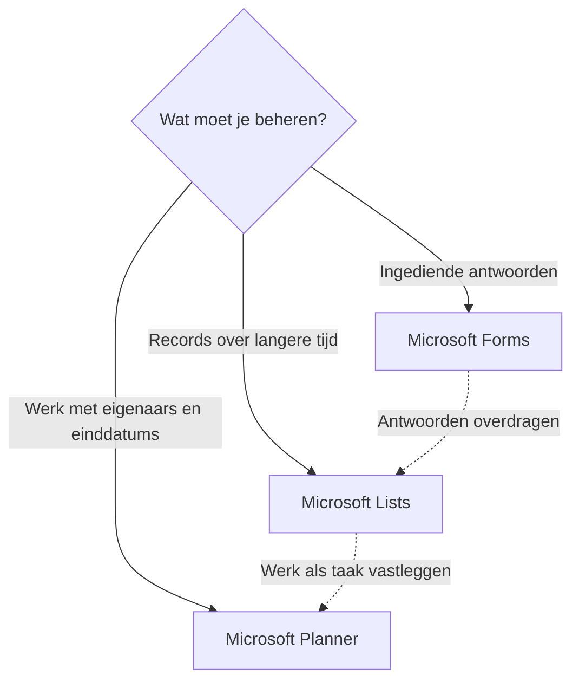

# Forms, Lists of Planner?

Forms, Lists en Planner kunnen alle drie informatie vastleggen, maar dienen verschillende doelen.

## Kort antwoord

Gebruik Forms om antwoorden te verzamelen. Gebruik Lists om gestructureerde records te volgen. Gebruik Planner om werk met verantwoordelijken, einddatums en voortgang te beheren.

## Keuzestroom

## Gebruik Forms wanneer

Gebruik [Microsoft Forms](../services/forms.md) wanneer mensen informatie indienen en de indiener het antwoord daarna niet hoeft te beheren.

Voorbeelden zijn enquêtes, registraties, feedback, quizzen, eenvoudige intake en korte peilingen.

## Gebruik Lists wanneer

Gebruik [Microsoft Lists](../services/lists.md) wanneer de organisatie een verzameling items langere tijd moet volgen.

Voorbeelden zijn bedrijfsmiddelenregisters, probleemoverzichten, aanvraagoverzichten, inhoudsinventarissen en gestructureerde operationele gegevens.

## Gebruik Planner wanneer

Gebruik [Microsoft Planner](../services/planner.md) wanneer elk item werk is dat iemand moet uitvoeren.

Voorbeelden zijn teamtaken, campagnechecklists, taakborden voor kleine projecten, onboardingplannen en terugkerend operationeel werk.

## Een praktisch patroon

Gebruik Forms voor intake, Lists voor het record dat opvolging nodig heeft en Planner voor werk dat uit dat record ontstaat. Gebruik alleen de stappen die het proces nodig heeft. Wijs iemand aan die elke overdracht handmatig of automatisch verzorgt en controleert of die werkt.

## Gerelateerde gidsen

- [Informatie verzamelen](../scenarios/collect-information.md)
- [Taken en werk beheren](../scenarios/manage-tasks-and-work.md)
