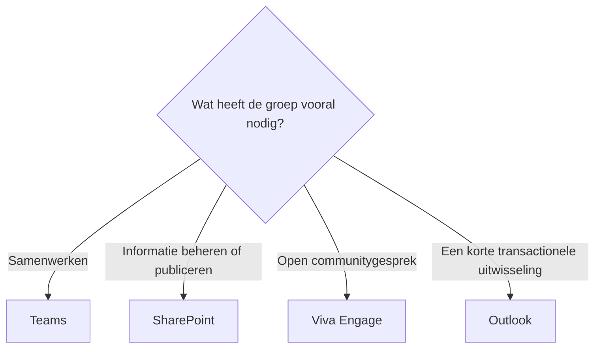

# Welk samenwerkingshulpmiddel moet ik gebruiken?

Samenwerkingshulpmiddelen in Microsoft 365 overlappen bewust. De juiste keuze hangt af van de relatie tussen de betrokken mensen.

## Kort antwoord

Gebruik Teams wanneer mensen samenwerken, kort in een chat of langer in een Team. Gebruik SharePoint om informatie voor de bedoelde doelgroep te organiseren, beheren of publiceren. Gebruik Viva Engage voor open communitygesprekken. Gebruik Outlook voor een korte transactionele uitwisseling.

## Beslisstroom

## Kies Teams voor actief werk

In Teams staan mensen die samenwerken centraal. Begin bij een informele behoefte in een chat of vergadering. Maak een Team wanneer mensen terugkerende samenwerking, gedeelde onderwerpen, hulpmiddelen en eigenaarschap nodig hebben.

Gebruik een Team voor projecten, afdelingen, werkgroepen en andere langdurige samenwerkingen. Bekijk [Informele en gestructureerde samenwerking in Teams](../services/teams/ad-hoc-and-structured-collaboration.md).

## Kies SharePoint voor inhoud

In SharePoint staat informatie centraal die structuur, eigenaarschap, toegang, publicatie, metagegevens of een langere levenscyclus nodig heeft. De doelgroep kan een samenwerkend Team, een afdeling of de hele organisatie zijn.

Gebruik het voor intranetpagina's, kennisbanken, documentbibliotheken, beleidsstukken, sjablonen en gepubliceerde bronnen.

## Kies Viva Engage voor community

Viva Engage is het sterkst wanneer een gesprek zichtbaar moet zijn buiten één team. Het werkt goed voor updates van leidinggevenden, vakcommunities, medewerkersbetrokkenheid en vragen die baat hebben bij een breed publiek.

Gebruik het wanneer ontdekken en deelnemen belangrijker zijn dan taakuitvoering.

## Kies Outlook voor korte transacties

E-mail heeft nog steeds een plaats. Gebruik Outlook wanneer een bericht kortdurend is, aan specifieke personen is gericht en geen gedeelde werkruimte of patroon voor langdurige samenwerking nodig heeft.

Wordt de uitwisseling blijvende samenwerking, ga dan verder in Teams. Geef informatie die een beheerde of gepubliceerde plek nodig heeft een passende SharePoint-site.

## Gerelateerde handleidingen

- [Teams](../services/teams/index.mdx)
- [SharePoint](../services/sharepoint/index.mdx)
- [Viva Engage](../services/viva-engage.md)
- [Teams of Viva Engage?](./teams-or-viva-engage.md)
