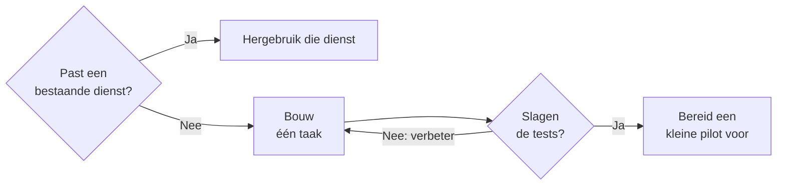

# Bouwen met Copilot Code

Gebruik Copilot Code als je eigen software nodig hebt en de gewenste werking kunt beschrijven. Begin met een kleine taak en test het resultaat. Hergebruik een bestaande dienst als die al voldoet.

[Microsofts uitleg over Code](https://learn.microsoft.com/nl-nl/copilot/code/use-code) behandelt apps, dashboards, statische websites, gegevensbewerkingen en scripts. Je beschrijft het gewenste resultaat in gewone taal. Code bouwt een eerste versie die je kunt testen en aanpassen. Je kunt zonder programmeerervaring beginnen, maar iemand moet het resultaat controleren.

Gebruik deze gids om een aanpak te kiezen, eisen te beschrijven en een oplossing te testen. Ga verder met [Copilot-apps publiceren en beheren](./managed-apps.mdx) als je collega's een gedeelde app wilt laten gebruiken.

## Kies het werk voordat je bouwt {#choose-the-work-before-building}

Gebruik [Chat](./assist.md) om samen met een persoon te schrijven of analyseren. Gebruik [Cowork](./delegate.md) voor werk over bestanden en diensten heen. Kies Code als je software nodig hebt die je opnieuw kunt gebruiken. Beoordeel ook Power Automate voor een vaste overdracht met duidelijke regels. Gebruik Cowork wanneer het interpreteren van het materiaal waarde toevoegt.

Een tekenteller kan een bruikbare eerste proef zijn. Een gedeeld contentbord vraagt meer. Gegevens moeten beschikbaar blijven nadat mensen de app sluiten. Controleer vóór het bouwen of [Microsoft Lists](../lists.md) en bestaande weergaven het probleem al oplossen.

Ik zou deze vertrekpunten vergelijken. De mogelijkheden overlappen:

| Behoefte | Vertrekpunt dat ik zou beoordelen | Belangrijkste beheervraag |
| --- | --- | --- |
| Een klein eigen hulpmiddel, script of dashboard | Copilot Code | Kan iemand de uitvoer controleren en het hulpmiddel onderhouden? |
| Een eigen interface voor gedeelde teamgegevens | Copilot Code met Managed Runtime | Kan het team de code, gegevensregels en releases ondersteunen? |
| Formulieren en taakschermen die Power Platform-makers beheren | Power Apps-canvas-apps | Ondersteunt het team de besturingselementen, formules en verbindingen al? |
| Een proces rond gerelateerde bedrijfsgegevens | Modelgestuurde Power Apps-apps met Dataverse | Zijn het gegevensmodel en de beveiligingsrollen goed ontworpen? |
| Een agent die vragen beantwoordt of acties uitvoert | [Agent Builder of Copilot Studio](./build.md) | Wie onderhoudt kennis, acties en tests? |
| Software met een ontwikkelteam en eigen AI-diensten | [GitHub Copilot en Microsoft Foundry](./develop.md) | Wie beheert architectuur, uitrol en ondersteuning? |

Microsofts [Power Apps-overzicht](https://learn.microsoft.com/nl-nl/power-apps/maker/) behandelt canvas-apps en bouwen met AI. De [uitleg over modelgestuurde apps](https://learn.microsoft.com/nl-nl/power-apps/maker/model-driven-apps/model-driven-app-overview) beschrijft Dataverse-relaties en releases via oplossingen. Alleen het gebruik van prompts bepaalt dus niet welk product past.

[Copilot Studio heeft ook een preview voor appcreatie](https://learn.microsoft.com/nl-nl/microsoft-copilot-studio/apps-experience/create-app). Die apps draaien op Managed Runtime. Studio ondersteunt verschillende soorten oplossingen. Controleer daarom welke ervaring je vergelijkt. Neem niet aan dat elke Studio-agent de appruntime gebruikt.

Als Code bij de taak past, zou ik deze route volgen. Hergebruik komt eerst. Test de eigen oplossing voordat je een pilot voorbereidt.

## Beschrijf de behoefte voordat je bouwt {#define-the-need-before-building}

Leg vast wie de oplossing gebruikt en wat zij willen bereiken. Benoem de gegevensbron en wie die mag wijzigen. Beschrijf hoe je het resultaat controleert.

Voor een contentbord zou ik eerst het volgende afspreken:

- Het team gebruikt één bestaande SharePoint-lijst voor de gegevens.
- Elk item heeft een titel, eigenaar, status en publicatiedatum.
- Bewerkers mogen items wijzigen. Lezers mogen ze alleen bekijken.
- Een opgeslagen statuswijziging blijft zichtbaar nadat de app opnieuw opent.
- Een mislukte opslagactie geeft een duidelijke melding.

Begin met één volledige taak. Laat een bewerker bijvoorbeeld de status van een item wijzigen. Bewaar automatische invoer, herinneringen en handmatige kaartvolgorde voor later.

Dit is een voorbeeld van een eerste opdracht aan Code:

> Bouw een contentbord voor ons communicatieteam. Begin met voorbeeldgegevens. Toon de titel, eigenaar, status en publicatiedatum van elk item. Laat een bewerker een item van Concept naar Beoordeling verplaatsen. Lezers mogen items alleen bekijken. Toon of het opslaan lukt. Later willen we een bestaande SharePoint-lijst gebruiken. Leg uit waar deze eerste versie de gegevens bewaart.

Dit zijn eisen die je moet testen. Een prompt dwingt geen rechten af en bewijst geen juiste gegevensopslag. Controleer beide voordat je de echte lijst koppelt.

## Kies waar je bouwt

Code ondersteunt lokale projecten en cloudprojecten. Microsofts [vergelijking van lokaal en in de cloud bouwen](https://learn.microsoft.com/nl-nl/copilot/code/overview#build-locally-or-in-the-cloud) beschrijft de opties:

| Bouwlocatie | Wanneer ik die zou beoordelen | Wat je controleert |
| --- | --- | --- |
| Lokale projectmap | Een hulpmiddel dat met bestanden op je apparaat werkt | Welke bestanden Code kan wijzigen, wat het installeert en hoe je een herstelbare kopie bewaart |
| Cloudproject | Een project dat je op meerdere apparaten gebruikt of wilt delen | Waar het project en de gegevens staan, en hoe de doelgroep het gebruikt |

Beoordeel de bouwlocatie en de uiteindelijke hosting afzonderlijk. Een cloudproject betekent op zichzelf geen gedeelde gegevensopslag of ondersteunde teamdienst. Bekijk voor interactieve teamapps de uitleg over [publiceren naar Managed Runtime](./managed-apps.mdx#publish-to-a-shared-runtime).

Gebruik een aparte lokale map met kopieën van testbestanden. [Code kan lezen en schrijven binnen projectmappen die al in gebruik zijn](https://learn.microsoft.com/nl-nl/copilot/code/use-code#stay-in-control). Standaard vraagt het toestemming voor netwerkverzoeken, terminalopdrachten en toegang buiten die mappen. Beoordeel elk verzoek op basis van de taak. De instelling *Always allow* blijft actief totdat je die uitschakelt, ook voor nieuwe sessies.

## Bepaal gegevensregels {#define-data-rules}

Een verzoek om een Kanban-bord beschrijft een interface. Je moet ook bepalen wat er met de gegevens gebeurt. Voor het contentbord verandert een kaartverplaatsing de status. Voeg een positieveld en wijzigingsregels toe om een handmatige volgorde binnen een kolom te bewaren.

Gebruik vaste item-ID's, zodat een gewijzigde titel naar hetzelfde item blijft verwijzen. Bepaal de toegestane statussen, een eigenaar en publicatiedatums. Beslis wat er gebeurt als twee collega's hetzelfde item wijzigen. Toon mislukte opslagacties duidelijk. Anders zien gebruikers een verplaatste kaart misschien als een opgeslagen wijziging.

Houd één leidende gegevensbron aan, de plek waar het team de gegevens onderhoudt. Hergebruik de bestaande lijst. Maak geen extra kopie voor de nieuwe interface. Kies de site en het toegangsmodel met [SharePoint-inhoudsstructuur en machtigingen](../sharepoint/sharepoint-content-structure.md).

Ik zou SharePoint kiezen voor een kleine teamtracker met duidelijk eigenaarschap. Heroverweeg het gegevensplatform als gerelateerde gegevens, complexe toegangsregels of meerdere afhankelijke wijzigingen centraal komen te staan. Een eigen interface kan een zwak gegevensontwerp minder zichtbaar maken.

Spreek af welk materiaal op het bord hoort als Cowork gegevens aanlevert. Houd persoonlijke notities gescheiden van goedgekeurde teaminformatie. Neem alleen over wat het team nodig heeft, met bron en selectiedatum. Test dubbele vermeldingen en gemiste uitvoeringen. Gebruik de [beheercontroles voor gekoppelde apps](./managed-apps.mdx#check-data-connections-and-permissions) voordat je deze overdracht inschakelt.

## Bouw en test in kleine stappen {#build-and-test-in-small-steps}

Microsoft adviseert [eenvoudig te beginnen en gericht te wijzigen](https://learn.microsoft.com/nl-nl/copilot/code/use-code#iterate-and-revert). Vraag Code waar het gegevens bewaart en wat elke verbinding doet. Test het resultaat zelf. Ook de uitleg van Code moet je controleren.

1. Bouw de eerste taak met voorbeeldgegevens.
2. Voer die uit als de bedoelde gebruiker. Controleer de uitvoer of het opgeslagen item.
3. Beschrijf één wijziging en herhaal daarna de eerste taak.
4. Test uitzonderingen voordat je functies toevoegt.
5. Houd eisen, wijzigingen en resultaten kort bij.

Voor het contentbord zou ik deze controles opnemen:

| Test | Te bevestigen resultaat |
| --- | --- |
| Verplaats een kaart, sluit de app en open die opnieuw | De opgeslagen status komt overeen met het bord. |
| Laat verplichte informatie leeg | De app legt uit wat je moet corrigeren. |
| Probeer een opslagactie die mislukt | De app meldt de fout en bewaart waar mogelijk het werk van de gebruiker. |
| Wijzig hetzelfde item met twee gebruikers | De app handelt het conflict af volgens de afgesproken regel. |
| Gebruik een lezersaccount | De gebruiker kan toegestane items bekijken en niet wijzigen. |
| Gebruik een account zonder bronrechten | De gebruiker kan de brongegevens niet lezen of wijzigen. |
| Wijzig één functie | Bestaande taken blijven werken. |

Vergelijk voor een script of gegevensbewerking bekende invoer met verwachte uitvoer. Neem lege bestanden, ongeldige waarden en een mislukte uitvoering mee. Controleer of opnieuw uitvoeren dubbele gegevens maakt of nuttige informatie overschrijft. Gebruik kopieën totdat je de gevolgen begrijpt.

:::warning[Controleer voordat je deelt]

Een werkend prototype vraagt nog om beoordeling. Laat de verantwoordelijken gegevenstoegang, bedrijfsregels en ondersteuning controleren voordat anderen ervan afhankelijk worden. Een preview-URL betekent niet dat je aparte testgegevens gebruikt.

:::

## Bereid gedeeld gebruik voor {#prepare-shared-use}

Wijs vóór een teampilot een proceseigenaar en appbeheerder aan. De proceseigenaar bepaalt of de werking klopt. De appbeheerder heeft toegang en kennis nodig om fouten te herstellen. Spreek af wie gebruikers ondersteunt, wijzigingen goedkeurt en de oplossing uitfaseert.

Leg eisen, gegevensregels, verbindingen, testresultaten en de bronlocatie vast. Bewaar een werkende versie en spreek een terugvaloptie af. Voor het bord kan dat tijdelijk de bestaande lijstweergave zijn. Test of een andere beheerder het werk kan voortzetten.

[Code bewaart projecten automatisch. Publiceren is een aparte actie](https://learn.microsoft.com/nl-nl/copilot/code/use-code#publish-your-app). Volg [Copilot-apps publiceren en beheren](./managed-apps.mdx) voordat je een app beschikbaar maakt. Die gids behandelt runtimetoegang, bronrechten, releasecontroles, overdracht aan een ontwikkelaar en herstel. Een app delen geeft geen toegang tot gekoppelde gegevens.

## Controleer previewtoegang en kosten

Code vereist Frontier-toegang. Controleer voor organisatiegebruik het ondersteunde account, de licentie, het platform en het ingeschakelde Code-tabblad in [Microsofts voorwaarden voor Code](https://learn.microsoft.com/nl-nl/copilot/code/code-requirements). Een GitHub-koppeling is optioneel. Je kunt zonder GitHub-account bouwen.

Code gebruikt ook [facturering naar verbruik met Copilot Credits](https://learn.microsoft.com/nl-nl/microsoft-365/copilot/user-subscription-license-usage-based-billing). Een gebruikerslicentie en uitgavenbeleid van een beheerder zijn vereist. Begroot naast de eerste versie ook tests, mislukte pogingen en latere wijzigingen.

Een gepubliceerde app uitvoeren vereist aparte dekking. Controleer [appfinanciering en runtimekosten](./managed-apps.mdx#budget-for-building-and-running) met de budgethouder. Gebruik [Licenties en kosten](./licensing-and-costs.md) voor de bredere licentiekeuze.

:::warning[Controleer de voorwaarden per preview]

Code en Managed Runtime hebben previewvoorwaarden. Microsofts [Copilot Studio-apppreview is niet bedoeld voor productiegebruik](https://learn.microsoft.com/nl-nl/microsoft-copilot-studio/apps-experience/create-app). Controleer elke ervaring afzonderlijk. Ik zou een pilot buiten kritieke processen houden. Spreek een terugvaloptie af voordat je met een team test.

:::

## Officiële Microsoft-documentatie

- [Toegang tot Code, accounts en ondersteunde platforms controleren](https://learn.microsoft.com/nl-nl/copilot/code/code-requirements).
- [Een oplossing beschrijven, bouwen, testen, publiceren en delen](https://learn.microsoft.com/nl-nl/copilot/code/use-code).
- [Lokale projecten en cloudprojecten vergelijken](https://learn.microsoft.com/nl-nl/copilot/code/overview#build-locally-or-in-the-cloud).
- [Copilot-licenties en facturering naar verbruik begrijpen](https://learn.microsoft.com/nl-nl/microsoft-365/copilot/user-subscription-license-usage-based-billing).

## Gerelateerde gidsen

- [Copilot-apps publiceren en beheren](./managed-apps.mdx)
- [Copilot-overzicht](./index.mdx)
- [Een agent bouwen](./build.md)
- [Ontwikkelen met AI](./develop.md)
- [Machtigingen en eigenaarschap](../../admin-and-governance/permissions-and-ownership.md)
- [Microsoft Lists](../lists.md)
