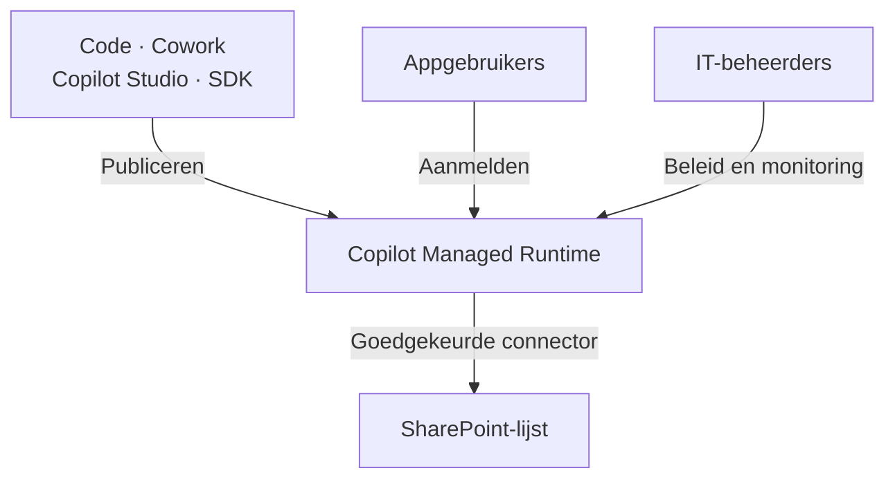
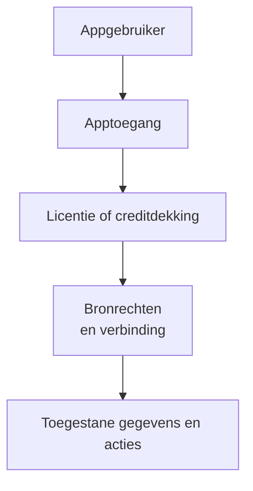

# Copilot-apps publiceren en beheren

Behandel een gedeelde Copilot-app als een te beheren teamdienst. Bepaal de gegevensregels, toegang, eigenaar, ondersteuning en het budget. Doe dat voordat collega's ervan afhankelijk worden. Hergebruik een bestaande lijst of applicatie als die al voldoet.

Gebruik deze gids voor publiceren, SharePoint-verbindingen, rechten, monitoring, kosten en platformkeuzes. Begin bij [Copilot Code](./code.md) als je eerst een oplossing wilt beschrijven en controleren.

:::info[Controleer previewtoegang]

[Copilot Code vereist Frontier-toegang](https://learn.microsoft.com/nl-nl/copilot/code/use-code). [Copilot Managed Runtime is beschikbaar als openbare preview](https://learn.microsoft.com/nl-nl/microsoft-365/managed-apps/). Controleer de voorwaarden en beschikbaarheid voor je tenant voordat je een uitrol plant.

:::

## Kies het werk voordat je bouwt

Gebruik [Chat](./assist.md) om samen met een persoon te schrijven of analyseren. Gebruik [Cowork](./delegate.md) voor een taak over bestanden en diensten heen. Bouw een app wanneer mensen een herbruikbare interface nodig hebben. Bewaar gedeelde resultaten op de afgesproken teamlocatie en wijs een eigenaar aan.

Bepaal selectieregels als Cowork gegevens aan de app toevoegt. Beslis hoe je dubbele vermeldingen en gemiste uitvoeringen afhandelt. Houd persoonlijke notities gescheiden van goedgekeurde teaminformatie. Neem alleen over wat het team nodig heeft, met bron en selectiedatum. Beoordeel ook Power Automate voor een vaste overdracht met duidelijke regels. Gebruik Cowork wanneer het interpreteren van het materiaal waarde toevoegt.

## Publiceer naar een gedeelde runtime

Een tekenteller zonder blijvende gegevensopslag is een bruikbare kleine test. Een gedeeld contentbord stelt een extra eis: wijzigingen moeten bewaard blijven en beschikbaar zijn voor collega's. Een aantrekkelijke preview bewijst die werking niet.

[Microsofts uitleg over Code](https://learn.microsoft.com/nl-nl/copilot/code/use-code) maakt onderscheid tussen bouwen en publiceren. Een project opslaan publiceert het niet. Publiceren maakt de nieuwste versie beschikbaar voor de mensen met wie je de app deelt. Ik zou dat moment gebruiken voor een korte releasecontrole. Test de wijziging, leg haar vast en publiceer daarna.

De runtime is de omgeving die de app host en uitvoert. [Copilot Managed Runtime](https://learn.microsoft.com/nl-nl/microsoft-365/managed-apps/) biedt één bestemming voor apps uit Code, Cowork, Copilot Studio en de ontwikkelhulpmiddelen (SDK). Gebruikers vinden beschikbare apps op `managedapps.cloud.microsoft`. Je kiest het bouwhulpmiddel en het platform voor uitvoering afzonderlijk.

Dit diagram vat die relaties samen:

Microsofts [aankondiging van de runtime](https://www.microsoft.com/nl-nl/copilot/blog/copilot-studio/build-where-you-want-run-with-confidence-now-microsoft-hosts-and-manages-the-code-created-by-copilot/) beschrijft hosting door Microsoft, Microsoft Entra-identiteit, Git-bronbeheer en beleidshandhaving. Teams kunnen verschillende bouwhulpmiddelen gebruiken. IT beheert hun gehoste apps op dezelfde plek.

Dat vraagt ook om een praktische overdracht. Een ontwikkelaar moet mogelijk onderhouden wat een zakelijke gebruiker begon. Leg de broncode, actieve versie, gegevensverbindingen en het supportcontact vast. Test hoe een andere beheerder het werk overneemt voordat de maker vertrekt.

## Bepaal gegevensregels en SharePoint-rechten

Neem een contentbord dat zijn gegevens in SharePoint bewaart. Een kaart naar een andere kolom verplaatsen verandert de status. Een handmatige volgorde binnen een kolom bewaren vereist ook een positieveld en wijzigingsregels.

Een verzoek om een Kanban-bord beschrijft een interface. Het legt niet volledig vast hoe de gegevens zich moeten gedragen.

Voor dit bord zou ik vaste item-ID's, toegestane statussen, een eigenaar en publicatiedatums vastleggen. Bepaal wat er gebeurt als twee collega's hetzelfde item aanpassen. Toon mislukte opslagacties duidelijk. Anders zien gebruikers een verplaatste kaart misschien als een opgeslagen wijziging.

Begin met de bestaande [uitleg over Microsoft Lists](../lists.md). Een beheerde lijst met bestaande weergaven kan al voldoen. Voeg een eigen app toe als die een concreet probleem oplost. Gebruik dezelfde leidende gegevensbron. Maak geen extra kopie voor de nieuwe interface. Kies de site en het toegangsmodel voor de lijst met [SharePoint-inhoudsstructuur en machtigingen](../sharepoint/sharepoint-content-structure.md).

Delen vraagt om afzonderlijke toegangsbeslissingen. [Microsofts uitleg over apps delen](https://learn.microsoft.com/nl-nl/microsoft-365/managed-apps/developer/share-app) onderscheidt apptoegang van toegang tot gekoppelde gegevens. Een app delen met een collega geeft geen SharePoint-rechten. Gebruikers moeten mogelijk ook hun verbinding instellen.

De volgende flow vat de controles voor een gekoppelde app samen. Toegang tot de runtime vereist een geschikte licentie of creditdekking.

Test met het account van een gewone collega. Neem iemand mee die gegevens mag lezen, maar niet wijzigen. Test ook met iemand zonder toegang tot de lijst. Controleer na elke actie het echte resultaat in SharePoint.

:::warning[Een verborgen knop neemt geen rechten weg]

Behandel een verborgen knop of gefilterd scherm niet als beveiligingsregel. Dwing toegang af bij de gegevensbron. Beoordeel [rechten en eigenaarschap](../../admin-and-governance/permissions-and-ownership.md) voordat je gevoelige gegevens koppelt.

:::

Ik zou SharePoint kiezen voor een afgebakende teamregistratie met duidelijk eigenaarschap. Beoordeel het gegevensplatform opnieuw wanneer gerelateerde gegevens, complexe toegangsregels of meerdere afhankelijke wijzigingen centraal staan. Een eigen interface kan zwak gegevensontwerp minder zichtbaar maken.

## Beoordeel beheer en inzicht {#review-governance-and-visibility}

Centraal beheer maakt deze apps beter vindbaar. Het geeft IT ook een plek om in te grijpen. Een app vinden verklaart echter niet elke actie die deze kan uitvoeren.

Microsoft beschrijft [standaard beheerregels](https://learn.microsoft.com/nl-nl/microsoft-365/admin/manage/apps/governance) voor routering, connectors, delen en browserinhoud. Je kunt connectoracties afzonderlijk beperken. Zo kan de SharePoint-connector beschikbaar blijven terwijl de vrije HTTP-aanvraagactie is geblokkeerd. Beoordeel bij het goedkeuren van een connector daarom ook de toegestane acties.

De huidige beheerweergave heeft beperkingen:

| Wat een beheerder kan beoordelen | Wat nog controle vraagt |
| --- | --- |
| Appinventaris en Data & tools | Exacte bestemmingen, dynamische eindpunten, uitgevoerde acties en effectieve bronrechten per gebruiker zijn daar niet volledig zichtbaar. |
| Weergave van connectorbeleid | Bestaand klassiek gegevensbeleid kan de effectieve toegang veranderen. Controleer ook het Power Platform-beheercentrum. |
| Technische werking en gebruik | Een technisch geslaagde wijziging kan toch de verkeerde bedrijfsregel toepassen. |
| Apptoegang en blokkeren | Het intrekken van apptoegang verwijdert niet alle onderliggende bronrechten. |

Deze toegangs- en inzichtsbeperkingen staan in [Microsofts veelgestelde vragen over de runtime](https://learn.microsoft.com/nl-nl/microsoft-365/admin/manage/apps/faq-about-apps). Controleer naast de inventaris ook de echte gegevensverbindingen en rechten.

:::warning[De beleidsweergave kan misleiden]

Microsoft beschrijft een [bekende beperking bij bestaande omgevingsgroepen](https://learn.microsoft.com/nl-nl/microsoft-365/admin/manage/apps/governance#known-limitations). Een weergave zonder toegestane connectors kan wijzen op ontbrekend geavanceerd connectorbeleid. Dat betekent niet automatisch dat connectors geblokkeerd zijn. Controleer het effectieve beleid voordat je op die weergave vertrouwt.

:::

[Monitoring van de runtime](https://learn.microsoft.com/nl-nl/microsoft-365/managed-apps/developer/monitor-apps) omvat centrale technische bewaking en waarschuwingen. Apps kunnen ook runtimegegevens naar een gekozen monitoringdienst sturen. Spreek af welke fouten een waarschuwing vereisen en wie reageert. Voorkom dat dagboektekst of andere gevoelige inhoud in logboeken komt.

Voor het contentbord zou ik mislukte opslagacties, verouderde gegevens en herhaalde automatiseringsfouten controleren. Daarnaast zou ik steekproeven nemen op geselecteerde ideeën. Voldoen ze aan de teamafspraken? Technische meetgegevens kunnen die redactionele keuze niet beoordelen.

Wijs een proceseigenaar, gegevenseigenaar en appbeheerder aan. Eén persoon kan meerdere rollen hebben. Leg vast wie wijzigingen goedkeurt, toegang beoordeelt en de app stopt. Bespreek bij uitfasering ook geplande taken, bronrechten en te bewaren gegevens.

## Ondersteun wijzigingen en incidenten {#support-changes-and-incidents}

Een gepubliceerde update kan eerder werkend gedrag verstoren. Dat heet een regressie. Een bord kan bijvoorbeeld nog openen terwijl statuswijzigingen niet meer goed worden opgeslagen. Een geslaagde build bewijst niet dat de werkwijze van het team nog werkt.

Spreek ondersteuning af voordat het team afhankelijk wordt van de app. Ik raad de volgende verdeling aan. Mensen kunnen meerdere rollen hebben. Ontwikkelondersteuning kan van ICT of een afgesproken leverancier komen.

| Rol | Verantwoordelijkheid |
| --- | --- |
| Proceseigenaar of KeyUser | Bepaalt de juiste werking, controleert belangrijke werkpaden en accepteert een herstelde versie. |
| Appbeheerder of ontwikkelaar | Onderhoudt broncode, test wijzigingen, publiceert releases en bereidt codeherstel voor. |
| ICT-platform- of serviceteam | Beheert tenantinstellingen, toegang, connectors en platformwerking; coördineert escalatie bij dienststoringen. |

Leg de app-ID, actieve URL, eigenaren, ondersteuningsroute, bronlocatie en gepubliceerde versie vast. Spreek af welke reparaties ICT ondersteunt en wie de rest afhandelt. Een tenantbeheerder is niet automatisch de ontwikkelaar van de app. Reserveer ontwikkeltijd als ICT codeonderhoud op zich neemt. Spreek af wie dat werk financiert en hoe spoedreparaties worden afgehandeld. Gebruik [Machtigingen en eigenaarschap](../../admin-and-governance/permissions-and-ownership.md) voor verantwoordelijkheden en continuïteit.

### Controleer bestaande werking voordat je publiceert

Houd een korte lijst bij met taken die moeten werken. Gebruik die bij elke release. Test lezen, toevoegen en wijzigen, leestoegang, mislukte opslagacties en gelijktijdige aanpassingen. Controleer de bestaande werkwijze naast de gevraagde wijziging. Gebruik een testlijst met voorbeeldgegevens. Een preview-URL betekent op zichzelf niet dat je aparte testgegevens gebruikt.

Microsoft beschrijft [aparte preview- en liveversies](https://learn.microsoft.com/nl-nl/microsoft-365/managed-apps/developer/dev-inner-loop). Het opdrachtregelhulpmiddel (CLI) gebruikt een ontwikkelpreview die schrijfrechten op de repository vereist. De repository bewaart code en de versiegeschiedenis. Spreek een testroute af voor zakelijke beoordelaars die deze rechten niet horen te hebben. Voor apps met Git-bronbeheer kan `ms app deploy --commit <sha>` een eerdere codeversie publiceren. Leg een werkende herstelversie vast en test die voordat je een wijziging publiceert.

### Regel overdracht aan een ontwikkelaar

Microsoft beschrijft [een bestaande app verder ontwikkelen in een code-editor](https://learn.microsoft.com/nl-nl/microsoft-365/managed-apps/developer/collaborate-on-app). De appeigenaar moet bewerkrechten geven. Een ontwikkelaar kan daarna een platformbeheerde repository kopiëren (klonen) met `ms app clone --app <app-id>`. Externe GitHub-repositories vereisen repositorytoegang en `git clone`. Apps zonder broncodekoppeling kunnen deze kloonroute niet gebruiken.

Test de overdracht voor de gekozen app vóór een incident. Geef de beheerder toegang tot eisen, gegevensmodel, verbindingen en releasegeschiedenis. Broncode alleen verklaart niet waarom een bedrijfsregel bestaat.

### Los een storing na een update op

1. Noteer de app, huidige en laatst werkende versies, het tijdstip, getroffen gebruikers en stappen om de fout te herhalen. Beschrijf de verwachte en werkelijke werking.
2. Pauzeer nieuwe releases. Beoordeel of verkeerde schrijfacties het stoppen van werk vereisen. Spreek een tijdelijke werkwijze af met de proceseigenaar.
3. Vergelijk code, lijstkolommen, rechten, verbindingen en uitgavenlimieten. Gebruik de [uitleg over monitoring](#review-governance-and-visibility) om platformstoringen van app- of gegevensproblemen te onderscheiden. Technische meetgegevens bevestigen op zichzelf geen juiste bedrijfsuitkomsten.
4. Herstel een passende codeversie of publiceer een geteste reparatie. Laat de proceseigenaar het hele werkpad controleren voordat het werk hervat. Escaleer platformstoringen met de verzamelde informatie via de ondersteuningsroute van de organisatie.

:::warning[Codeherstel herstelt geen gegevens]

Oudere code publiceren draait gewijzigde records of lijstkolommen niet terug. Controleer vóór het terugzetten of de code past bij de huidige gegevens. Plan gegevensherstel apart met de gegevenseigenaar. SharePoint kan [eerdere itemversies herstellen als versiebeheer is ingeschakeld](https://support.microsoft.com/nl-nl/sharepoint/documents-and-library/restore-a-previous-version-of-an-item-or-file-in-sharepoint). Controleer wat je kunt herstellen voordat je gegevens of hun structuur wijzigt.

:::

## Begroot bouwen en uitvoeren {#budget-for-building-and-running}

Copilot Credits meten het toepasselijke verbruik. Een capacity pack levert vooruitbetaalde credits. Pay-as-you-go rekent creditverbruik af via een Azure-abonnement. Gebruik Microsofts term *Copilot Credit capacity pack* wanneer je vooruitbetaalde capaciteit aanvraagt.

Microsoft beschrijft deze [opties voor credits kopen en factureren](https://learn.microsoft.com/nl-nl/microsoft-365/copilot/usage-based-billing-compare-dashboard-views):

| Financieringsroute | Hoe die het toepasselijke verbruik betaalt |
| --- | --- |
| Vooruitbetaalde capacity packs | Het verbruik gaat af van een vooraf gekocht credittegoed. |
| Copilot Credit Pre-purchase Plan (P3) | Je koopt vooraf credits via een gekoppeld Azure-abonnement. |
| Pay-as-you-go | Het toepasselijke creditverbruik wordt berekend via een gekoppeld Azure-abonnement. |

Een beheerder moet [facturering naar verbruik inschakelen en uitgavenbeleid instellen](https://learn.microsoft.com/nl-nl/microsoft-365/copilot/usage-based-billing-copilot-credits-setup) voor de bedoelde gebruikers en diensten. Controleer de beschikbare capaciteit. Credits die aan Power Platform-omgevingen zijn toegewezen, verminderen het elders beschikbare tegoed. P3 vult pay-as-you-go aan. Na verbruik van het P3-tegoed loopt de facturering door naar verbruik. Capacity packs kunnen bij de juiste instellingen ook terugvallen op pay-as-you-go. Stel limieten en waarschuwingen in voordat je breed gebruik inschakelt.

Schat de kosten voor bouwen en doorlopend gebruik afzonderlijk. Een geslaagde eerste versie bepaalt de maandkosten nog niet. Meet het volgende tijdens een pilot:

| Kostenonderdeel | Wat je tijdens een pilot meet |
| --- | --- |
| Bouwen en aanpassen | Eerste versie, mislukte pogingen, testen en latere wijzigingen |
| Gepland Cowork-werk | Uitvoeringen, interpretatiewerk, nieuwe pogingen en controle |
| Appuitvoering | Gebruikersactiviteit en aanroepen naar gekoppelde diensten |
| Aanvullende diensten | Apart berekende AI-diensten en eventuele monitoringmiddelen |

Voor organisatiegebruik [vereisen Code en Cowork een gebruikerslicentie en facturering naar verbruik](https://learn.microsoft.com/nl-nl/microsoft-365/copilot/user-subscription-license-usage-based-billing). Credits vervangen die licentie niet.

Voor het uitvoeren van de gebouwde app gelden andere regels. Microsofts [veelgestelde vragen over runtimelicenties](https://learn.microsoft.com/nl-nl/microsoft-365/admin/manage/apps/licensing-faq) noemen Power Apps Premium of Copilot Credits. Gebruikers hebben geen Microsoft 365 Copilot-licentie nodig om alleen de app uit te voeren. De inbegrepen Power Apps-rechten in Microsoft 365 dekken deze runtime niet.

Dezelfde uitleg noemt 0,1 credit per runtime-API-aanroep. Power Apps Premium dekt runtimegebruik binnen de toepasselijke aanvraaglimieten. Gebruik boven die limieten en gespecialiseerde diensten kunnen extra kosten geven.

Ter illustratie: 10.000 gemeten runtimeaanroepen verbruiken 1.000 credits. Tegen het [pay-as-you-go-tarief van $0,01 USD uit Microsofts Copilot Credits Guide](https://www.microsoft.com/licensing/guidance/CopilotCreditsGuide) is dat $10 USD. Gebruik deze rekensom om de verbruiksmeting te begrijpen. Meet aanroepen tijdens echt gebruik voordat je een maandbedrag schat.

[Kosten voor bouwen en uitvoeren worden afzonderlijk beheerd](https://learn.microsoft.com/nl-nl/microsoft-365/admin/manage/apps/). Controleer de dekking voor gebruikers van de gepubliceerde app. Het budget van de maker geeft niet automatisch runtimedekking voor het hele team.

Gebruik [uitgavenbeleid](https://learn.microsoft.com/nl-nl/microsoft-365/copilot/usage-based-billing-manage-copilot-credits) voor de bedoelde gebruikers en diensten. Stel limieten en waarschuwingen in. Bespreek het verbruik daarna met de budgethouder. Controleer overlappend beleid en of toekomstige diensten automatisch worden toegevoegd. Beoordeel toegangsbeperkingen los van de uitgavenbeslissing. Gebruik [Licenties en kosten](./licensing-and-costs.md) om abonnementen en creditfinanciering met de budgethouder te vergelijken.

## Vergelijk platforms en plan een pilot

Ik zou een bestaande Power Apps-oplossing niet vervangen omdat een nieuw bord mooier oogt. Vergelijk eerst de vereiste gegevensregels, beheerkennis, het releaseproces en de gebruikskosten.

Dit zijn mijn vertrekpunten voor de keuze. De mogelijkheden van de hulpmiddelen overlappen:

| Behoefte | Vertrekpunt dat ik zou beoordelen | Belangrijkste beheervraag |
| --- | --- | --- |
| Een kleine eigen webinterface voor teamwerk | Copilot Code en Managed Runtime | Kan iemand de gegenereerde app begrijpen, testen en onderhouden? |
| Formulieren en taakschermen die Power Platform-makers beheren | Power Apps-canvas-apps | Ondersteunt het team de besturingselementen, formules en verbindingen al? |
| Een proces rond gerelateerde bedrijfsgegevens | Modelgestuurde Power Apps-apps met Dataverse | Zijn het gegevensmodel en de beveiligingsrollen goed ontworpen? |
| Een agent die vragen beantwoordt en acties uitvoert via meerdere kanalen | [Copilot Studio](./build.md) | Wie onderhoudt kennis, acties, evaluaties en releases? |

Microsofts [Power Apps-overzicht](https://learn.microsoft.com/nl-nl/power-apps/maker/) behandelt canvas-apps en bouwen met AI. De [uitleg over modelgestuurde apps](https://learn.microsoft.com/nl-nl/power-apps/maker/model-driven-apps/model-driven-app-overview) beschrijft Dataverse-relaties. Ook legt die uit hoe je onderdelen via oplossingen tussen omgevingen verplaatst. Alleen het gebruik van prompts onderscheidt deze producten dus onvoldoende.

[Copilot Studio](https://learn.microsoft.com/nl-nl/microsoft-copilot-studio/fundamentals-what-is-copilot-studio) ondersteunt agents en workflows. Er is ook een [preview voor appcreatie](https://learn.microsoft.com/nl-nl/microsoft-copilot-studio/apps-experience/create-app) die naar Managed Runtime publiceert. Wie alleen "Code-apps tegenover Studio-agents" vergelijkt, mist inmiddels een deel van Studio. Controleer wat je precies bouwt en hoe je het beheert. Neem niet aan dat elke Studio-agent op de appruntime draait.

:::warning[Gebruik preview-apps niet voor kritieke productieprocessen]

Microsoft stelt dat de [Copilot Studio-apppreview niet voor productiegebruik bedoeld is](https://learn.microsoft.com/nl-nl/microsoft-copilot-studio/apps-experience/create-app). Controleer de previewvoorwaarden van elke ervaring afzonderlijk. Ik zou een pilot buiten kritieke processen houden. Spreek ook een terugvaloptie af voordat je met een team test.

:::

Kies voor een eerste pilot één klein proces. Hergebruik de bestaande gegevens. Leg de eigenaar, doelgroep, toegestane acties en het budget vast. Test toegang, mislukte wijzigingen en gelijktijdige aanpassingen. Publiceer voor een kleine groep. Beoordeel daarna fouten, credits, beheerwerk en bruikbaarheid samen.

Zorg dat iemand de app kan herstellen voordat collega's ervan afhankelijk worden. Die persoon moet de gegevensregels kunnen uitleggen en de app veilig kunnen uitfaseren.

## Officiële Microsoft-documentatie

- [Copilot Code gebruiken, inclusief publiceren en delen](https://learn.microsoft.com/nl-nl/copilot/code/use-code).
- [Copilot Managed Runtime en de bouwmogelijkheden begrijpen](https://learn.microsoft.com/nl-nl/microsoft-365/managed-apps/).
- [Standaard beheerregels en bekende beperkingen van de beleidsweergave beoordelen](https://learn.microsoft.com/nl-nl/microsoft-365/admin/manage/apps/governance).
- [Beperkingen van beheerinzicht en toegang controleren](https://learn.microsoft.com/nl-nl/microsoft-365/admin/manage/apps/faq-about-apps).
- [Een app vooraf bekijken, publiceren en een eerdere versie terugzetten](https://learn.microsoft.com/nl-nl/microsoft-365/managed-apps/developer/dev-inner-loop).
- [Een bestaande app overdragen aan een andere ontwikkelaar](https://learn.microsoft.com/nl-nl/microsoft-365/managed-apps/developer/collaborate-on-app).
- [Een eerdere SharePoint-itemversie herstellen](https://support.microsoft.com/nl-nl/sharepoint/documents-and-library/restore-a-previous-version-of-an-item-or-file-in-sharepoint).
- [Runtimelicenties en verbruiksmeting controleren](https://learn.microsoft.com/nl-nl/microsoft-365/admin/manage/apps/licensing-faq).
- [Creditfinanciering en Azure-facturering vergelijken](https://learn.microsoft.com/nl-nl/microsoft-365/copilot/usage-based-billing-compare-dashboard-views).
- [Facturering inschakelen en een financieringsmethode voor credits kiezen](https://learn.microsoft.com/nl-nl/microsoft-365/copilot/usage-based-billing-copilot-credits-setup).
- [Uitgavenbeleid en limieten instellen](https://learn.microsoft.com/nl-nl/microsoft-365/copilot/usage-based-billing-manage-copilot-credits).

## Gerelateerde gidsen

- [Oplossingen bouwen met Copilot Code](./code.md).
- [Werk delegeren aan Cowork](./delegate.md).
- [Agent Builder en Copilot Studio vergelijken](./build.md).
- [Copilot Studio-agents beheren voordat makers toegang krijgen](../../admin-and-governance/govern-copilot-studio-agents.md).
- [Copilot-licenties en kosten begrijpen](./licensing-and-costs.md).
- [Delen in SharePoint beheren](../../admin-and-governance/govern-sharing-in-sharepoint.md).
