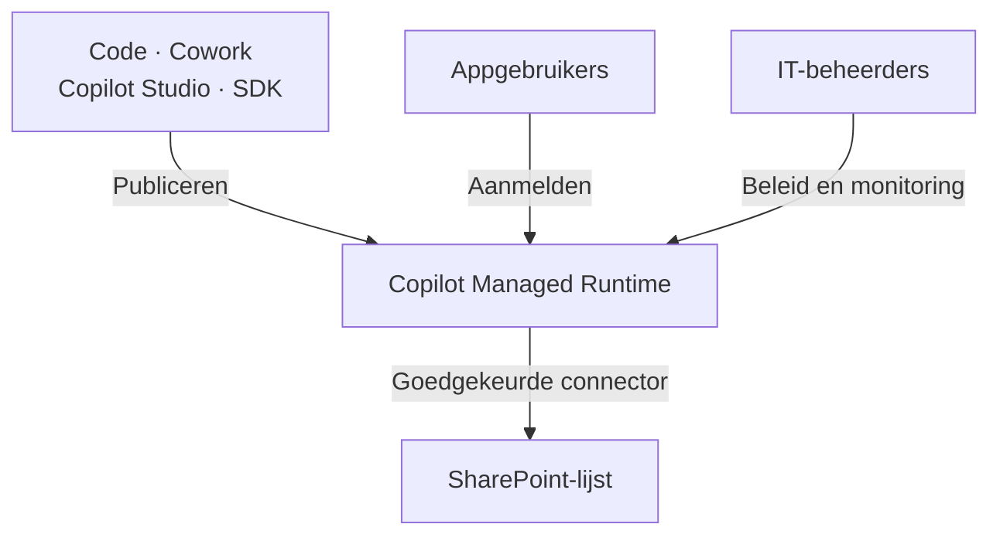
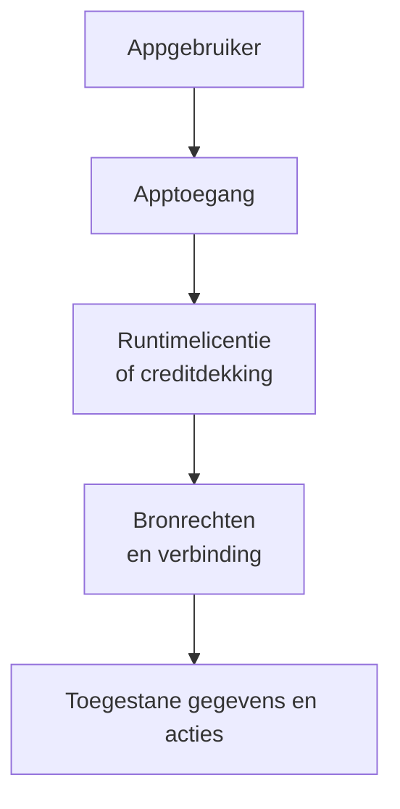

# Copilot-apps publiceren en beheren

Behandel een gedeelde Copilot-app als een te beheren teamdienst. Spreek toegang, eigenaarschap, ondersteuning en budget af voordat collega's ervan afhankelijk worden. Controleer of de geteste app na publicatie nog werkt.

Gebruik deze gids voor publiceren, gegevensverbindingen, rechten, monitoring, kosten en ondersteuning. Begin bij [Copilot Code](./code.md) om aanpakken te vergelijken, gegevensregels te bepalen en een eerste versie te testen. Het contentbord uit die gids is hier het voorbeeld.

:::info[Controleer previewtoegang]

[Copilot Code vereist Frontier-toegang](https://learn.microsoft.com/nl-nl/copilot/code/use-code). [Copilot Managed Runtime is beschikbaar als openbare preview](https://learn.microsoft.com/nl-nl/microsoft-365/managed-apps/). Controleer de voorwaarden en beschikbaarheid voor je tenant voordat je een uitrol plant.

:::

## Bereid de app voor op gedeeld gebruik {#choose-the-work-before-building}

Bevestig de doelgroep, toegestane acties, gegevensbron en testresultaten. Hergebruik de bestaande lijst of applicatie als die al voldoet. De [platformvergelijking in de Code-gids](./code.md#choose-the-work-before-building) helpt bij die keuze. Bewaar gedeelde gegevens op de afgesproken teamlocatie en wijs een eigenaar aan.

Neem de [eisen en testresultaten](./code.md#prepare-shared-use) mee in de releasebeoordeling. Spreek af wie de app accepteert en wie fouten herstelt. Een ontwikkelaar moet mogelijk onderhouden wat een zakelijke gebruiker begon. Test die overdracht voordat de maker vertrekt.

## Publiceer naar een gedeelde runtime {#publish-to-a-shared-runtime}

Controleer voor het contentbord of gegevens bewaard blijven nadat de app sluit en opnieuw opent. Controleer de echte SharePoint-lijst, naast de kaarten op het scherm. De [Code-gids beschrijft de gegevensregels en eerste tests](./code.md#define-data-rules).

[Microsofts uitleg over Code](https://learn.microsoft.com/nl-nl/copilot/code/use-code#publish-your-app) maakt onderscheid tussen bouwen en publiceren. Code bewaart het project terwijl je werkt. Vraag Code om te publiceren als de versie klaar is. Na publicatie is die versie beschikbaar voor de mensen met wie je de app deelt. Ik zou eerst de wijziging testen en de versie vastleggen.

De runtime is de omgeving die de app host en uitvoert. [Copilot Managed Runtime](https://learn.microsoft.com/nl-nl/microsoft-365/managed-apps/) host apps uit Code, Cowork, Copilot Studio en de software development kit (SDK). Microsoft verzorgt de hosting. Apps gebruiken Microsoft Entra-verificatie en volgen tenantbeleid. Gebruikers vinden beschikbare apps op `managedapps.cloud.microsoft`.

Je kiest het bouwhulpmiddel en het platform voor uitvoering afzonderlijk. Teams kunnen verschillende hulpmiddelen gebruiken terwijl IT hun gehoste apps samen beheert. Beoordeel de [opties voor bronbeheer en publicatie](https://learn.microsoft.com/nl-nl/microsoft-365/managed-apps/developer/dev-inner-loop) voor de gekozen app. Neem niet aan dat elke app dezelfde broncodeopzet heeft.

Leg de bronlocatie, actieve versie, gegevensverbindingen en het supportcontact vast. Gebruik de [controles voor overdracht aan een ontwikkelaar](#support-changes-and-incidents) voordat het team afhankelijk wordt van de app.

## Controleer gegevensverbindingen en rechten {#check-data-connections-and-permissions}

Bevestig welke lijst het gepubliceerde bord leest en wijzigt. Bewaar de [afgesproken gegevensregels](./code.md#define-data-rules) bij de beheerinformatie. Beoordeel het toegangsmodel van de site met [SharePoint-inhoudsstructuur en machtigingen](../sharepoint/sharepoint-content-structure.md).

Delen vraagt om afzonderlijke toegangsbeslissingen. [Microsofts veelgestelde vragen over de runtime](https://learn.microsoft.com/nl-nl/microsoft-365/admin/manage/apps/faq-about-apps) onderscheiden apptoegang van toegang tot gekoppelde gegevens. Een app delen met een collega geeft geen SharePoint-rechten. Gebruikers hebben ook de juiste gegevensverbindingen nodig.

[Apps delen](https://learn.microsoft.com/nl-nl/microsoft-365/managed-apps/developer/share-app) kan met gebruikers, groepen of organisatielinks. Geef gewone gebruikers toegang om de app uit te voeren. Geef alleen bewerkrechten aan mensen die de app onderhouden. Een ontvanger heeft ook de vereiste runtimelicentie of creditdekking nodig.

Test met het account van een gewone collega. Neem iemand mee die gegevens mag lezen, maar niet wijzigen. Test ook met iemand zonder toegang tot de lijst. Controleer na elke actie het echte resultaat in SharePoint.

:::warning[Een verborgen knop neemt geen rechten weg]

Behandel een verborgen knop of gefilterd scherm niet als beveiligingsregel. Dwing toegang af bij de gegevensbron. Beoordeel [rechten en eigenaarschap](../../admin-and-governance/permissions-and-ownership.md) voordat je gevoelige gegevens koppelt.

:::

Beoordeel de overdracht als aparte afhankelijkheid als [Cowork](./delegate.md) gegevens aanlevert. Bevestig de selectieregels, bron en selectiedatum. Houd persoonlijke notities buiten de gedeelde lijst, tenzij goedgekeurd voor teamgebruik. Wijs iemand aan die dubbele vermeldingen, gemiste uitvoeringen en verkeerde selecties afhandelt. Bepaal of mensen het bord kunnen blijven gebruiken als de overdracht stopt.

## Beoordeel beheer en inzicht {#review-governance-and-visibility}

IT kan de apps centraal vinden en waar nodig ingrijpen. De inventaris toont niet elke actie die een app kan uitvoeren. Beoordeel naast de inventaris ook de gegevensverbindingen en rechten.

Microsoft beschrijft [standaard beheerregels](https://learn.microsoft.com/nl-nl/microsoft-365/admin/manage/apps/governance) voor routering, connectors, delen en browserinhoud. Routering bepaalt de omgeving van de maker. Je kunt connectoracties afzonderlijk beperken. Zo kan de SharePoint-connector beschikbaar blijven terwijl de vrije HTTP-aanvraagactie is geblokkeerd. Beoordeel de toegestane acties als je een connector goedkeurt.

De huidige beheerweergave heeft beperkingen:

| Wat een beheerder kan beoordelen | Wat nog controle vraagt |
| --- | --- |
| Appinventaris en Data & tools | Exacte bestemmingen, dynamische eindpunten, uitgevoerde acties en effectieve bronrechten per gebruiker zijn daar niet volledig zichtbaar. |
| Weergave van connectorbeleid | Bestaand klassiek gegevensbeleid kan de effectieve toegang veranderen. Controleer ook het Power Platform-beheercentrum. |
| Technische werking en gebruik | Een technisch geslaagde wijziging kan toch de verkeerde bedrijfsregel toepassen. |
| Apptoegang en blokkeren | Het intrekken van apptoegang verwijdert niet alle onderliggende bronrechten. |

[Microsofts veelgestelde vragen over de runtime](https://learn.microsoft.com/nl-nl/microsoft-365/admin/manage/apps/faq-about-apps) beschrijven de toegangs- en inzichtsbeperkingen. De proceseigenaar moet nog steeds controleren of de app de juiste regels toepast.

:::warning[De beleidsweergave kan misleiden]

Microsoft beschrijft een [bekende beperking bij bestaande omgevingsgroepen](https://learn.microsoft.com/nl-nl/microsoft-365/admin/manage/apps/governance#known-limitations). Een weergave zonder toegestane connectors kan wijzen op ontbrekend geavanceerd connectorbeleid. Dat betekent niet automatisch dat connectors geblokkeerd zijn. Controleer dat beleid, de instelling *Advanced connector policies only* en toepasselijk klassiek gegevensbeleid in het Power Platform-beheercentrum.

:::

[Monitoring van de runtime](https://learn.microsoft.com/nl-nl/microsoft-365/managed-apps/developer/monitor-apps) omvat centrale technische bewaking en waarschuwingen. Apps kunnen ook runtimegegevens naar een gekozen monitoringdienst sturen. Configureer daarvoor de app en toegestane monitoringbestemmingen. Spreek af welke fouten een waarschuwing vereisen en wie reageert. Voorkom dat persoonlijke notities of andere gevoelige inhoud in logboeken komt.

Voor het contentbord zou ik mislukte opslagacties, verouderde gegevens en herhaalde automatiseringsfouten controleren. Daarnaast zou ik met steekproeven nagaan of geselecteerde ideeën aan de teamafspraken voldoen. Technische meetgegevens kunnen die redactionele keuze niet beoordelen.

Wijs een proceseigenaar, gegevenseigenaar en appbeheerder aan. Eén persoon kan meerdere rollen hebben. Leg vast wie wijzigingen goedkeurt, toegang beoordeelt en de app stopt. Bespreek bij uitfasering ook geplande taken, bronrechten en te bewaren gegevens.

## Ondersteun wijzigingen en incidenten {#support-changes-and-incidents}

Een gepubliceerde update kan eerder werkend gedrag verstoren. Dat heet een regressie. Een bord kan bijvoorbeeld nog openen terwijl statuswijzigingen niet meer goed worden opgeslagen. Een geslaagde build bewijst niet dat de werkwijze van het team nog werkt.

Spreek ondersteuning af voordat het team afhankelijk wordt van de app. Ik raad de volgende verdeling aan. Mensen kunnen meerdere rollen hebben. Ontwikkelondersteuning kan van ICT of een afgesproken leverancier komen.

| Rol | Verantwoordelijkheid |
| --- | --- |
| Proceseigenaar of KeyUser | Bepaalt de juiste werking, controleert belangrijke werkpaden en accepteert een herstelde versie. |
| Appbeheerder of ontwikkelaar | Onderhoudt broncode, test wijzigingen, publiceert releases en bereidt codeherstel voor. |
| ICT-platform- of serviceteam | Beheert tenantinstellingen, toegang, connectors en platformwerking; coördineert escalatie bij dienststoringen. |

Leg de app-ID, actieve URL, eigenaren, ondersteuningsroute, bronlocatie en gepubliceerde versie vast. Spreek af welke reparaties ICT ondersteunt en wie de rest afhandelt. Een tenantbeheerder is niet automatisch de ontwikkelaar van de app.

Reserveer ontwikkeltijd als ICT codeonderhoud op zich neemt. Spreek af wie dat werk financiert en hoe spoedreparaties worden afgehandeld. Gebruik [Machtigingen en eigenaarschap](../../admin-and-governance/permissions-and-ownership.md) voor verantwoordelijkheden en continuïteit.

### Controleer bestaande werking voordat je publiceert

Houd een korte lijst bij met taken die moeten werken. Gebruik die bij elke release. Begin met de [tests voor een eerste versie in de Code-gids](./code.md#build-and-test-in-small-steps). Neem lezen, toevoegen en wijzigen, leestoegang, mislukte opslagacties en gelijktijdige aanpassingen mee. Controleer de bestaande werkwijze naast de gevraagde wijziging. Gebruik een testlijst met voorbeeldgegevens. Een preview-URL betekent op zichzelf niet dat je aparte testgegevens gebruikt.

Microsoft beschrijft [aparte preview- en liveversies](https://learn.microsoft.com/nl-nl/microsoft-365/managed-apps/developer/dev-inner-loop). Het opdrachtregelhulpmiddel (CLI) biedt een ontwikkelpreview voor apps met Git-bronbeheer. Die preview vereist schrijfrechten op de repository, die code en versiegeschiedenis bewaart. Spreek een testroute af voor zakelijke beoordelaars die deze rechten niet horen te hebben.

Voor deze apps kan `ms app deploy --commit <sha>` een eerdere codeversie publiceren. Leg een werkende herstelversie vast en test die voordat je een wijziging publiceert.

### Regel overdracht aan een ontwikkelaar

Microsoft beschrijft [hoe je een bestaande app verder ontwikkelt in een code-editor](https://learn.microsoft.com/nl-nl/microsoft-365/managed-apps/developer/collaborate-on-app). De appeigenaar moet bewerkrechten geven. Een ontwikkelaar kan daarna een platformbeheerde repository kopiëren (klonen) met `ms app clone --app <app-id>`.

Externe GitHub-repositories vereisen repositorytoegang en `git clone`. Apps zonder broncodekoppeling kunnen deze kloonroute niet gebruiken.

Test de overdracht voor de gekozen app vóór een incident. Geef de beheerder toegang tot eisen, gegevensmodel, verbindingen en releasegeschiedenis. Broncode alleen verklaart niet waarom een bedrijfsregel bestaat.

### Los een storing na een update op

1. Noteer de app, huidige en laatst werkende versies, het tijdstip en getroffen gebruikers. Voeg stappen toe om de fout te herhalen. Beschrijf de verwachte en werkelijke werking.
2. Pauzeer nieuwe releases. Beoordeel of verkeerde schrijfacties het stoppen van werk vereisen. Spreek een tijdelijke werkwijze af met de proceseigenaar.
3. Vergelijk code, lijstkolommen, rechten, verbindingen en uitgavenlimieten. Gebruik de [uitleg over monitoring](#review-governance-and-visibility) om platformstoringen van app- of gegevensproblemen te onderscheiden. Technische meetgegevens bevestigen op zichzelf geen juiste bedrijfsuitkomsten.
4. Herstel een passende codeversie of publiceer een geteste reparatie. Laat de proceseigenaar het hele werkpad controleren voordat het werk hervat. Escaleer platformstoringen met de verzamelde informatie via de ondersteuningsroute van de organisatie.

:::warning[Codeherstel herstelt geen gegevens]

Als je oudere code publiceert, blijven gewijzigde records en lijstkolommen bestaan. Controleer vóór het terugzetten of de code past bij de huidige gegevens. Plan gegevensherstel apart met de gegevenseigenaar. SharePoint kan [eerdere itemversies herstellen als versiebeheer is ingeschakeld](https://support.microsoft.com/nl-nl/sharepoint/documents-and-library/restore-a-previous-version-of-an-item-or-file-in-sharepoint). Controleer wat je kunt herstellen voordat je gegevens of hun structuur wijzigt.

:::

## Begroot bouwen en uitvoeren {#budget-for-building-and-running}

Copilot Credits meten het toepasselijke verbruik. Een capacity pack levert vooruitbetaalde credits. Pay-as-you-go rekent creditverbruik af via een Azure-abonnement. Gebruik Microsofts term *Copilot Credit capacity pack* wanneer je vooruitbetaalde capaciteit aanvraagt.

Microsoft beschrijft deze [opties voor credits kopen en factureren](https://learn.microsoft.com/nl-nl/microsoft-365/copilot/usage-based-billing-compare-dashboard-views):

| Financieringsroute | Hoe die het toepasselijke verbruik betaalt |
| --- | --- |
| Vooruitbetaalde capacity packs | Het verbruik gaat af van een vooraf gekocht credittegoed. |
| Copilot Credit Pre-purchase Plan (P3) | Je koopt vooraf credits via een gekoppeld Azure-abonnement. |
| Pay-as-you-go | Het toepasselijke creditverbruik wordt berekend via een gekoppeld Azure-abonnement. |

Een beheerder moet [facturering naar verbruik inschakelen en uitgavenbeleid instellen](https://learn.microsoft.com/nl-nl/microsoft-365/copilot/usage-based-billing-copilot-credits-setup) voor de bedoelde gebruikers en diensten. Controleer de beschikbare capaciteit. Credits die aan Power Platform-omgevingen zijn toegewezen, verminderen het elders beschikbare tegoed.

P3 vult pay-as-you-go aan. Na verbruik van het P3-tegoed loopt de facturering door naar verbruik. Capacity packs kunnen bij de juiste instellingen ook terugvallen op pay-as-you-go. Stel limieten en waarschuwingen in voordat je breed gebruik inschakelt.

Schat de kosten voor bouwen en doorlopend gebruik afzonderlijk. Een geslaagde eerste versie bepaalt de maandkosten nog niet. Meet het volgende tijdens een pilot:

| Kostenonderdeel | Wat je tijdens een pilot meet |
| --- | --- |
| Bouwen en aanpassen | Eerste versie, mislukte pogingen, testen en latere wijzigingen |
| Gepland Cowork-werk | Uitvoeringen, interpretatiewerk, nieuwe pogingen en controle |
| Appuitvoering | Gebruikersactiviteit en aanroepen naar gekoppelde diensten |
| Aanvullende diensten | Apart berekende AI-diensten en eventuele monitoringmiddelen |

Voor organisatiegebruik [vereisen Code en Cowork een gebruikerslicentie en facturering naar verbruik](https://learn.microsoft.com/nl-nl/microsoft-365/copilot/user-subscription-license-usage-based-billing). Credits vervangen die licentie niet.

Om de app uit te voeren, hebben gebruikers Power Apps Premium of Copilot Credits nodig. Microsofts [veelgestelde vragen over runtimelicenties](https://learn.microsoft.com/nl-nl/microsoft-365/admin/manage/apps/licensing-faq) leggen die eis uit. Gebruikers hebben geen Microsoft 365 Copilot-licentie nodig om alleen de app uit te voeren. De inbegrepen Power Apps-rechten in Microsoft 365 dekken deze runtime niet.

Dezelfde uitleg noemt 0,1 credit per runtime-API-aanroep. Daaronder vallen het openen van een app, connectorverzoeken en publicatie. Power Apps Premium dekt runtimegebruik binnen de toepasselijke aanvraaglimieten. Gebruik boven die limieten en gespecialiseerde diensten kunnen extra kosten geven.

Ter illustratie: 10.000 gemeten runtimeaanroepen verbruiken 1.000 credits. Tegen het [pay-as-you-go-tarief van $0,01 USD uit Microsofts Copilot Credits Guide](https://www.microsoft.com/licensing/guidance/CopilotCreditsGuide) is dat $10 USD. Gebruik deze rekensom om de verbruiksmeting te begrijpen. Meet aanroepen tijdens echt gebruik voordat je een maandbedrag schat.

[Kosten voor bouwen en uitvoeren worden afzonderlijk beheerd](https://learn.microsoft.com/nl-nl/microsoft-365/admin/manage/apps/licensing-faq#are-build-costs-and-runtime-costs-billed-together). Controleer de dekking voor gebruikers van de gepubliceerde app. Het budget van de maker geeft niet automatisch runtimedekking voor het hele team.

Gebruik [uitgavenbeleid](https://learn.microsoft.com/nl-nl/microsoft-365/copilot/usage-based-billing-manage-copilot-credits) voor de bedoelde gebruikers en diensten. Stel limieten en waarschuwingen in. Bespreek het verbruik daarna met de budgethouder. Controleer overlappend beleid en of toekomstige diensten automatisch worden toegevoegd. Beoordeel toegangsbeperkingen los van de uitgavenbeslissing.

Gebruik [Licenties en kosten](./licensing-and-costs.md) om abonnementen en creditfinanciering met de budgethouder te vergelijken.

## Vergelijk platforms en plan een pilot

Vergelijk Code, Power Apps en Copilot Studio met de [platformvergelijking in de Code-gids](./code.md#choose-the-work-before-building). Controleer vóór de release wie de oplossing kan onderhouden. Beoordeel hoe wijzigingen gebruikers bereiken en wat het gebruik kost. Ik zou een bestaande Power Apps-oplossing behouden als die aan de eisen voldoet en het team haar kan ondersteunen.

:::warning[Gebruik preview-apps niet voor kritieke productieprocessen]

Microsoft stelt dat de [Copilot Studio-apppreview niet voor productiegebruik bedoeld is](https://learn.microsoft.com/nl-nl/microsoft-copilot-studio/apps-experience/create-app). Controleer de previewvoorwaarden van elke ervaring afzonderlijk. Ik zou een pilot buiten kritieke processen houden. Spreek ook een terugvaloptie af voordat je met een team test.

:::

Kies voor een eerste pilot één klein proces. Hergebruik de bestaande gegevens. Leg de eigenaar, doelgroep, toegestane acties en het budget vast. Test toegang, mislukte wijzigingen en gelijktijdige aanpassingen. Publiceer voor een kleine groep. Beoordeel fouten, credits, beheerwerk en bruikbaarheid samen voordat je de toegang uitbreidt.

Zorg dat iemand de app kan herstellen voordat collega's ervan afhankelijk worden. Die persoon moet de gegevensregels kunnen uitleggen en de app veilig kunnen uitfaseren.

## Officiële Microsoft-documentatie

- [Copilot Code gebruiken, inclusief publiceren en delen](https://learn.microsoft.com/nl-nl/copilot/code/use-code).
- [Copilot Managed Runtime en de bouwmogelijkheden begrijpen](https://learn.microsoft.com/nl-nl/microsoft-365/managed-apps/).
- [Een app delen met gebruikers of groepen en toegangsniveaus beoordelen](https://learn.microsoft.com/nl-nl/microsoft-365/managed-apps/developer/share-app).
- [Standaard beheerregels en bekende beperkingen van de beleidsweergave beoordelen](https://learn.microsoft.com/nl-nl/microsoft-365/admin/manage/apps/governance).
- [Beperkingen van beheerinzicht en toegang controleren](https://learn.microsoft.com/nl-nl/microsoft-365/admin/manage/apps/faq-about-apps).
- [Appwerking bewaken en runtimegegevens voor monitoring instellen](https://learn.microsoft.com/nl-nl/microsoft-365/managed-apps/developer/monitor-apps).
- [Een app vooraf bekijken, publiceren en een eerdere versie terugzetten](https://learn.microsoft.com/nl-nl/microsoft-365/managed-apps/developer/dev-inner-loop).
- [Een bestaande app overdragen aan een andere ontwikkelaar](https://learn.microsoft.com/nl-nl/microsoft-365/managed-apps/developer/collaborate-on-app).
- [Een eerdere SharePoint-itemversie herstellen](https://support.microsoft.com/nl-nl/sharepoint/documents-and-library/restore-a-previous-version-of-an-item-or-file-in-sharepoint).
- [Runtimelicenties en verbruiksmeting controleren](https://learn.microsoft.com/nl-nl/microsoft-365/admin/manage/apps/licensing-faq).
- [Creditfinanciering en Azure-facturering vergelijken](https://learn.microsoft.com/nl-nl/microsoft-365/copilot/usage-based-billing-compare-dashboard-views).
- [Facturering inschakelen en een financieringsmethode voor credits kiezen](https://learn.microsoft.com/nl-nl/microsoft-365/copilot/usage-based-billing-copilot-credits-setup).
- [Uitgavenbeleid en limieten instellen](https://learn.microsoft.com/nl-nl/microsoft-365/copilot/usage-based-billing-manage-copilot-credits).

## Gerelateerde gidsen

- [Oplossingen bouwen met Copilot Code](./code.md).
- [Werk delegeren aan Cowork](./delegate.md).
- [Agent Builder en Copilot Studio vergelijken](./build.md).
- [Copilot Studio-agents beheren voordat makers toegang krijgen](../../admin-and-governance/govern-copilot-studio-agents.md).
- [Copilot-licenties en kosten begrijpen](./licensing-and-costs.md).
- [Delen in SharePoint beheren](../../admin-and-governance/govern-sharing-in-sharepoint.md).
