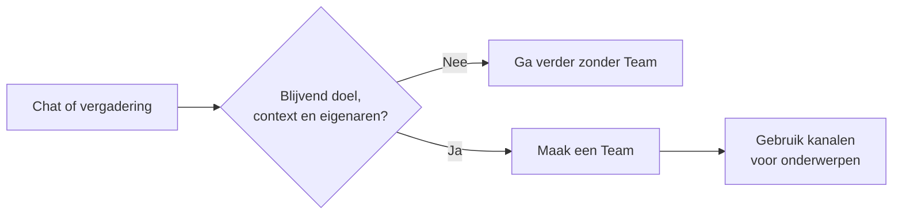

# Informele en gestructureerde samenwerking in Teams

Begin op de kleinste plek waar mensen samen kunnen werken. Een korte uitwisseling kan in een chat of rond een vergadering blijven. Maak een Team wanneer het werk een herkenbaar doel, terugkerende deelname, gedeelde context en eigenaren nodig heeft die het op langere termijn beheren.

## Kies een plek voor het werk

| Plek | Gebruik deze wanneer | Let op |
| --- | --- | --- |
| Een-op-een-chat | Twee mensen samen iets moeten vragen, besluiten of beoordelen. | Besluiten die anderen nodig hebben, verdienen een beheerde en vindbare plek. |
| Groepschat | Enkele mensen snel willen overleggen of kortdurend iets moeten afstemmen. | Een chat met een naam kan blijven bestaan, maar biedt niet de onderwerpstructuur en het eigenaarschap van een Team. |
| Vergaderchat | Deelnemers links, vragen of vervolgacties rond een vergadering willen delen. | Toegang voor en na de vergadering hangt af van de uitnodiging, het type deelnemer en de vergaderinstellingen. |
| Team | Mensen herhaaldelijk samenwerken aan een gedeeld doel. | Wijs eigenaren aan en beoordeel lidmaatschap, informatie en het einde van de samenwerking. |
| Kanaal | Een onderwerp binnen een Team een eigen gesprek, gedeelde inhoud en apps nodig heeft. | Maak een kanaal voor een betekenisvol onderwerp, niet voor elke kleine activiteit. |

Microsoft beschrijft [een-op-een- en groepschats](https://support.microsoft.com/nl-nl/teams/chat/chat-with-others-in-microsoft-teams) en [toegang tot vergaderchats](https://support.microsoft.com/nl-nl/teams/meetings/access-meeting-chat-in-microsoft-teams). Een vergaderchat kan na de vergadering doorgaan, maar niet iedere deelnemer heeft dezelfde toegang. Bewaar blijvende besluiten op een plek die de bedoelde groep kan vinden en beheren.

## Laat de samenwerking groeien

Een groepschat kan met een vraag beginnen en later een terugkerende activiteit worden. Wanneer nieuwe deelnemers de voorgeschiedenis nodig hebben, het werk meerdere onderwerpen krijgt of bestanden en apps een gedeelde plek nodig hebben, spreek dan het doel en de eigenaren van een Team af. Gebruik passende kanalen voor doorlopende onderwerpen en regelmatige vergaderingen daarover. Verplaats of koppel belangrijke informatie aan de bedoelde beheerde locatie. Ga er niet van uit dat het maken van een Team de chatgeschiedenis of bestanden automatisch overneemt.

Laat het doel en de levensduur van het werk de keuze bepalen. Een grote eenmalige vergadering heeft mogelijk geen Team nodig. Een kleine groep die verantwoordelijk is voor een doorlopend proces mogelijk wel. Gebruik [Microsoft Teams-governance](../../admin-and-governance/teams-governance.md) wanneer de samenwerking afzonderlijke eigenaren en een levenscyclus nodig heeft.

:::tip[Begin klein]

Begin in chat wanneer de behoefte nog vorm krijgt. Maak een Team zodra mensen het gedeelde doel, de eigenaren en het werk dat voor anderen beschikbaar moet blijven kunnen benoemen.

:::

## Gerelateerde gidsen

- [Microsoft Teams](./index.mdx)
- [Kanalen en levenscyclus in Teams](./channels-and-lifecycle.md)
- [Welk samenwerkingshulpmiddel moet ik gebruiken?](../../decisions/which-collaboration-tool-should-i-use.md)
