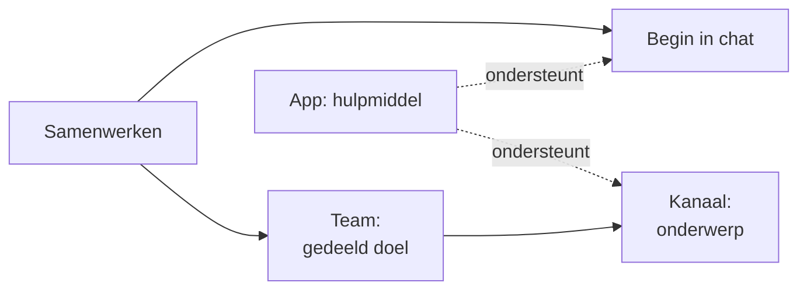

# Microsoft Teams

Microsoft Teams is een werkruimte voor mensen die samenwerken. Begin met een chat of vergadering voor een korte uitwisseling. Maak een Team wanneer de samenwerking een gedeeld doel, context en eigenaarschap nodig heeft dat langer meegaat dan één gesprek.

Een **Team** brengt mensen bijeen voor een samenwerking. Een **kanaal** geeft een onderwerp binnen die samenwerking een eigen plek. Een **app** biedt gereedschap om het werk uit te voeren. Chat, vergaderingen, gedeelde inhoud en apps kunnen zowel informeel als gestructureerd werk ondersteunen.

## Het beste voor

Gebruik Teams om werk met anderen af te stemmen, besluiten te bespreken, te vergaderen en de hulpmiddelen voor het werk te gebruiken. Een afdeling kan jarenlang een Team houden; een project gebruikt er mogelijk een totdat het werk eindigt. Voor een korte vraag of eenmalige vergadering kan een chat voldoende zijn.

## Teams en SharePoint

In Teams staan de mensen die samenwerken centraal. In SharePoint staat de informatie centraal die wordt georganiseerd, beheerd of gepubliceerd. Een SharePoint-site kan een Team, afdeling of organisatiebrede doelgroep bedienen. Teams gebruikt SharePoint-sites voor kanaalinhoud, terwijl SharePoint ook informatie- en publicatiebehoeften buiten Teams ondersteunt. Bekijk [SharePoint](../sharepoint/index.mdx).

## Verken Teams

1. [Kies tussen chat, vergaderingen, Teams en kanalen](./ad-hoc-and-structured-collaboration.md).
2. [Geef onderwerpen een plek en beheer hun levenscyclus](./channels-and-lifecycle.md).
3. [Gebruik apps als hulpmiddelen voor het werk](./apps.md).

## Gerelateerde gidsen

- [Welk samenwerkingshulpmiddel moet ik gebruiken?](../../decisions/which-collaboration-tool-should-i-use.md)
- [Microsoft Teams-governance: voorkom wildgroei](../../admin-and-governance/teams-governance.md)
- [Teams of Viva Engage?](../../decisions/teams-or-viva-engage.md)
